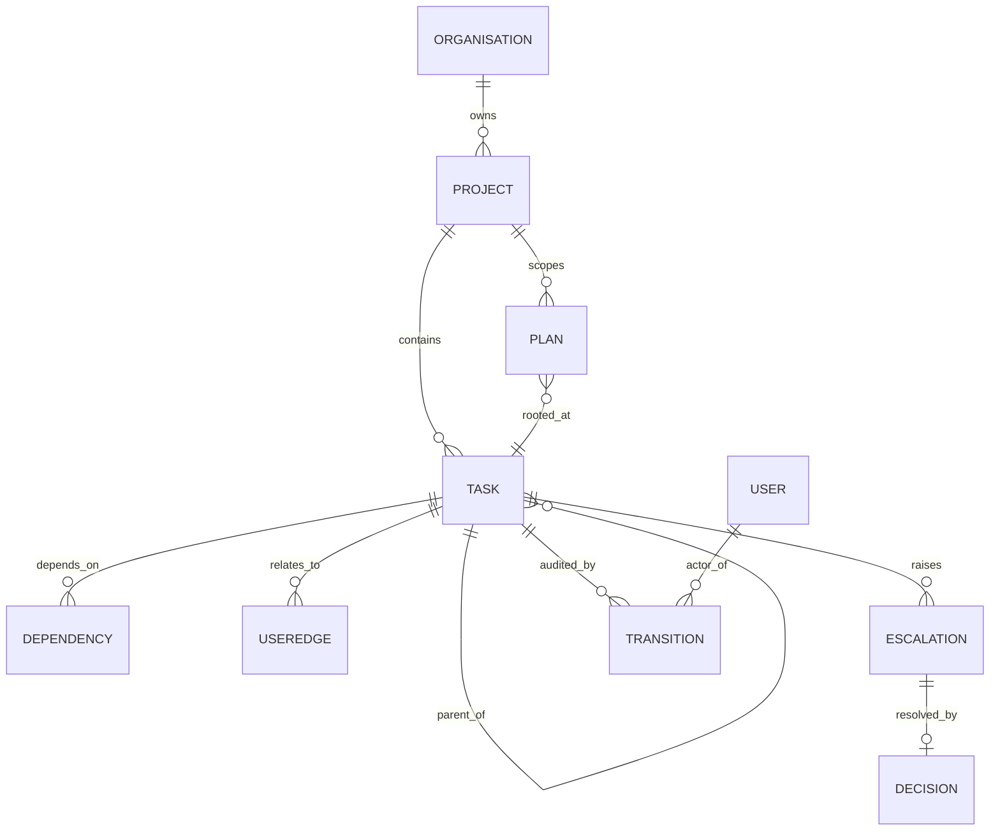
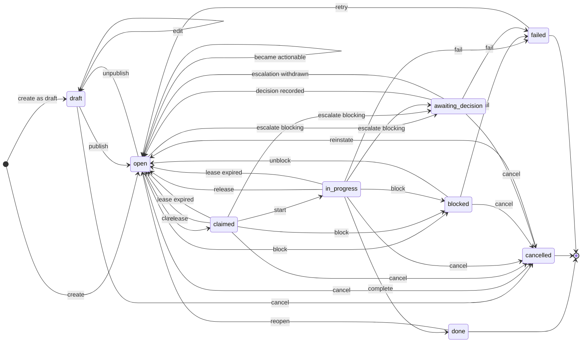

# D01: Domain model

**Status:** Draft v2 — 2026-09-14. Owner: designer agent (T1). Reviewer: —. Approver: —.

## Purpose

This document defines the storage-independent domain model for task-tree-stream: Project, Plan, Task, Dependency, user-defined edge, Metadata, Escalation, Decision and Transition; the three relationship shapes (tree, stream, graph); the task state machine including claim and lease semantics for concurrent agents; the required timestamps; and the stream derivation rules.

It covers objectives **O1** (tree, stream, graph in one model), **O2** (arbitrary metadata without schema change), **O4** (decisions as first-class objects) and **O8** (full auditability, jointly with D09 §4.2). It touches **O3** (agent-operable plans), **O5**, **O6** and **O9** only at the boundary.

**What this document does not own.** Organisation, Team, User, Principal, the system principal, permissions, the audit event and redaction are owned by **D09** and are referenced here by section, never redefined (Concept ownership map, `docs/design/README.md`). Storage is D02's; the protocol is D03's; complexity is D05's; throughput metrics and WIP limits are D06's.

It does not decide storage. Where a domain rule needs a storage mechanism, the rule is stated as a domain requirement, the mechanism this document believes is available is named with the dated research note that verified it, and what D02 must confirm is stated explicitly.

## Context

### Prior decisions this rests on

- **ADR 0001** — SurrealDB is the single datastore for both document and graph workloads.
- **ADR 0002** — Rust backend. Every enum below is closed and exhaustively listed so statuses and transitions can be enforced as types.
- **ADR 0003** — design before code. Nothing here is implemented.
- `docs/vision.md` principles 1 (model the shape of work honestly), 3 (every actor is identified), 4 (state over story), 6 (escalation is cheap and explicit).
- **D09 §1.10** is the identity interface this document consumes. D01 assumes exactly what §1.10 grants and nothing more.

### Founder decisions and scope cuts this version applies

Recorded in `docs/design/README.md` (Open escalations, Scope decisions), all dated 2026-09-14.

| Decision | Applied in |
| --- | --- |
| **E-01** Cross-project dependencies permitted within an organisation behind a default-off org setting, with the opaque-blocker read rule. **D01 must model the blocker and the out-of-scope prerequisite in the stream.** | §2.5 (D-2), §3.2, §3.6 |
| **E-02** No sensitive-key feature in v1. Metadata must not carry secrets or personal data; audited redaction-with-tombstone (D09 §4.3) is the removal path and covers `Transition.reason` and `Transition.changed_fields`. | §4.2, TR-1, TR-6 |
| **E-03** No `Account` entity. | §2.1 (identity is referenced, not modelled) |
| **Scope cut** The task review gate is removed: `in_review`, `requires_review`, `reviewer`, `review_requested_at`, `reviewed_at`, the three review transitions, §6.7 and Q11. | §6 throughout |
| **Scope cut** Unenforced dependency kinds removed: finish-to-start only, no `kind`, no `enforced`. | §2.5, §3.3 |
| **Scope cut** Reserved complexity fields removed; D05 adds what it needs. Reserved throughput fields reduced to counters a plain state machine produces. | §2.4 |
| **Scope cut** `Transition.on_behalf_of` removed (delegation does not exist in v1); `Escalation.requires_human` added (D09 §1.10). | §2.8, §2.10 |
| **D09 §1.10** D01 §2.1–§2.3's identity field tables are deleted and replaced by references. | §2.1 |

### Research this relies on

Every external claim in this document cites one of these dated notes. Nothing external is asserted without one.

| Note | Date checked | What this document takes from it |
| --- | --- | --- |
| `docs/research/2026-09-14-transactions-and-claiming.md` | 2026-09-14 | **Verified by running** on SurrealDB `3.2.3+20260721.40522d1`: a guarded single-statement `UPDATE ... WHERE` under 8-way concurrency yields exactly one winner and zero rows for every loser; a multi-statement `BEGIN`/`COMMIT` block on one session detects write-write conflict **at commit, on the same record**, and returns a retryable error rather than losing an update; snapshot isolation is the only isolation level. Basis of §3.4 and §6.2. |
| `docs/research/2026-09-14-traversal-at-scale.md` | 2026-09-14 | **Verified by running** at 1k/10k/100k tasks: subtree collection costs ~1.4 / 14 / 152 ms of engine time; single-task dependency closure is sub-0.1 ms at every size; "all dependency edges with both ends inside a subtree" costs 22 ms / 2.4 s / 243 s — roughly quadratic and unusable above ~10k. Basis of §3.2 and Q1. |
| `docs/research/2026-09-14-edges-vs-record-links.md` | 2026-09-14 | **Verified by running:** a subtree is a single recursive query over `RELATE` edges and is *not* expressible as one query over a parent record link; edges carry their own metadata; recursion depth is hard-capped at 256. Basis of §2.6's edge metadata and TK-4. |
| `docs/research/2026-09-14-recursive-traversal.md` | 2026-09-14 | **Verified by running:** recursion depth bound 1–256, enforced; `+collect` for closure sets; "next unblocked task" should be a bounded indexed query, not an unbounded recursive scan per poll. Basis of TK-4 and §3.5's cost note. |
| `docs/research/2026-09-14-schema-metadata-indexing.md` | 2026-09-14 | **Verified by running:** a `SCHEMAFULL` table with a `FLEXIBLE` object field accepts undeclared keys and a single key can be indexed after the fact with no migration. Indexing was verified only on **plain scalar paths** (`meta.priority = 'high'`); a discriminated value shape and range operators over one were **not** tested. Basis of §4.1's encoding note and Q-M. |
| `docs/research/2026-09-10-surrealdb-status.md` | 2026-09-10 | SurrealDB 3.x is the target line; 3.2.3 is the pin (founder decision E-05). |

Two gaps are carried forward rather than papered over: no benchmark was run on the persistent `rocksdb` backend (memory backend only), and no `EXPLAIN` was captured for the quadratic query shape, so its cause is observed but not diagnosed. Both are named in Q1.

### Assumptions stated explicitly

1. **A1. Server clocks are synchronised** within a few seconds. Ordering authority is `Transition.seq`, never a timestamp (§5.4), precisely so this assumption is not load-bearing for correctness.
2. **A2. Agents are untrusted, short-lived, and crash.** A claim is therefore a lease, never a lock (§6.2, A9).
3. **A3. The service does not run agents** (`docs/objectives.md` non-goals). Nothing in the model may depend on an agent being reachable.
4. **A4. Plans are bounded.** The working figure for a plan an agent executes interactively is 10,000 in-scope tasks; §3.2's derived stream is stated against that figure and Q1 sets the final number.
5. **A5. Every domain write is a single principal's act**, authenticated by D09 §2, and every reference resolves inside one Organisation (D09 I4).

### Notation

Field types are domain types, not storage types.

| Type | Meaning |
| --- | --- |
| `id` | Opaque, stable, globally unique identifier for an entity |
| `ref<E>` | A reference to an entity of type `E` |
| `text` | Unicode text, unbounded unless a limit is stated |
| `slug` | Short, human-typed identifier, unique within its stated scope |
| `enum(...)` | Closed set of values, exhaustively listed |
| `int`, `decimal`, `bool` | Scalars |
| `timestamp` | Instant, UTC, millisecond precision or finer |
| `duration` | Elapsed time, millisecond precision |
| `list<T>`, `map<K,V>` | Ordered list, keyed map |
| `MetadataMap` | `map<slug, MetaValue>`, defined in §4 |

"Set by" is one of **system** (the service sets it; clients may not write it) or **user** (a principal sets it; the system may supply a default).

## Design

### 1. Shape of the model

Three relationship shapes exist over tasks, and they are deliberately separate.

| Shape | Relationship | Cardinality | Crosses project boundary | Cyclic? |
| --- | --- | --- | --- | --- |
| **Tree** | containment (`parent`/`children`) | one parent, many children | never | never — prevented at write (§3.4) |
| **Stream** | execution order within a plan | total order per plan, derived on read | never — a stream contains only tasks in the plan's scope, and a plan is rooted in one project (§3.2) | n/a — derived |
| **Graph** | `Dependency` edges, and `UserEdge` edges | many-to-many | dependency: only when the organisation enables it (D09 §1.1 `settings.cross_project_dependencies`, default false); user edges: yes | dependency: never — prevented at write. user edges: permitted |

A prerequisite outside the plan's scope — in another subtree, another project, or unreadable by the caller — never enters the stream. It constrains readiness, not order. §3.6 defines what the caller sees instead.

Everything that is not one of these three shapes is **metadata**: a typed key/value map on the entity (O2). Nothing about a relationship is ever encoded in free text (O1).



`ORGANISATION` and `USER` appear only as the endpoints D01 references; their fields are D09 §1.1 and §1.4.

### 2. Entities

#### 2.1 Identity: referenced, never defined here

Organisation, Team, User, the system principal, Membership, TeamMembership, Grant, roles and permission verbs are **owned by D09**. This document defines none of them and restates no field of any of them. What D01 relies on, and where it is defined:

| What D01 uses | Defined in | What D01 assumes |
| --- | --- | --- |
| `ref<Organisation>` on every entity | **D09 §1.1** | It exists, is the tenant boundary, has `status`, `settings` and `archived_at`. Cross-organisation references are illegal (D09 I4). |
| `ref<Team>` for assignment | **D09 §1.2** | Org-scoped, does not nest (this answers v1's Q7), has `archived_at`. Membership is the TeamMembership record (D09 §1.3), not a list on Team. |
| `ref<User>` for every actor, owner, assignee and claimant | **D09 §1.4** | Org-scoped; `handle` (not `slug`); `kind ∈ {human, agent, system}`; `status ∈ {active, suspended, disabled}`. **"May not claim work" means `status != active`.** |
| The system principal named as actor on system-initiated transitions | **D09 §1.5** | Exactly one per organisation, always exists, always active, never authenticates, holds no role. This is what makes `Transition.actor` never null, so O8 holds with no special case. |
| Permission verbs behind the actor restrictions in §6.4 | **D09 §3.4** | `task.claim`, `task.transition`, `task.cancel`, `task.reverse`, `dependency.create`/`dependency.remove`, `edge.write`, `metadata.write`, `escalation.*`, `decision.make`, `plan.*`. D01 states which verb class a transition needs and never which role holds it. |
| The audit event that accompanies every Transition | **D09 §4.1, §4.2** | It exists and references the Transition. **The Transition remains authoritative for domain state** (D09 §4.2 rule 2). |
| Redaction | **D09 §4.3** | `Transition.reason` and `Transition.changed_fields` are subject to the same audited redaction-with-tombstone as audit events. This is the one exception to TR-1 (TR-6). |
| The cross-project dependency authorisation rule | **D09 §3.6** | Creation requires `dependency.create` plus `task.update` on the depending task and `task.read` on the depended-on task; a principal who cannot read the far end sees an opaque blocker. D01 models the blocker (§3.6). |

**Organisation-level archive.** While the owning Organisation is `suspended` or has `archived_at` set (D09 §1.1), every Project it contains behaves exactly as an archived project: read-only except for un-archiving (P-4). No claim, start, complete, block or escalate succeeds. This closes the v1 gap where an archived organisation's agents kept executing. Organisation **deletion is not an operation in v1** (D09 §1.1); A15 below says the same for the domain.

#### 2.2 Project

The root of a tree of tasks. Owns metadata, plans, and a dependency graph.

| Field | Type | Req | Set by | Notes |
| --- | --- | --- | --- | --- |
| `id` | `id` | required | system | |
| `org` | `ref<Organisation>` | required | system | D09 §1.1 |
| `slug` | `slug` | required | user | unique within `org`, immutable after creation |
| `name` | `text` | required | user | |
| `description` | `text` | optional | user | free text; never a source of state (vision principle 4) |
| `owner` | `ref<User>` | required | user | defaults to the creating principal. Also the default owner of an unrouted escalation (ES-6) |
| `owning_team` | `ref<Team>` | optional | user | |
| `status` | `enum(active, paused, archived)` | required | user | default `active`. `paused` is the intake throttle (§6.5) |
| `root_task` | `ref<Task>` | required | system | the implicit root of the containment tree (P-2) |
| `metadata` | `MetadataMap` | required | user | may be empty |
| `default_lease_duration` | `duration` | required | user | default for `Task.lease_duration`; system default if unset (§6.2) |
| `created_at`, `updated_at` | `timestamp` | required | system | |
| `archived_at` | `timestamp` | optional | system | |

**Invariants**

- P-1. `slug` is unique within `org` and immutable after creation.
- P-2. Every Project has exactly one root Task, created with it, whose `parent` is null. Making the root a Task rather than a special case means tree operations, metadata and the stream have no "level 0" exception. The root task is never claimable and never leaves `open` (§6.6).
- P-3. Every Task in the project has the project's root task as a transitive ancestor.
- P-4. While `status = archived`, the project and everything it contains is read-only except for un-archiving. §2.1 extends the same rule to a suspended or archived organisation.
- P-5. A Project carries the serialisation point that §3.4 requires for tree and dependency-graph writes. Its shape is D02's; its existence is a domain requirement.

**WIP limits are not fields here.** v1 reserved `wip_limit` on Project and Plan for D06. D06 owns throughput control and will add what it needs; a field reserved before its semantics exist is a field D06 has to change anyway. §6.5 keeps the domain hook (`paused`) that intake throttling actually needs.

#### 2.3 Plan

**Decision: a Plan is a named, addressable, policy-carrying *view* over a subtree of exactly one Project. It is not a copy of tasks, and it does not own tasks.**

A Plan holds a reference to a root Task plus an optional filter and an execution policy. Pointing an agent at a plan means pointing it at that subtree under that policy (O3).

Justification, in the order the alternatives were weighed:

1. **Tasks must have one home.** Vision principle 1 makes the tree the containment relationship and the glossary fixes it as a strict hierarchy with one parent. If a Plan owned tasks, a task in two plans would have two containers. A view has no such problem.
2. **Agents need a stable handle, not a stable snapshot.** O3 requires an agent to be given "only a plan identifier": an addressable object with an id, a name and a policy. It does not need a frozen copy — the control-plane framing in the vision means the agent should see the plan as it is now.
3. **Snapshots would fork the audit trail** (O8). Rejected as A2.
4. **The subtree is already the natural scope.** Decomposition (O5) produces subtrees.

| Field | Type | Req | Set by | Notes |
| --- | --- | --- | --- | --- |
| `id` | `id` | required | system | |
| `org` | `ref<Organisation>` | required | system | |
| `project` | `ref<Project>` | required | system | derived from `root` |
| `slug` | `slug` | required | user | unique within `project` |
| `name` | `text` | required | user | |
| `root` | `ref<Task>` | required | user | the task whose subtree this plan covers |
| `filter` | `MetadataFilter` | optional | user | restricts the plan to subtree tasks matching a predicate (§4.3). Absent means the whole subtree |
| `include_root` | `bool` | required | user | default `false`; whether `root` itself is executable work or only a container |
| `status` | `enum(active, paused, completed, abandoned)` | required | user | `paused` blocks claiming (§6.5); `completed`/`abandoned` are set by a principal, never derived (PL-4) |
| `assigned_team` | `ref<Team>` | optional | user | advisory |
| `default_lease_duration` | `duration` | optional | user | overrides the project default for tasks claimed through this plan |
| `metadata` | `MetadataMap` | required | user | |
| `created_at`, `updated_at` | `timestamp` | required | system | |
| `activated_at` | `timestamp` | optional | system | first time `status` became `active` |
| `closed_at` | `timestamp` | optional | system | when `status` became `completed` or `abandoned` |

**Invariants**

- PL-1. `root` is a Task in `project`, and `project.org = org`.
- PL-2. A Task may be in zero, one, or many Plans. Plans may overlap and nest. Overlap is how a release plan and a team plan cover the same tasks.
- PL-3. A Plan never changes a Task's parent, status, or identity. Plan membership is a query result, not a stored property of the task.
- PL-4. Plan completion is **not** derived. A plan whose in-scope tasks are all terminal is reported as *exhausted* (a derived flag); closing it is an explicit act recorded as a Transition. Deriving it would silently close plans during decomposition, when a parent is momentarily childless.
- PL-5. Deleting a Plan never deletes tasks.
- PL-6. A task claimed through a plan may not be re-parented out of that plan's scope while the claim is live (TK-11).

#### 2.4 Task

The central entity.

**Core identity and containment**

| Field | Type | Req | Set by | Notes |
| --- | --- | --- | --- | --- |
| `id` | `id` | required | system | |
| `org` | `ref<Organisation>` | required | system | |
| `project` | `ref<Project>` | required | system | immutable (TK-2) |
| `parent` | `ref<Task>` | optional | user | null only for the project root task |
| `title` | `text` | required | user | max 200 characters; a one-line imperative statement |
| `body` | `text` | optional | user | the detail an executor needs. Free text, never a source of state |
| `acceptance_criteria` | `list<text>` | optional | user | checkable statements, so the task contract of ADR 0004 and `docs/agent-rules.md` §3 is representable in the product itself |
| `scope_boundary` | `text` | optional | user | what is explicitly not in the task |
| `sequence_hint` | `decimal` | optional | user | manual ordering hint among siblings (§3.2). `decimal` so a task can be inserted between two others without renumbering |

**Assignment, claim and lease** (semantics in §6.2)

| Field | Type | Req | Set by | Notes |
| --- | --- | --- | --- | --- |
| `assignee` | `ref<User>` | optional | user | intent: who *should* do it |
| `assignee_team` | `ref<Team>` | optional | user | intent at team granularity |
| `claimed_by` | `ref<User>` | optional | system | fact: who currently holds it |
| `claim_id` | `id` | optional | system | fresh per successful claim; the fencing token (§6.2) |
| `claim_expires_at` | `timestamp` | optional | system | lease expiry |
| `claim_plan` | `ref<Plan>` | optional | system | the plan the claim was taken through, if any; TK-11 and §6.5 need it |
| `lease_duration` | `duration` | optional | user | this task's lease length; defaults from plan, then project |
| `last_heartbeat_at` | `timestamp` | optional | system | |

**Status and lifecycle**

| Field | Type | Req | Set by | Notes |
| --- | --- | --- | --- | --- |
| `status` | `enum(draft, open, claimed, in_progress, blocked, awaiting_decision, done, cancelled, failed)` | required | system | changed only through a transition (§6) |
| `resolution` | `enum(completed, superseded, duplicate, wont_do, obsolete, abandoned)` | optional | system | required when `cancelled`; defaults to `completed` when `done` |
| `failure_reason` | `text` | optional | user | required when entering `failed` |
| `blocked_reason` | `text` | optional | user | required when entering `blocked` |

`blocked_on_external` is **cut**. v1 made it a free-text identifier of the external blocker and then relied on it to answer "how much work is stuck on vendor X", which is the flattening of structure into prose that vision principle 4 and O1 exist to prevent. The prose lives in `blocked_reason`; anything an operator wants to aggregate is ordinary metadata (`blocked_on.vendor = {string: "acme"}`), which O2 already makes filterable and D06 can group by.

**Throughput counters**

Four counters, each produced by the state machine itself as a side effect of a transition it was already writing. Each is justified in one line; nothing else is reserved.

| Field | Type | Req | Set by | Why it earns its place |
| --- | --- | --- | --- | --- |
| `attempt_count` | `int` | required | system | incremented on every entry into `in_progress`; "how many times has this been tried?" is the question repeated agent failure makes urgent, and it cannot be recovered once transitions are archived |
| `claim_count` | `int` | required | system | incremented on every successful claim; claims without attempts are agents picking work up and putting it down, which is a different pathology from attempts without completions |
| `lease_expiry_count` | `int` | required | system | incremented on every `lease_expired`; distinguishes agents that fail loudly from agents that vanish, which is the reliability signal O6 needs |
| `reopen_count` | `int` | required | system | incremented on every exit from a terminal state; a task completed three times was not completed the first two, and the terminal timestamps alone record only the latest |

**Durations are not stored.** v1 accumulated `active_duration` and `blocked_duration` on the task and then failed to accumulate them on four of the transitions that left the accumulating state. Both are exactly derivable from the Transition log (TR-3), which is authoritative; D06 decides whether a materialised projection is worth its invalidation cost. Lead time, cycle time and queue time were already derived (§5.3) for the same reason.

**Complexity and size fields are cut.** v1 reserved seven (`complexity_score`, `complexity_method`, `complexity_scored_at`, `complexity_scored_by`, `size_class`, `split_recommended`, `split_reason`) plus `estimated_effort`, before D05 had chosen a method. If D05 chooses differently the fields change anyway, so the "no model change later" benefit was speculative. **D05 owns complexity and adds the fields it needs**; adding a field to Task is additive and needs no change here.

**Labels are cut.** v1 carried `labels: list<slug>` beside `metadata`, justified only by the expectation that "has label X" would be the most common filter — a storage argument inside a storage-independent document. A `string_set` MetaValue (§4.1) expresses the same thing with the same filter grammar, and D02 may index that key like any other (`docs/research/2026-09-14-schema-metadata-indexing.md`, 2026-09-14: a single metadata key is indexable after the fact with no migration).

**Metadata**

| Field | Type | Req | Set by | Notes |
| --- | --- | --- | --- | --- |
| `metadata` | `MetadataMap` | required | user | may be empty (§4) |

**Timestamps** — §5.

**Invariants**

- TK-1. Exactly one of: `parent` is null (project root task only), or `parent` is a Task with the same `project`.
- TK-2. `project` is immutable. Moving work between projects is cancel-and-recreate with a `superseded_by` metadata link, because re-parenting across projects would move audit history across a tenancy and authorisation boundary (D09 I4).
- TK-3. The containment relation is acyclic: a task may not be its own ancestor. Prevented at write time under the serialisation point in §3.4, not merely checked.
- TK-4. Tree depth is limited to `MAX_TREE_DEPTH`. The ceiling is not negotiable above 256: SurrealDB's recursive idiom rejects a depth bound above 256 outright (`docs/research/2026-09-14-recursive-traversal.md`, 2026-09-14, verified by running), and both traversal notes recommend an application constant well below it. Proposed value 12; final number is Q4.
- TK-5. `status` is never written directly by a client. Clients request transitions; the system applies them and writes a Transition (§7).
- TK-6. `claimed_by`, `claim_id` and `claim_expires_at` are all set or all null. There is no partial claim.
- TK-7. A task in `claimed` or `in_progress` has a non-null claim; a task in any other status has a null claim.
- TK-8. A task may not enter `done` while it has a child in a non-terminal state, unless the `complete` request carries `allow_incomplete_children = true` **and** a reason. That flag is a parameter of the transition request, recorded on the Transition; it is **not** metadata. v1 put it behind the `sys.` prefix that §4.2 forbids clients from writing, which made the only escape hatch unusable by the principals who needed it (§6.8).
- TK-9. `resolution` is set if and only if `status` is `done` or `cancelled`.
- TK-10. The project root task is always `open` and is never claimable.
- TK-11. A task with a live claim taken through a Plan may not be re-parented outside that plan's scope. A re-parent within the plan's scope is permitted and is visible to the claimant (§6.4 row 21, and a new open question for D03 on how it is surfaced).

#### 2.5 Dependency

A directed edge between two tasks meaning "this cannot start until that has finished". Dependencies are the graph shape that *gates execution*, which is what separates them from user-defined edges.

| Field | Type | Req | Set by | Notes |
| --- | --- | --- | --- | --- |
| `id` | `id` | required | system | |
| `org` | `ref<Organisation>` | required | system | |
| `from` | `ref<Task>` | required | user | the dependent (blocked) task |
| `to` | `ref<Task>` | required | user | the prerequisite task |
| `hard` | `bool` | required | user | default `true`. A hard dependency gates the transition; a soft one orders but does not block (§3.3) |
| `reason` | `text` | optional | user | why the dependency exists |
| `created_by` | `ref<User>` | required | system | |
| `metadata` | `MetadataMap` | required | user | |
| `created_at` | `timestamp` | required | system | |
| `removed_at` | `timestamp` | optional | system | soft-deleted, so the audit trail can still explain why a task was once blocked (O8) |

`kind` and `enforced` are **cut**. v1 stored four PMI-style kinds of which one was ever enforced, and derived `enforced` from `kind`. The claim that storing the other three "costs nothing" was false: they forced a derived field on every edge, a special-case exclusion from the cycle check, an exclusion from stream ordering, and a permanent explanation in the UI and the agent protocol for values that never did anything. **Finish-to-start is the only semantic, and it is now the only one representable.** Re-introducing kinds later is an additive field with a default.

`hard` survives the same test, and earns it. A soft dependency is the only way to say "ideally after" across a subtree boundary: `sequence_hint` orders siblings only, and a UserEdge is definitionally inert (UE-1). It costs one boolean, one clause in the gating rule (§3.3), and nothing in the cycle check, which treats hard and soft alike because both take part in the stream's order.

**Invariants**

- D-1. `from ≠ to`.
- D-2. `from.org = to.org` (D09 I4). `from.project = to.project` **unless** the organisation has `settings.cross_project_dependencies = true` (D09 §1.1), in which case the authorisation rule in D09 §3.6 applies at creation and the read degrades per §3.6 below.
- D-3. The set of non-removed Dependencies forms a DAG. Cycles are prevented at write time under the serialisation point in §3.4, which is what makes "prevented" true rather than aspirational.
- D-4. At most one non-removed Dependency exists for a given (`from`, `to`) pair.
- D-5. A dependency whose `to` task is `cancelled` is **satisfied**, so cancelling work does not permanently wedge its dependents. G-1 governs what happens if that task is later reinstated.
- G-1. **Dependency gating is evaluated at the moment of the gated transition and is never retroactive.** A dependency added, reinstated, or rendered unsatisfied after a task has left `open` does not retract that task's progress, revoke its claim, or reverse its completion. It is visible on the task (and in the UI and the protocol) as an unsatisfied prerequisite, and it gates the task's *next* transition out of `open` if it ever returns there. This is the rule that stops `reinstate` (§6.4 row 20) from silently invalidating a dependent that is already `in_progress` or `done`, and it is stated once here rather than as a special case per transition.

#### 2.6 User-defined edge (`UserEdge`)

A named relationship created by users between two entities, stored as a graph edge, filterable like metadata (O2). This is the extension point that keeps users from encoding relationships in free text.

| Field | Type | Req | Set by | Notes |
| --- | --- | --- | --- | --- |
| `id` | `id` | required | system | |
| `org` | `ref<Organisation>` | required | system | |
| `edge_type` | `slug` | required | user | the relationship name, e.g. `relates_to`, `duplicates`, `informs`, `tested_by` |
| `from` | `ref<Task \| Project \| Plan>` | required | user | see UE-2 |
| `to` | `ref<Task \| Project \| Plan>` | required | user | |
| `from_type`, `to_type` | `enum(task, project, plan)` | required | system | denormalised for query and validation |
| `directed` | `bool` | required | user | default `true`. An undirected edge is queried symmetrically |
| `metadata` | `MetadataMap` | required | user | **user edges carry their own metadata map**, with the same typed value model as entity metadata (§4). This is how a user says "relates to, severity 3" without a schema change. Edges carrying their own fields is verified behaviour (`docs/research/2026-09-14-edges-vs-record-links.md`, 2026-09-14) |
| `created_by` | `ref<User>` | required | system | |
| `created_at` | `timestamp` | required | system | |
| `removed_at` | `timestamp` | optional | system | soft-deleted, like dependencies |

**Invariants**

- UE-1. **A UserEdge never affects state.** It is never consulted by the state machine, never gates a transition, never contributes to readiness, and never participates in stream ordering. This is the decision that makes user edges safe: users can invent any relationship they like and cannot break execution with it. Anything that must gate execution is a Dependency, which is a closed, validated, cycle-checked type.
- UE-2. `from` and `to` are in the same organisation. Permitted endpoint types in v1: **Task, Project, Plan**. v1 also allowed Escalation and Decision; those are removed because a Decision is immutable and an Escalation already carries a typed `subject`, so neither had a use case that O2 does not already meet, and each extra endpoint type is another validation path and another UI case.
- UE-3. Cycles are permitted. Because of UE-1 a cycle cannot deadlock anything, and forbidding them would make `relates_to` unusable.
- UE-4. `edge_type` is a free slug. An Organisation may register an optional **edge-type declaration** (name, description, allowed endpoint types, whether directed) to get validation and a nicer UI; undeclared types still work. Whether declarations are advisory or enforceable is Q5.
- UE-5. At most one non-removed edge per (`from`, `to`, `edge_type`) triple.

#### 2.7 Metadata (value object, not a row)

See §4 for the full treatment. Metadata is a value object on its owner, not an independent entity: a key/value pair has no identity, no lifecycle, and no audit interest apart from its owner. Whether storage materialises it as embedded fields or a side table is D02's (Q1, and the two strategies the metadata-indexing note measured).

#### 2.8 Escalation

A first-class request for a decision, raised by an agent or a human (O4, vision principle 6).

| Field | Type | Req | Set by | Notes |
| --- | --- | --- | --- | --- |
| `id` | `id` | required | system | |
| `org` | `ref<Organisation>` | required | system | |
| `subject` | `ref<Task \| Project \| Plan>` | required | user | Task is the common case |
| `subject_type` | `enum(task, project, plan)` | required | system | |
| `raised_by` | `ref<User>` | required | system | the authenticated principal |
| `owner` | `ref<User>` | required | system | who must answer. **Never null** (ES-6); defaults to the subject's project `owner` when the raiser does not name one |
| `owner_team` | `ref<Team>` | optional | user | an additional routing hint; it does not replace `owner` |
| `title` | `text` | required | user | max 200 characters |
| `question` | `text` | required | user | the actual question |
| `options` | `list<EscalationOption>` | optional | user | structured choices |
| `recommendation` | `text` | optional | user | the raiser's recommendation, per `docs/agent-rules.md` §5 |
| `blocking` | `bool` | required | user | default `true`. A blocking escalation moves its subject task to `awaiting_decision` (§6.9) |
| `requires_human` | `bool` | required | user | default `false`. When true, only a principal with `kind = human` holding `decision.make` may answer; an agent receives the machine-readable refusal `requires_human_decision`. Required by **D09 §1.10 and §3.5**; D09 owns the rule, D01 owns the field |
| `severity` | `enum(low, normal, high, urgent)` | required | user | default `normal`; routing and SLA are D06/D07 |
| `status` | `enum(open, answered, withdrawn, expired)` | required | system | |
| `decision` | `ref<Decision>` | optional | system | set when `status` becomes `answered` |
| `due_at` | `timestamp` | optional | user | when an answer is needed |
| `metadata` | `MetadataMap` | required | user | |
| `created_at`, `updated_at` | `timestamp` | required | system | |
| `answered_at`, `withdrawn_at`, `expired_at` | `timestamp` | optional | system | |

`EscalationOption` is a value object: `{ key: slug, label: text, detail: text?, recommended: bool }`. Structured options exist so an agent can be answered machine-readably: a Decision naming `option_key` is unambiguous where prose is not (vision principle 4, O3).

**Invariants**

- ES-1. `status` transitions: `open → answered`, `open → withdrawn`, `open → expired`. Terminal states are final; a new question is a new Escalation, which keeps the decision record immutable (O8).
- ES-2. `decision` is non-null if and only if `status = answered`.
- ES-3. Only `raised_by`, the `owner`, or a principal holding `escalation.withdraw` (D09 §3.4) may withdraw.
- ES-4. A subject task has at most one open **blocking** escalation at a time; it may have any number of open non-blocking ones. This keeps `awaiting_decision` unambiguous about what is being waited for.
- ES-5. Option `key`s are unique within an escalation.
- ES-6. **`owner` is required and never null.** O4 requires that every escalation has an owner. An agent is still never forced to guess one: if the raiser names neither `owner` nor `owner_team`, the system sets `owner` to the `owner` of the subject's Project and records that it did so on the creating Transition. Re-routing later is the `assign_owner` event (§7.1), which is itself audited. v1 left both fields optional, which allowed a blocking escalation that nobody was accountable for — the lost-comment failure vision principle 6 exists to prevent.

#### 2.9 Decision

The recorded resolution of an escalation, made by an agent or a human (O4). Decisions are immutable.

| Field | Type | Req | Set by | Notes |
| --- | --- | --- | --- | --- |
| `id` | `id` | required | system | |
| `org` | `ref<Organisation>` | required | system | |
| `escalation` | `ref<Escalation>` | required | system | |
| `decided_by` | `ref<User>` | required | system | the authenticated principal; may be an agent. Its `kind` is authoritative and **must** be shown wherever a Decision is rendered (D09 §3.5); no denormalised field is needed |
| `option_key` | `slug` | optional | user | required if the escalation offered options and the decision selects one |
| `outcome` | `enum(selected_option, free_form, deferred, rejected)` | required | user | `deferred` and `rejected` still close the escalation; they are answers |
| `rationale` | `text` | required | user | why. Required, because an unexplained decision is not auditable (O8) |
| `directive` | `text` | optional | user | what the raiser should now do |
| `supersedes` | `ref<Decision>` | optional | user | a later decision that reverses an earlier one references it; the earlier record is never mutated |
| `metadata` | `MetadataMap` | required | user | |
| `created_at` | `timestamp` | required | system | |

**Invariants**

- DE-1. A Decision is immutable after creation. Changing your mind creates a new Escalation and a new Decision with `supersedes` set.
- DE-2. `option_key`, when present, matches an option on the escalation.
- DE-3. Exactly one Decision per Escalation.
- DE-4. Creating a Decision atomically sets the escalation to `answered` and, if the escalation was blocking, releases the subject task from `awaiting_decision` to `open` (§6.9). The three writes are one transaction; §3.4 states the mechanism and what D02 must confirm.
- DE-5. A Decision on an escalation with `requires_human = true` may only be created by a principal whose `kind = human` (D09 §3.5). The refusal code is `requires_human_decision` and D03 must treat it as a normal outcome, not an error to retry.

#### 2.10 Transition (audit)

The audit record. **Every** state change of a Task, Escalation, Plan, Project, Dependency or UserEdge writes one. This entity is how D01 meets O8.

| Field | Type | Req | Set by | Notes |
| --- | --- | --- | --- | --- |
| `id` | `id` | required | system | |
| `org` | `ref<Organisation>` | required | system | |
| `subject` | `ref<Entity>` | required | system | the entity that changed |
| `subject_type` | `enum(task, escalation, plan, project, dependency, user_edge)` | required | system | |
| `seq` | `int` | required | system | gapless, strictly increasing per subject, starting at 1. Allocated by the same guarded write that performs the change (§3.4). Gives a total order per entity independent of clock skew |
| `event` | `enum(...)` | required | system | the named transition; the full list is §7.1 |
| `from_status` | `text` | optional | system | prior status; null for a creation event |
| `to_status` | `text` | required | system | resulting status |
| `actor` | `ref<User>` | required | system | never null. System actions name the organisation's system principal (D09 §1.5) |
| `actor_kind` | `enum(human, agent, system)` | required | system | denormalised at write time so audit stays readable if a principal changes later |
| `reason` | `text` | conditional | user | required for every transition §6.4 marks reason-required. Redactable (TR-6) |
| `claim_id` | `id` | optional | system | the claim under which the action was taken, for claim-scoped transitions |
| `escalation` | `ref<Escalation>` | optional | system | set on escalation-driven transitions |
| `decision` | `ref<Decision>` | optional | system | |
| `changed_fields` | `map<slug, FieldDelta>` | optional | system | for non-status edits; `FieldDelta` is `{ before, after }` rendered as `MetaValue`. Redactable (TR-6) |
| `params` | `map<slug, MetaValue>` | optional | system | transition parameters that changed the outcome, e.g. `allow_incomplete_children` (TK-8). Recorded so an override is visible in audit, not only in its effect |
| `client` | `text` | optional | system | client tool name and version, from the request |
| `request_id` | `id` | optional | user | idempotency key from the caller (§6.10). D09 §4.5 defers to this mechanism and this name; there is no second one |
| `occurred_at` | `timestamp` | required | system | |

`on_behalf_of` is **cut**: delegation does not exist in v1 (D09 §1.10, scope decision 2026-09-14).

**Invariants**

- TR-1. Transitions are append-only and immutable. There is no update and no delete — with the single named exception in TR-6.
- TR-2. `seq` is gapless and strictly increasing per subject. **This is achievable and the mechanism is stated**: `seq` is allocated by the same single guarded `UPDATE` of the subject record that performs the state change, inside the `BEGIN`/`COMMIT` that writes the Transition (§3.4). Because every allocation for a subject is a write to that one record, two concurrent allocations contend on it: the guarded form leaves the loser matching zero rows, and a blind form returns a retryable conflict at commit rather than losing the update (`docs/research/2026-09-14-transactions-and-claiming.md`, 2026-09-14, verified by running). Gaplessness follows because an aborted transaction rolls the allocation back with everything else. D09 §4.1 already assumes exactly this and the two documents now say the same thing. **D02 confirms the statement shape.**
- TR-3. For any Task, replaying its transitions in `seq` order reproduces its current `status`, claim fields and terminal fields exactly. This is the testable statement of O8 and D10 should assert it as a property test. It is also why the accumulated durations were removable from §2.4.
- TR-4. `from_status` of transition `n+1` equals `to_status` of transition `n`, for status-changing events.
- TR-5. A field edit that changes no status still writes a Transition with `event = edit`, `from_status = to_status = current status`, and a populated `changed_fields`. Which fields are audited at field granularity is Q3 (volume), owner D02.
- TR-6. **Redaction is the one exception to TR-1.** `reason` and `changed_fields` are subject to D09 §4.3's audited redaction-with-tombstone, on the same terms and by the same operation as an audit event's `reason`/`prior_state`/`new_state`. The tombstone is a value, never an absence, and the redaction is itself audited. This is what makes the founder's E-02 decision (no sensitive-key feature; metadata must not carry secrets; accidents are removed by audited redaction) reach the immutable Transition rather than stopping at the audit event. A value copied into an export or a backup before redaction is beyond the system's reach, and §4.2 exists to keep the volume of such accidents low.
- TR-7. The Transition and its audit event are written together and are atomic with the domain change (D09 §4.2 rule 1). Where they overlap the Transition wins for domain state and the audit event wins for security context (D09 §4.2 rule 2). D01 does not define the audit event; §8 records it as D09's.

### 3. The three shapes in detail

#### 3.1 Tree (containment)

- Strict hierarchy: exactly one parent, many children, one project.
- Acyclic (TK-3). On create or re-parent, the system rejects the write if the proposed parent is the task itself or one of its descendants. The check and the write are serialised per project (§3.4).
- Depth limited (TK-4).
- Sibling order is `sequence_hint`, then `created_at`, then `id` — total, stable, no ties.
- **Cascade rules**, part of the model because agents must be able to predict them:
  - Cancelling a task cancels its non-terminal descendants, each with `resolution = obsolete` and its own Transition naming the ancestor cancel as `reason`. Cascades are never silent.
  - Completing a task does **not** cascade to children; it is gated on them (TK-8).
  - Reinstating a cancelled task does **not** un-cancel its descendants, and by G-1 does not retract progress on its dependents.
  - Deleting is not a domain operation. Nothing is hard-deleted. Removal is `cancelled` with a resolution.

#### 3.2 Stream — **decision: derived on read, by a defined algorithm, over the plan's in-scope tasks only**

**The Stream is a derived total order, not a stored sequence.** Persisted is a single per-task `sequence_hint`; the order is computed on read.

**Scope.** The stream of a Plan contains exactly the tasks in that plan's scope: the subtree under `Plan.root` (including `root` if `include_root`), filtered by `Plan.filter`. Nothing else ever appears in it. A prerequisite outside that scope — in another subtree, in another project, or unreadable by the caller — is not a member and therefore cannot be ordered; it is surfaced as a blocker on its dependent instead (§3.6).

**The algorithm, stated precisely.** v1 said "topological layer, then tree pre-order" and also claimed "a parent's subtree is contiguous". Those two properties cannot both hold: if `A2` depends on a task `B` elsewhere in the plan, any topological order places `B` between `A1` and `A2` and splits `A`'s subtree. v1 also never defined what a "topological layer" was. v2 replaces both with one deterministic procedure:

1. Compute the **tree pre-order index** of every in-scope task: depth-first from the plan root, children in `sequence_hint`, `created_at`, `id` order. This index is the tie-break priority and it is total.
2. Build the **in-plan dependency edge set**: every non-removed Dependency, hard or soft, with **both** ends in scope. Out-of-scope prerequisites are excluded here and handled by §3.6.
3. Run Kahn's algorithm over that edge set: repeatedly emit the in-degree-zero task with the **lowest pre-order index**, then remove its outgoing edges.
4. If the queue empties with tasks remaining, a cycle exists. That is a bug, not a recoverable condition: the computation fails loudly with the cycle path (§3.4, defence in depth), and never emits an arbitrary order.

The result is total, stable, and definitionally consistent with the dependency graph. **Subtree contiguity is not guaranteed and is not claimed.** It holds whenever no in-plan dependency crosses a subtree boundary, which is the common case; where a dependency does cross one, the dependency wins, because it is a correctness constraint and contiguity is a presentation preference. D07 may render the tree separately for that reason.

Tasks in terminal states remain in the stream — the stream is the plan's order, not a queue — and are filtered out of the *actionable* view (§3.5).

Why derived rather than stored:

- **A stored ordering must be maintained on every write.** Adding a dependency, adding a child, decomposing, or re-parenting would each rewrite a stored sequence. Decomposition (O5) is a core, frequent operation.
- **A stored order can contradict the dependency graph.** Two sources of truth for "what is next" is the ambiguity O1 and vision principle 4 exist to prevent.
- **Plans overlap (PL-2).** A stored per-task position cannot serve two overlapping plans with different scopes; a derived order per plan can.
- **Humans still need to say "this one first".** `sequence_hint` gives them that, at sibling granularity, without contradicting a dependency. A hint that fights a dependency loses, and the UI can say so.

**Is it affordable? — the conditional answer to Q1.** `docs/research/2026-09-14-traversal-at-scale.md` (2026-09-14, verified by running on SurrealDB 3.2.3) measured the three primitives this algorithm needs:

| Primitive | 1k tasks | 10k | 100k | Verdict |
| --- | --- | --- | --- | --- |
| Subtree collection (step 1) | 1.4 ms | 14 ms | 152 ms engine time | Affordable per request at every size tested |
| Single-task dependency closure | <0.1 ms | <0.1 ms | <0.1 ms | Free; scales with the task's own chain, not the tree |
| All dependency edges with both ends inside a subtree (step 2) | 22 ms | **2.4 s** | **243 s** | Roughly quadratic; unusable above ~10k |

So the decision is conditional, and the condition is on step 2 only:

- **The derived stream stands as specified, conditional on D02 making the in-plan edge set an indexed lookup rather than an array-membership scan.** The note's own first candidate is to denormalise a root/subtree identifier onto the `depends_on` edge records themselves, mirroring the `task.root` convenience field that made the subtree query 1.4–1.7× faster in the same run, so step 2 becomes an indexed equality scan over edges instead of a membership test against a 100k-element array for every edge row. The denormalised value belongs on the **`from`** end (the depending task's root), because that is the end the plan's stream enumerates; a cross-project prerequisite has a different root and is excluded by §3.6 anyway.
- **If D02 cannot make step 2 an indexed lookup**, two fallbacks, in order: (i) build the edge set from **per-task closures** instead — one bounded closure query per in-scope task, each essentially free per the table above, at the cost of N queries, which is viable for the plan sizes A4 assumes and is the reason the stream is scoped to a plan rather than a project; (ii) above the size D02 sets, serve a **maintained projection** of the derived order, invalidated on dependency and tree writes, with the graph still authoritative. **A projection is a cache, not a return to stored ordering** — and the note is explicit that caching alone does not rescue step 2, because populating a cache with a multi-second query is not a workable pattern. That is why (i) comes first.
- **Not yet closed:** no `EXPLAIN` was captured for the quadratic shape, so its cause is observed and not diagnosed; the persistent `rocksdb` backend was not benchmarked; one tree shape was tested per size. Q1 carries all three.

#### 3.3 Dependency semantics — **decision: finish-to-start, and nothing else**

- **"`from` may not *start* until `to` is *finished*."** Finished means `to.status = done`, or `to.status = cancelled` (D-5).
- **Gating rule.** A task may not transition `open → claimed` or `claimed → in_progress` if it has any non-removed dependency with `hard = true` whose `to` task is not in {`done`, `cancelled`}. The attempt is rejected with the list of unsatisfied prerequisites — opaque ones included, by id only (§3.6) — which is what an agent needs to decide what to do next (O3).
- **Gating is evaluated at the transition, never retroactively** (G-1).
- **Soft dependencies.** `hard = false` orders but does not gate: the edge appears in the graph, in the UI, and in the stream's topological input, but it blocks no claim and no start. This is how decomposition expresses "ideally after" without wedging an agent.
- **Ancestors do not gate descendants.** A parent being `in_progress` is not a precondition for a child. Containment is not dependency. If ordering is wanted between a parent and a child, that is an explicit dependency edge.

#### 3.4 Serialisation, atomicity and cycle prevention — **rewritten against what the transactions note actually verified**

v1 asserted that the cycle check and the edge write "must be atomic against concurrent writers" and deferred the mechanism to D02 as an open question. That was not good enough: the verified behaviour of the datastore does not provide it by default, and the invariant would have been false in production.

**What is verified** (`docs/research/2026-09-14-transactions-and-claiming.md`, 2026-09-14, verified by running against SurrealDB `3.2.3+20260721.40522d1`):

1. Snapshot isolation is the only isolation level, and **write conflicts are detected at commit, on the same record**.
2. A guarded single-statement `UPDATE ... WHERE <expected state>` under 8-way concurrency produces **exactly one winner**; every loser matches zero rows and gets no error.
3. A multi-statement `BEGIN`/`COMMIT` block on **one session** is atomic, and a blind read-modify-write under contention returns `"Transaction conflict: Write conflict, retry the transaction"` at commit rather than losing an update. The caller must retry the whole block.

**What that does and does not give us.**

- **The claim path is safe as designed.** Two agents claiming the same task both write the *same* task record, so finding 2 applies directly: `UPDATE <task> SET status = 'claimed', ... WHERE status = 'open' AND <gating satisfied>` gives exactly one winner, no retry loop, and a zero-row result that means "someone else got there first" rather than an error (§6.2.1).
- **Per-subject `seq` is safe, for the same reason.** Every Transition for a subject allocates its `seq` by a guarded `UPDATE` of that one subject record, in the same `BEGIN`/`COMMIT` as the Transition write. Contention is on one record, so findings 2 and 3 cover it and TR-2 holds gaplessly. D09 §4.1 states the identical mechanism for `subject_seq` on audit events; the two documents agree by construction rather than by coincidence.
- **Cycle prevention is *not* safe without an explicit serialisation point, and v1 was wrong to assume it was.** Two concurrent `Dependency` creations `A→B` and `B→A` read disjoint tasks and write two new, distinct edge records. Neither conflicts with the other — nothing writes the same record — so both commit, and the cycle D-3 calls "prevented" exists. Two concurrent re-parents defeat TK-3 the same way. This is classic write skew, and snapshot isolation does not prevent it.

**The mechanism, stated rather than deferred.** Every write that can change the shape of a project's tree or dependency graph — `Dependency` create, `Dependency` remove, and `reparent` — runs inside one `BEGIN`/`COMMIT` on one session that:

1. Reads the project's **graph version**, a monotonically increasing integer on the Project record (P-5);
2. Performs the reachability check (ancestor walk for the tree, bounded by TK-4; dependency reachability for the graph);
3. Writes the edge or the new parent;
4. Bumps the graph version with a guarded `UPDATE ... WHERE graph_version = <the value read in step 1>`.

Every such writer contends on **one record per project**, which is exactly the situation findings 2 and 3 cover. A loser either matches zero rows or receives the retryable conflict, re-reads, re-runs the reachability check against the now-committed graph, and retries. Two concurrent edge creations can therefore no longer both commit, and the check the second one runs sees the first one's edge.

- **Scope of the serialisation point is the project, not the organisation.** Status transitions, claims, heartbeats, edits and escalations never touch it, so the throughput O6 exists to measure is not serialised — only shape changes are, and they are rare relative to execution.
- **Cross-project dependencies** (D-2, when the organisation enables them) bump the graph version of **both** projects in the same transaction, in ascending project-id order so two writers cannot deadlock on the pair.
- **Escalation and Decision coupling** (DE-4) is a multi-record write on one session: the Decision, the Escalation status, and the subject task's status-and-`seq` update, one `BEGIN`/`COMMIT`, with the task update guarded on `status = 'awaiting_decision'`. Finding 3 covers it; the caller retries on conflict.

**What D02 must confirm, by running:**

- **C1.** That the guarded version-bump statement behaves under concurrency exactly as finding 2's guarded claim did, for this statement shape, at 8-way or greater concurrency.
- **C2.** That a transaction retried after a conflict reads the **committed** effect of the transaction that beat it — i.e. that the retry takes a fresh snapshot. Snapshot isolation implies it; nothing in the note tested it, and D-3 depends on it.
- **C3.** The cost of the reachability query **inside** the transaction, since it holds the serialisation point for its duration. The traversal note measured single-task closure at under 0.1 ms at 100k tasks, which is encouraging, but it did not measure it under an open transaction.
- **C4.** The write rate at which per-project serialisation of shape changes becomes a bottleneck, so D06 knows what to report and D03 knows what backoff to specify.

**Defence in depth.** The stream's topological sort (§3.2 step 4) must detect a cycle and fail loudly with the cycle path rather than emit an arbitrary order. If that ever fires, it is a bug and an alert, not a recoverable condition.

**User edges** are never cycle-checked (UE-3) and never take the serialisation point.

#### 3.5 Readiness — **decision: derived, never stored as a status**

"Is this task actionable right now?" is computed, not stored:

```
actionable(t) :=
      t.status = open
  and t.claimed_by is null
  and t.project.status = active
  and t.org is neither suspended nor archived
  and t is not the project root task
  and every hard dependency of t is satisfied      (D-5, §3.6 for opaque ones)
  and (for a plan query) t is in the plan's scope and the plan is active
```

The alternative — a stored `ready` status — was rejected because it must be recomputed on every change to every prerequisite, and a stale `ready` flag is the worst failure mode available: an agent claims work it cannot do. Derivation means "blocked by a dependency" can never disagree with the dependency graph.

**A note on the tension with the traversal research, stated rather than buried.** `docs/research/2026-09-14-recursive-traversal.md` (2026-09-14) recommends that "give me the next unblocked task" be a bounded, indexed query rather than an unbounded recursive scan per poll, and raises a maintained `blocked` boolean as a candidate. That is not in conflict with this section: what is rejected here is a `ready` **status in the state machine**, which a principal could observe, an agent could rely on, and the state machine would have to honour. A maintained, system-owned boolean that is a **cache of the predicate above**, invalidated on every write that could change it and never authoritative, is a storage decision and D02 may make it. A7 records the distinction. If D02 does maintain one, the predicate above remains the definition and D10 must test that the cache cannot disagree with it.

Consequently, **`blocked` is a status only for blockers the system cannot see** — an external ticket, a missing credential, a person who has not replied outside an escalation. Dependency-blocked tasks stay `open` and simply are not actionable. This separation keeps the state machine honest about what the system knows.

#### 3.6 Prerequisites outside the plan, and the opaque blocker (E-01)

The founder decided E-2026-09-14-01 as option 2 — cross-project dependencies within an organisation, behind `settings.cross_project_dependencies` (default false), with D09 §3.6's opaque-blocker read rule — and made **D01 responsible for modelling the blocker and its effect on the stream**. This section is that model. Note that the same rules cover the ordinary in-project case of a prerequisite that is merely outside the plan's subtree or excluded by its filter; the cross-project case is only the one where authorisation also bites.

**The opaque blocker.** When a principal may read the depending task but not the depended-on task (D09 §3.6), the Dependency is rendered to that principal as an **opaque blocker**, a derived value object:

| Field | Type | Meaning |
| --- | --- | --- |
| `dependency` | `id` | the Dependency's own id — stable, referenceable, and safe to expose |
| `direction` | `enum(blocks_this)` | v1 renders only the incoming direction; an unreadable task's dependents are not enumerated to the far side |
| `hard` | `bool` | whether it gates, so the caller can tell a hard block from an advisory one |
| `satisfied` | `bool` | computed by the service, which can read both ends |
| `since` | `timestamp` | the Dependency's `created_at` |

Nothing else. No title, no body, no metadata, no status, no project, and **not the far task's id** — an id is a handle to ask for the record with, and a caller who cannot read the record should not be handed one.

Rules:

- **OB-1. The gate is unaffected.** An unsatisfied hard dependency blocks `claim` and `start` whether or not the caller can read its far end. The rejection lists opaque blockers by `dependency` id alongside readable prerequisites by task id. An agent is never told a task is ready when it is not.
- **OB-2. `satisfied` is computed by the service, never by the caller.** This is the whole point: the service can see both ends, so honesty costs no leakage.
- **OB-3. Losing read access does not delete anything.** An existing Dependency degrades to an opaque blocker (D09 §3.6). Removing it needs `dependency.remove` and `task.update` on the depending task only, since removing a constraint on work you control leaks nothing.
- **OB-4. Opaque blockers are never emitted in a stream**, because the far task is not in the plan's scope — see below. They appear only on their dependent.

**What the stream does with an out-of-scope prerequisite.** §3.2 step 2 builds the topological input from dependencies with **both** ends in the plan's scope. A prerequisite outside the scope is therefore excluded from ordering entirely. It cannot be ordered: it is not in the list, and inventing a position for it would either leak an unreadable task or place a task from another project inside a plan's stream, which §1's shape table says never happens. Instead:

- **OB-5.** Every task in the stream carries two derived counts: `blocked_by_out_of_scope` (unsatisfied hard prerequisites outside the plan's scope, readable or not) and `opaque_blockers` (of those, how many are unreadable). A non-zero first count is why an otherwise-first task in the stream is not actionable, and the agent protocol must be able to say so (new open question for D03, OQ-D03-2).
- **OB-6.** An out-of-scope prerequisite never changes the *relative order* of in-scope tasks. It changes only readiness. This is what keeps the stream a property of the plan rather than of the whole organisation, and it is what bounds §3.2's step 2 to the subtree — the same bound Q1's performance answer depends on.
- **OB-7.** Cycle prevention (§3.4) still spans every non-removed Dependency, in scope or not, because a cycle anywhere makes some stream undefined. Cross-project edges take both projects' serialisation points.

### 4. Metadata

#### 4.1 Typed values — **decision: typed, not string-only**

A metadata value is a tagged union, `MetaValue`:

| Tag | Payload | Notes |
| --- | --- | --- |
| `string` | `text` | |
| `int` | `int` | 64-bit signed |
| `decimal` | `decimal` | arbitrary precision; never binary floating point, so equality and ordering are exact |
| `bool` | `bool` | |
| `timestamp` | `timestamp` | UTC |
| `duration` | `duration` | |
| `ref` | `ref<Entity>` + `entity_type` | a typed reference to another entity in the same org |
| `string_set` | `list<slug>` | unordered, de-duplicated |
| `null` | — | an explicitly present, empty value, distinct from an absent key |

Justification for typed over string-only:

1. **Filtering is an objective, not a nicety.** O2 requires users to "filter and query on" metadata. `priority > 3` and `due_before 2026-10-01` are the filters people want. With string-only values every range comparison is either lexicographic (wrong for numbers: `"10" < "9"`) or needs a cast whose failure mode is silent or per-row.
2. **Agents produce and consume these values.** An agent reading `{"retries": "3"}` has to parse, and parsing failures in an agent loop become hallucinated values.
3. **The cost is one-sided.** A type costs one discriminator and one validation at write time. String-only is paid forever, at every read, by every consumer.
4. **It does not reintroduce a schema.** No key is declared, no migration is needed, and two tasks may use the same key with different types.

**Tagging is a domain statement, not a storage encoding.** v1's own example wrote a value as `{"retries": {int: 3}}` while §4.2 said "there is no nested structure in v1", which left D02 unable to tell whether a filter and an index address `meta.retries` or `meta.retries.int`. v2 separates the two questions: **the domain says every value has a type and a payload; how that is encoded is D02's.** D01 states one constraint on the encoding and one preference:

- **Constraint.** Whatever encoding D02 picks must support after-the-fact indexing of a single key with no migration, and range operators on `int`, `decimal`, `timestamp` and `duration` values.
- **Preference: the scalar-plus-catalogue encoding.** `docs/research/2026-09-14-schema-metadata-indexing.md` (2026-09-14) verified by running that a `SCHEMAFULL` table with a `FLEXIBLE TYPE option<object>` field accepts undeclared keys and that `DEFINE INDEX ... FIELDS meta.priority` can be added afterwards with no data migration and is then used (`EXPLAIN` shows `IndexScan`). That was verified **only on plain scalar paths**; a discriminated `{tag: value}` shape and range operators over one were **not** tested. Storing the payload as a plain scalar at `meta.<key>` and recording the tag in the per-organisation key catalogue below therefore keeps the verified path available. **Q-M** asks D02 to confirm or refute before fixing the encoding; nothing in §4.3's grammar changes either way.

**Type stability.** A key's type is not declared up front. The first write of a key within an Organisation records an **observed type** in a per-org **key catalogue**. A later write of a different type is permitted but flagged, and the catalogue records the key as multi-typed. The catalogue exists for the UI (offer the right filter control), for agents (know what to expect), and for D02 (know what to index and, under the preferred encoding, how to read a value back). It is derived and rebuildable, never authoritative. Whether a strict mode exists is Q5; whether the catalogue must be an entity is Q12.

#### 4.2 Rules

- `metadata` is present (possibly empty) on Project, Plan, Task, Dependency, UserEdge, Escalation and Decision. Organisation, Team and User carry their own (`labels`, D09 §1.4); D01 does not define metadata on entities it does not own.
- Keys are slugs: lowercase ASCII letters, digits, `_`, `-`, `.`, `:`; 1–64 characters. Dotted keys (`sprint.number`) are conventional grouping, not nesting; **user-supplied values are never nested and never lists of objects**, because those become a second, undocumented schema and are unfilterable in practice.
- Reserved key prefix: `sys.` is reserved for system-written metadata. Clients may read it and may not write it. **No domain rule ever requires a client to write a `sys.` key.** v1 broke that: `sys.allow_incomplete_children` was the only escape hatch from TK-8 and no principal could write it. It is now a transition parameter (TK-8, §6.8). The remaining `sys.` keys are system-written facts such as `sys.last_claimant` (§6.1).
- Per-entity limits, proposed: 200 keys, 64-character keys, 8 KiB per `string` value, 128 KiB total per entity. Guardrails against an entity becoming a document store; exact numbers are Q6, confirmed against storage limits in D02.
- Metadata changes are audited as `edit` transitions with `changed_fields` (TR-5), subject to Q3.
- **Metadata must not carry secrets or personal data beyond what the product needs.** This is the founder's decision on E-2026-09-14-02 (option 1): a stated constraint, not an enforced feature. **There is no sensitive-key mechanism in v1** — keys cannot be marked sensitive, and nothing is excluded from `changed_fields` on the basis of its key. The removal path for an accident is audited redaction with a tombstone (TR-6, D09 §4.3), which reaches both the audit event and the Transition. D09 §5.4 states the same constraint for task text, escalation questions, decision rationales and transition reasons.

#### 4.3 Metadata filters

A `MetadataFilter` (used by `Plan.filter`, by the UI, and by the agent protocol) is a predicate tree:

- **Leaf:** `{ key, op, value }` where `op` is one of `eq`, `ne`, `lt`, `lte`, `gt`, `gte`, `in`, `not_in`, `contains` (string-set membership or substring), `exists`, `not_exists`.
- **Node:** `{ all: [...] }`, `{ any: [...] }`, `{ not: ... }`.
- Comparison operators apply only to comparable types; comparing a `string` to an `int` is a **rejected filter, not a false match**. Rejecting is the honest behaviour: a silently-false filter hides work from an agent. This requires the evaluator to know the value's type, which the catalogue (§4.1) and the stored tag both provide; Q-M covers whether the chosen encoding makes it cheap.
- Filters may also address typed fields (`status`, `assignee`, `size`-style metadata, `parent`) using the same grammar, so callers learn one predicate language. The serialisation and the API-level grammar are D04's.

### 5. Timestamps

#### 5.1 Universal

Every entity has `created_at` (system, immutable) and, except Transition and Decision which are immutable, `updated_at` (system, set on every write including status changes).

#### 5.2 Task timestamps (the full required list)

| Field | Set by | When it is set | Meaning | Overwritten? |
| --- | --- | --- | --- | --- |
| `created_at` | system | on create | task came into existence | never |
| `updated_at` | system | on every write | last modification of any kind | every write |
| `ready_at` | system | the first time the task becomes actionable (§5.5) | start of the "waiting to be picked up" clock | first time only |
| `claimed_at` | system | on a successful `claim` | when the current claim was taken | each claim |
| `claim_expires_at` | system | on claim and on each heartbeat | when the current lease lapses | each heartbeat |
| `last_heartbeat_at` | system | on each heartbeat | liveness of the claimant | each heartbeat |
| `first_started_at` | system | first entry into `in_progress` | start of cycle time | first time only |
| `started_at` | system | every entry into `in_progress` | start of the current work interval | each start |
| `blocked_at` | system | entry into `blocked` | when the external blocker was declared | each block |
| `unblocked_at` | system | exit from `blocked` | when it cleared | each unblock |
| `escalated_at` | system | entry into `awaiting_decision` | when a blocking escalation took hold | each occurrence |
| `decided_at` | system | exit from `awaiting_decision` via a Decision | when the answer arrived | each occurrence |
| `completed_at` | system | entry into `done` | completion | each occurrence; `reopen_count` records re-entry |
| `cancelled_at` | system | entry into `cancelled` | | each occurrence |
| `failed_at` | system | entry into `failed` | | each occurrence |
| `closed_at` | system | entry into any terminal state | the single "it stopped" timestamp, whichever terminal state | each occurrence |
| `due_at` | **user** | any time | when the task is wanted by. Purely declarative: nothing in the state machine consults it | user-editable |
| `start_after` | **user** | any time | earliest time the task should be claimed. Excluded from `actionable` in v1 unless Q8 says otherwise | user-editable |

Only `due_at` and `start_after` are user-set. Every other timestamp is system-set and rejected if a client supplies it — otherwise an agent could rewrite its own throughput history (O6, O8).

Timestamps that can be set more than once always record the **most recent** occurrence. The full history is in the Transition log, which is authoritative (TR-3); the fields on the task are a convenience projection. `first_started_at` and `ready_at` exist precisely because "first" is what the projection would otherwise lose, and cycle time and queue time need it.

The review-gate timestamps `review_requested_at` and `reviewed_at` are cut with the review gate.

#### 5.3 Derived, not stored

| Quantity | Definition | Consumer |
| --- | --- | --- |
| `lead_time` | `closed_at − created_at` | D06 |
| `cycle_time` | `closed_at − first_started_at` | D06 |
| `queue_time` | `first_started_at − ready_at` | D06 |
| `active_duration` | sum of `in_progress` intervals, replayed from the Transition log (TR-3) | D06 |
| `blocked_duration` | sum of `blocked` and `awaiting_decision` intervals, replayed the same way | D06 |
| `is_overdue` | `due_at < now` and status non-terminal | D07 |
| `lease_stale` | `claim_expires_at < now` and status in {`claimed`, `in_progress`} | §6.2 |

D06 decides whether any of these is worth materialising. D01 stores none of them, because a stored accumulator and the log it is supposed to summarise are two sources of truth for one fact, and v1 proved it by getting four transitions' accumulation wrong.

#### 5.4 Other entities, and the clock rule

- **Escalation:** `created_at`, `updated_at`, `due_at` (user), `answered_at`, `withdrawn_at`, `expired_at`.
- **Decision:** `created_at` only; immutable.
- **Plan:** `created_at`, `updated_at`, `activated_at`, `closed_at`.
- **Project:** `created_at`, `updated_at`, `archived_at`.
- **Dependency, UserEdge:** `created_at`, `removed_at`.
- **Transition:** `occurred_at`, immutable.

**Clock rule.** All timestamps are server-set from the service's clock. Client-supplied times are never trusted for ordering; `Transition.seq` (TR-2), not `occurred_at`, is the ordering authority. This matters because agents may run anywhere, and it is why assumption A1 about clock synchronisation is a convenience rather than a correctness dependency. D09 §4.1 says the same for audit events, which have no cross-subject total order either.

#### 5.5 How `ready_at` is actually set

v1 said `ready_at` is set "when the task first becomes actionable" and then set it only at `create` and `publish`. Readiness is derived (§3.5) and normally changes as a side effect of a transition on a **different** task, so every dependency-gated task — the normal case — would have kept a null `ready_at` forever, making `queue_time` undefined for exactly the population O6 exists to measure.

The rule in v2:

- **The system sets `ready_at` when it first observes the task to be actionable**, and never overwrites it.
- It observes this at five points, each of which is already a write it was performing: `create` and `publish` (the task itself); `unblock`; the resumption of its project or governing plan; and the satisfaction or removal of its **last** unsatisfied hard prerequisite.
- The last case is the one v1 missed. When a task reaches `done` or `cancelled`, the system walks its **direct dependents only** — the reverse dependency edges, which the traversal note measured at under 0.1 ms at 100k tasks because the cost scales with the task's own edges and not with the tree — and for each dependent now actionable with `ready_at` unset, sets it and writes a `became_actionable` Transition (§6.4 row 22). It is a one-hop walk, not a closure, so the fan-out is bounded by the prerequisite's own dependent count.
- `became_actionable` is a system-actor event that changes no status. Its cost, and whether the write amplification is acceptable at the dependency densities D02 measures, is **Q-R**, owned by D02 with D06.
- A task that becomes actionable, stops being actionable, and becomes actionable again keeps its **first** `ready_at`. Queue time therefore measures from first readiness, which slightly overstates it for tasks that were re-gated. D06 owns whether it needs an accumulated ready duration; the Transition log has everything required to compute one.

### 6. Task state machine

#### 6.1 States

Nine states. `in_review` is cut with the review gate (founder scope decision, 2026-09-14).

| State | Terminal | Meaning | Claim held |
| --- | --- | --- | --- |
| `draft` | no | being written; not in the executable stream and never actionable | no |
| `open` | no | in the stream. Actionable if §3.5 holds; otherwise waiting on dependencies | no |
| `claimed` | no | a principal holds a lease but has not started work | **yes** |
| `in_progress` | no | work is actively happening | **yes** |
| `blocked` | no | stopped by a blocker the system cannot see (external) | no |
| `awaiting_decision` | no | stopped by an open blocking Escalation | no |
| `done` | **yes** | work complete | no |
| `cancelled` | **yes** | will not be done; `resolution` says why | no |
| `failed` | **yes** | attempted and could not be completed; `failure_reason` required | no |

Four deliberate choices:

- **`draft` stays.** The minor finding that it "serves no objective" is answered: decomposition (O5) creates children while the parent is being worked, and a child that is actionable the instant it is created can be claimed by another agent before its author has written its acceptance criteria. Without `draft`, the only alternative is to create work already in the pool. `draft` costs one state and two transitions and prevents a real race.
- **`blocked` and `awaiting_decision` are separate.** Different owners, different resolution paths, different meaning for throughput. Collapsing them makes "how much work is stuck waiting on *us*?" unanswerable, which O6 requires.
- **Both release the claim.** A stalled agent should not hold a lease. When the blocker clears the task returns to `open` and may be claimed by anyone, including the original claimant. `claimed_by` is cleared, the Transition records the prior holder, and `sys.last_claimant` metadata lets the UI and the protocol offer it back first (D03's concern).
- **`failed` is distinct from `cancelled`.** Cancelled is a decision not to do the work; failed is an attempt that did not succeed. O6 counts them separately, and an agent needs to say "I tried and could not" without claiming authority to cancel.

#### 6.2 Claim and lease semantics (domain level)

1. **A claim is exclusive.** At most one User holds a task at a time. Two agents claiming concurrently: exactly one succeeds; the other receives a rejection naming the current holder and the expiry. This is directly supported by the verified guarded-`UPDATE` behaviour (§3.4): the loser matches zero rows, which the protocol reports as "someone else got there first", not as an error.
2. **A claim is a lease, not a lock.** It carries `claim_expires_at = now + lease_duration`, taken from the task, else the plan, else the project, else a system default (proposed 15 minutes; Q9).
3. **A claim has an identity.** `claim_id` is a fresh opaque id on every successful claim and acts as a **fencing token**: every claim-scoped action (`start`, `heartbeat`, `complete`, `fail`, `block`, `escalate`, `release`, and `reparent` on a claimed task) must present the `claim_id` it was issued. An action presenting a stale `claim_id` is rejected even if the same User re-claimed the task in between. Without this, an agent that stalls past expiry, wakes, and reports "done" overwrites a second agent's work.
4. **Heartbeats extend; they do not re-claim.** A heartbeat with a valid `claim_id` sets `last_heartbeat_at` and extends `claim_expires_at`. A heartbeat on an expired claim fails and the agent must re-claim.
5. **Expiry is a system transition.** When `claim_expires_at` passes and the task is `claimed` or `in_progress`, the system releases the claim: status returns to `open`, claim fields clear, `lease_expiry_count` increments, and a Transition with `event = lease_expired`, `actor_kind = system` is written. Whether expiry is evaluated by a sweeper, lazily on read, or by a database feature is Q10; the domain requires only that an expired lease is never honoured and that the release is audited.
6. **Voluntary release is first-class.** An agent that cannot proceed should `release` with a reason rather than let the lease lapse. Released and expired are distinct events so D06 can see agents failing silently.
7. **A claim is not an assignment.** `assignee` is intent and survives claim and release; `claimed_by` is fact and does not. Whether a non-assignee may claim an assigned task is not constrained: the domain permits it, `task.claim` is the only gate, and D09 §1.10 confirms it adds no further rule.
8. **Work resumes from a partial state.** `attempt_count` increments on each entry to `in_progress`, so a re-claimed task after an expiry shows as a second attempt rather than fresh work (O6).

#### 6.3 The state diagram



`edit` and `reparent` apply in every non-terminal state and are omitted from the diagram to keep it readable; both are in the table below.

#### 6.4 Transition table

**Actors:** **A** = agent, **H** = human, **S** = system (the organisation's system principal, D09 §1.5). **Verb** names the D09 §3.4 permission the caller needs; D09 owns which role holds it. **Claim** means the action must present the task's current `claim_id`. Twenty-two transitions.

| # | Event | From → To | Actors | Verb (D09 §3.4) | Claim | Reason | Records |
| --- | --- | --- | --- | --- | --- | --- | --- |
| 1 | `create` | — → `draft` \| `open` | A, H | `task.create` | — | no | Transition `seq` 1, `created_at`; `ready_at` if immediately actionable |
| 2 | `edit` | x → x (non-terminal) | A, H | `task.update`, plus `metadata.write` for metadata keys | no | no | `updated_at`, `changed_fields` (redactable, TR-6) |
| 3 | `publish` | `draft` → `open` | A, H | `task.transition` | — | no | `updated_at`; `ready_at` if now actionable |
| 4 | `unpublish` | `open` → `draft` | H (A only if `settings.agent_reversals`) | `task.reverse` | — | **yes** | rejected if the task is claimed |
| 5 | `claim` | `open` → `claimed` | A, H | `task.claim` | issues one | no | `claimed_by`, fresh `claim_id`, `claimed_at`, `claim_expires_at`, `claim_plan`, `claim_count`++ |
| 6 | `heartbeat` | `claimed` \| `in_progress` → same | A, H | `task.claim` | **yes** | no | `last_heartbeat_at`, extended `claim_expires_at`. Writes no Transition by default (volume); Q3 |
| 7 | `start` | `claimed` → `in_progress` | A, H | `task.transition` | **yes** | no | `started_at`, `first_started_at` if unset, `attempt_count`++ |
| 8 | `release` | `claimed` \| `in_progress` → `open` | A, H | `task.claim` | **yes** | **yes** | clears claim, sets `sys.last_claimant` |
| 9 | `lease_expired` | `claimed` \| `in_progress` → `open` | **S** | — (not evaluated; D09 §1.5) | — | auto | clears claim, `lease_expiry_count`++, `sys.last_claimant` |
| 10 | `block` | `open` \| `claimed` \| `in_progress` → `blocked` | A, H | `task.transition` | **yes** if claimed | **yes** | `blocked_at`, `blocked_reason`; clears claim. On an unclaimed `open` task any principal with the verb may block: blocking is a statement that the work cannot proceed, it destroys nothing, and `unblock` is symmetric |
| 11 | `unblock` | `blocked` → `open` | A, H | `task.transition` | — | **yes** | `unblocked_at`; `ready_at` if unset and now actionable. **Not a system actor** — v1's table said "A, H, S" while its own note listed three system transitions not including this one (§7.3) |
| 12 | `escalate` | `open` \| `claimed` \| `in_progress` → `awaiting_decision` | A, H | `escalation.create` + `task.transition` | **yes** if claimed | via the escalation | creates a blocking Escalation with a non-null `owner` (ES-6), `escalated_at`; clears claim; records `escalation` |
| 13 | `decision_recorded` | `awaiting_decision` → `open` | **S** | — (the decider needs only `decision.make`; D09 §3.5) | — | auto | `decided_at`; records `escalation` and `decision` |
| 14 | `escalation_withdrawn` | `awaiting_decision` → `open` | **S** | — | — | auto | records `escalation` |
| 15 | `complete` | `in_progress` → `done` | A, H | `task.transition` | **yes** | no, unless overriding TK-8 | `completed_at`, `closed_at`, `resolution` (default `completed`). Rejected if a child is non-terminal unless `params.allow_incomplete_children = true` **and** a reason, both recorded (§6.8) |
| 16 | `fail` | `in_progress` \| `blocked` \| `awaiting_decision` → `failed` | A, H | `task.transition` | **yes** from `in_progress`; **no claim exists** in the other two (TK-7) | **yes** | `failed_at`, `closed_at`, `failure_reason` |
| 17 | `cancel` | any non-terminal → `cancelled` | H, A | `task.cancel` | no | **yes** | `cancelled_at`, `closed_at`, `resolution` required; cascades per §3.1 |
| 18 | `reopen` | `done` → `open` | H (A only if `settings.agent_reversals`) | `task.reverse` | — | **yes** | clears `completed_at`/`closed_at`/`resolution`, `reopen_count`++ |
| 19 | `retry` | `failed` → `open` | A, H | `task.transition` | — | **yes** | clears `failed_at`/`closed_at`, `reopen_count`++ |
| 20 | `reinstate` | `cancelled` → `open` | H (A only if `settings.agent_reversals`) | `task.reverse` | — | **yes** | clears `cancelled_at`/`closed_at`/`resolution`, `reopen_count`++; does **not** un-cancel descendants; G-1 governs dependents already past `open` |
| 21 | `reparent` | x → x (non-terminal) | A, H | `task.update` | **yes** if claimed | **yes** | `changed_fields` with old and new parent; takes the project serialisation point (§3.4); subject to TK-3, TK-4, TK-11 |
| 22 | `became_actionable` | `open` → `open` | **S** | — | — | auto | `ready_at` if unset (§5.5). Changes no status and no other field |

Notes on actor restrictions:

- Rows 4, 18 and 20 reverse a recorded outcome or take work out of the stream. They map to D09's `task.reverse`, which is held by administrators and project admins only and is additionally gated to `kind = human` unless `Organisation.settings.agent_reversals` is true (default false). That is the enforceable form of "agents escalate rather than reverse" (`docs/agent-rules.md` §5), and D09 §3.4 owns it — v1 called it a domain default and left the enforceability open.
- Row 17 `cancel` maps to D09's separate `task.cancel` verb, which contributors do not hold, because cancellation cascades to every non-terminal descendant. An agent that needs a subtree cancelled escalates.
- Rows 9, 13, 14 and 22 are the **only** system-actor transitions. Each names the organisation's system principal (D09 §1.5), so O8 has no null actors and §7.3 enumerates exactly these four.
- Row 16's claim column is now honest. v1 said "if claimed" for all three source states, but TK-7 guarantees the claim is null in `blocked` and `awaiting_decision`, so the condition could never fire there.

#### 6.5 Pause and throttle

While `Project.status = paused` or the governing `Plan.status = paused`, `claim` is rejected for tasks in scope; `claim_plan` records which plan a claim was taken through, so a paused plan can be enforced. Tasks already claimed or in progress continue: pausing throttles **intake**, it does not stop work. This is the domain hook O6 needs; the policy — WIP limits, per-agent rates, what a rejection tells the caller — is D06's, including the fields it wants for it.

#### 6.6 Root task

The project root task is `open` forever, is excluded from `actionable`, and rejects `claim`, `start`, `complete`, `fail`, `cancel` and `reparent`. It exists to be a parent and to carry project-wide metadata at tree level (P-2, TK-10).

#### 6.7 (Cut) Review gate

The review gate — `in_review`, `requires_review`, `reviewer`, its two timestamps, the `submit_for_review`/`approve`/`reject` transitions, and the question of whether an agent may approve — is **removed from v1** (founder scope decision, 2026-09-14). No objective required it, v1's own R4 admitted it might be unused ceremony, and it carried an open authorisation question of its own. D09 §3.4 consequently defines no `task.approve` verb. Re-introducing it later is additive: one state, one boolean, three transitions, and one verb. The section number is retained so cross-references to §6.8 and §6.9 do not shift.

#### 6.8 Parent completion

A task may not enter `done` while a child is non-terminal (TK-8). The rejection names the offending children. The escape hatch is a **parameter of the `complete` request**, `allow_incomplete_children = true`, which requires a reason and is recorded in `Transition.params` and audited. It exists for the genuine case of a parent that is a container for optional follow-ups.

This also resolves the decomposition deadlock v1 had: nothing restricts who may add a child to a task another principal holds, so a claimant could finish its work, find `complete` rejected because of a child it did not create, and have no way out except letting its lease expire — which then incremented `lease_expiry_count` and recorded a structural failure as an agent failure. Now the claimant can either use the parameter (if it holds the verb) or escalate, and neither path burns the lease. **A `complete` rejected for TK-8 does not consume or shorten the claim**; how the protocol surfaces the rejection and what the agent should do is a new open question for D03 (OQ-D03-3).

Cancelling the parent instead cascades (§3.1), which is the normal way to abandon a subtree.

#### 6.9 Escalation interaction

- Raising a **blocking** escalation on a task in `open`, `claimed` or `in_progress` moves it to `awaiting_decision` and releases any claim, atomically with creating the Escalation (§3.4).
- Recording a Decision, or withdrawing or expiring the escalation, returns the task to `open`, atomically (DE-4).
- The task does **not** return to its prior status, and specifically not to `in_progress`. Returning to `open` forces a re-claim, which is correct: an unknown amount of time has passed and the original agent may be gone. The prior claimant is preserved in `sys.last_claimant` so the protocol can offer it back (D03).
- A **non-blocking** escalation changes no status. It is a question asked in parallel with the work.
- An escalation may be raised on a terminal task (asking about a completed decision); it is non-blocking by force in that case.
- An escalation with `requires_human = true` may only be answered by a human principal (DE-5, D09 §3.5). The refusal an agent receives is `requires_human_decision` and the agent's correct response is to wait.

#### 6.10 Idempotency

Every state-changing request carries a caller-supplied `request_id`. Replaying a request with the same `request_id` **and the same parameters** returns the original outcome without applying the transition twice; the same `request_id` with different parameters is an error, not a silent replay. This is a domain requirement — agents retry, and a double-applied `claim` or `complete` corrupts throughput counts and audit.

**There is one mechanism and one name.** D09 v1 specified a competing `Idempotency-Key` keyed on `(principal, key)` for 24 hours with no parameter comparison, which would have returned the first result where this document requires an error. D09 v2 §4.5 deletes that variant and defers to `request_id` and to this rule, requiring only that the `request_id` is recorded on the audit event so a replay is visible in audit. The retention window and the exact matching rule are **D03's**; storage is D02's.

### 7. Audit

#### 7.1 Event vocabulary

The `Transition.event` enum is closed. For tasks: `create`, `edit`, `publish`, `unpublish`, `claim`, `heartbeat`, `start`, `release`, `lease_expired`, `block`, `unblock`, `escalate`, `decision_recorded`, `escalation_withdrawn`, `complete`, `fail`, `cancel`, `reopen`, `retry`, `reinstate`, `reparent`, `became_actionable`. For escalations: `create`, `assign_owner`, `answer`, `withdraw`, `expire`, `edit`. For plans: `create`, `activate`, `pause`, `resume`, `complete`, `abandon`, `edit`. For projects: `create`, `pause`, `resume`, `archive`, `unarchive`, `edit`. For dependencies and user edges: `create`, `remove`, `edit`.

`submit_for_review`, `approve` and `reject` are removed with the review gate.

Adding an event is a design change, recorded here, not an ad hoc string.

#### 7.2 Guarantees, and what "why" actually means

- **Completeness.** No path changes a status without writing a Transition. The state machine is the only writer of `status` (TK-5).
- **Replayability.** TR-3: replaying transitions reproduces current state. D10 should make this a property test.
- **Who, when, prior state.** `actor` + `actor_kind`; `occurred_at` + `seq`; `from_status`. Each is required and non-null where the table says so.
- **Why — stated precisely, because v1 overclaimed it.** O8 requires every state change to carry a "why". v1's §7.2 said the fields met O8 "field by field" while §2.12 made `reason` optional and §6.4 required it on only some rows, so the entire happy path an agent executes was audited with a null reason. The honest position, and the one v2 takes: **the "why" of a transition is its `event` plus, where the event alone does not explain the change, a required `reason`.** `claim`, `start`, `complete`, `publish` and `heartbeat` are self-explaining — the event name *is* the reason, and the task's own `acceptance_criteria` and `body` say what was being done. Every transition that **stops** work (`block`, `escalate`, `fail`), **gives work back** (`release`), **reverses a recorded outcome** (`unpublish`, `reopen`, `retry`, `reinstate`), **destroys work** (`cancel`), **overrides an invariant** (`complete` with `allow_incomplete_children`), or **moves work** (`reparent`) requires a reason, because in each of those the event name leaves a reader asking "why?" and the answer is not recoverable from anything else. That is thirteen of the twenty-two rows. `edit` is the one deliberate exception among state-neutral events: its `changed_fields` records what changed, and requiring prose on every field edit would produce noise that degrades the log rather than improving it (Q3 covers the volume question).
- **Immutability.** TR-1, with TR-6's single named exception.

#### 7.3 The system actor

System-initiated transitions — exactly rows 9, 13, 14 and 22 — name the organisation's system principal (D09 §1.5), with `actor_kind = system` and a `reason` naming the rule that fired. Nothing in the audit trail is anonymous (vision principle 3). The system principal is never an assignee, claimant, owner or decider (D09 I13).

### 8. What this document does not decide

For the avoidance of doubt, so a reviewer can check nothing leaked in:

- **Identity and security (D09):** Organisation, Team, User, the system principal, Membership, TeamMembership, Grant, roles, permission verbs, authentication, credentials, tokens, **the audit event and its retention**, and **redaction**. v1's list omitted the audit event entirely; D09 §4.2 fixes the relationship (Transition authoritative for domain state, audit event authoritative for security context) and D01 does not restate it.
- **Storage (D02):** table and edge-table layout, record link versus edge, indexes, schema-full versus schema-less, the metadata value encoding (§4.1), the exact transaction statement shapes (§3.4 C1–C4), whether readiness is cached (§3.5), whether any derived duration is materialised (§5.3), SurrealQL of any kind.
- **Protocol (D03):** wire operations, retry and backoff, the idempotency retention window, how an opaque blocker or a TK-8 rejection is presented, lease default tuning.
- **API (D04):** transport, versioning, error model, filter serialisation.
- **Complexity and size (D05)** and **throughput metrics, WIP limits and throttling policy (D06)**: v2 reserves no fields for either; each adds what it needs.

## Alternatives considered

**A1. Stream as a stored, materialised ordering.** Cheap reads, trivially pageable, explicit order. Rejected because it creates a second source of truth alongside the dependency graph; because decomposition and re-parenting would each rewrite a stored sequence under a transaction; and because overlapping plans (PL-2) cannot share one stored per-task position. The stated fallback if D02 cannot make §3.2 step 2 cheap is a *cache* of the derived order, not a return to stored ordering.

**A2. Plan as a snapshot: tasks copied in at creation.** Attractive for reproducibility and for isolating an agent from concurrent edits. Rejected because it duplicates tasks, forks the audit trail (O8), and means a human fixing a task's description does not reach the agent executing it. The legitimate need — knowing what an agent saw — is met by the Transition log plus the plan's `filter`, which reconstruct the scope at any past time.

**A3. Plan as a first-class container that owns tasks.** Rejected: containment becomes ambiguous when a task is in two plans, and it breaks the one-parent tree the glossary and vision principle 1 fix.

**A4. Plan as a rootless saved query.** More flexible ("everything labelled `release-3`" needs no common ancestor). Rejected as the primary model because a bare filter has no tree to present, no containment ordering, and no completion boundary. The filter capability is kept *within* a root. A rootless plan type can be added later without changing Task.

**A5. String-only metadata values.** Rejected for the filtering, agent-parsing and one-sided-cost reasons in §4.1.

**A6. Fully schema-free nested JSON metadata.** Rejected: nested documents become an undocumented schema, are painful to filter and index, and invite the task body to migrate into metadata.

**A7. `ready` as a stored status in the state machine.** Rejected in §3.5: it must be recomputed on every prerequisite change, and staleness makes an agent claim work it cannot do. **This rejection is narrower than v1's.** A system-owned, non-authoritative *cache* of the readiness predicate — which the recursive-traversal note recommends considering — is a storage decision D02 may take, provided the predicate in §3.5 stays the definition and D10 tests that the cache cannot disagree with it. What is rejected is a readiness *status* a principal can observe and the state machine must honour.

**A8. One `blocked` status covering external blockers and open decisions.** Rejected: different owners, different resolution paths, and O6 needs to distinguish "stuck on the world" from "stuck on us".

**A9. Locks instead of leases.** Rejected because agents crash, lose network access, and are killed by their harnesses; a lock with no expiry wedges a task until a human intervenes, which is the failure mode this product exists to remove.

**A10. Optimistic concurrency with no claim at all.** Two agents work the same task and the second write loses. Rejected because the wasted work is the expensive part when the worker is an LLM agent, and because "who is working on this right now?" is a question O6 and the operator UI must answer.

**A11. Keeping the three unenforced PMI dependency kinds as storable data.** v1 kept `start_to_start`, `finish_to_finish` and `start_to_finish` as values of a `kind` field on the argument that storing them cost nothing and prevented a migration. **Rejected in v2, and the field is gone.** They forced a derived `enforced` field on every edge, a special case in the cycle check, an exclusion from stream ordering, and a permanent explanation in the UI and the protocol for values that never did anything, for no v1 user. Enforcing them would require a scheduler, which `docs/objectives.md` excludes as a non-goal. Re-adding a `kind` field later is additive with a default.

**A12. Detecting dependency cycles asynchronously and flagging them.** Simpler writes, no reachability query on the hot path. Rejected because a cycle makes the stream undefined and makes `actionable` false forever for every task in it — an agent finds nothing to do, with no error. Loud rejection at write time, with the offending path, is far kinder.

**A13. Allowing user-defined edges to gate execution.** Rejected by UE-1: unvalidated, user-invented relationships could create undetectable deadlocks and would make the state machine depend on an open set.

**A14. Deriving Plan completion from its tasks.** Rejected in PL-4: a plan momentarily empty of non-terminal tasks during decomposition would auto-close.

**A15. Hard deletes.** Rejected throughout: `cancelled` with a resolution, and `removed_at` on edges, keep O8 intact. Real deletion is a data-retention operation, not a domain one, and belongs to D09 — which decides (§1.1) that organisation deletion is not an operation in v1 either.

**A16. Storing `active_duration` and `blocked_duration` as accumulators on the Task.** v1 did, and got it wrong: four transitions that left `in_progress` never accumulated, so an agent could work a task for two hours, escalate, and have the two hours vanish. The accumulator and the Transition log are two sources of truth for one fact, and the log is the one TR-3 makes authoritative. Rejected; both are derived (§5.3). If D06 wants them materialised for query cost, that is a projection with a named invalidation rule, not a second truth.

**A17. A per-organisation serialisation point for graph writes, rather than per-project.** Simpler to reason about and would cover cross-project dependencies without the two-project bump in §3.4. Rejected because every shape change in the organisation would contend on one record, which is the single-writer bottleneck D09 §4.1 removed from the audit design for exactly the same reason (O6, D09 T3). Per project is the smallest scope that makes the tree and the dependency DAG well-defined, and the cross-project case pays for itself by taking two points in a fixed order.

**A18. A per-organisation sensitive-key declaration, values stored but never copied into audit** (E-02 option 3). Genuinely better than v2's position for the case it addresses, and the reviewer and both document authors recommended it. The founder chose option 1 plus redaction, and this document implements that. Option 3 remains a **designed-but-unbuilt extension** and is additive: it needs a declaration store and one exclusion rule in `changed_fields`. Option 4 (crypto-shredding or deleting audit records) is rejected here as it is in D09 §4.3.

## Risks and open questions

| # | Question | Why it matters | Owner | Plan to close |
| --- | --- | --- | --- | --- |
| Q1 | Can step 2 of §3.2 — the in-plan dependency edge set — be made an indexed lookup rather than an array-membership scan? | The traversal note measured the current shape at 2.4 s (10k) and 243 s (100k). §3.2's decision is explicitly conditional on this. | D02 author, with researcher | Denormalise a root/subtree id onto dependency edge records and re-measure at 10k and 100k; capture `EXPLAIN` for the current shape to diagnose it; benchmark the `rocksdb` backend, not only `memory`; test more than one tree shape. Record in `docs/research/` with a date. If it cannot be done, §3.2's fallback (i) then (ii) applies and D01 §3.2 is revised. |
| Q2 | *(Closed.)* v1 asked whether the storage layer can make cycle-check-plus-write and claim-check-plus-write atomic, and give gapless per-subject `seq`. | It is answered: claims and `seq` are safe on the verified guarded-`UPDATE` behaviour; cycle prevention is **not** safe without the explicit serialisation point §3.4 now specifies. | — | Superseded by confirmations **C1–C4** in §3.4, owned by D02, each to be verified by running before D02 is approved. |
| Q3 | Which field edits are audited at field granularity, and are heartbeats audited at all? | TR-5 as written could generate very high transition volume; heartbeats especially. | D02 author with D06 author | Decide an audited-field allow-list in D02. Default position: audit all typed fields and metadata key changes; write no Transition per heartbeat. |
| Q4 | Is `MAX_TREE_DEPTH = 12` right? | Too low frustrates decomposition; too high makes ancestor walks expensive. The hard ceiling is 256 (verified, TK-4). | D05 author with D02 | D05 states expected decomposition depth; D02 states traversal cost; the number is fixed in D02 and TK-4 updated. |
| Q5 | Are metadata key types and user-edge type declarations advisory, or is there a strict mode? | Affects whether an org can rely on a key's type and how the UI renders filters. | D01 owner, escalating to the founder if it becomes a product question | Default in this draft: advisory, with the observed-type catalogue. Revisit at adversarial review; a strict mode is additive. |
| Q6 | Are the metadata limits (200 keys, 8 KiB string, 128 KiB total) right? | Guardrails against entities becoming document stores; must fit storage limits. | D02 author | Check SurrealDB record-size guidance and index behaviour; set final numbers in D02 and update §4.2. |
| Q8 | Does `start_after` gate `actionable`? | Would add a time-based precondition to claiming, and a clock dependency in readiness. | D03 author | D03 decides whether the protocol needs scheduled starts. Working assumption: declarative only, excluded from `actionable`. |
| Q9 | What is the default lease duration, and should it vary by task size? | Too short causes churn and false expiries; too long leaves tasks stuck after an agent dies. | D03 author with D06 author | Start at 15 minutes with heartbeats every third of the lease; D06 measures `lease_expiry_count` and tunes. |
| Q10 | How is lease expiry evaluated — sweeper, lazily on read, or a database feature? | Determines how quickly an abandoned task returns to the pool, and whether a stopped service leaves tasks stuck. | D02 author with D03 author | D02 checks what SurrealDB offers; D03 defines the observable guarantee ("an expired lease is never honoured; release is visible within N seconds"). |
| Q12 | Does the observed-type catalogue (§4.1) need to be an entity, or is it a derived index? | Affects D02 only if it must be queryable and maintained transactionally. Under the preferred scalar encoding it also becomes the only record of a value's type. | D02 author | Working assumption: derived and rebuildable, maintained asynchronously. If D02 adopts the scalar encoding, re-examine — an authoritative type record is a stronger requirement than a UI hint. |
| Q-M | Which encoding does D02 choose for a typed metadata value, and does after-the-fact indexing and range comparison work on it? | §4.1's verified indexing evidence covers plain scalar paths only. §4.3's "a type mismatch is a rejected filter, not a false match" depends on the evaluator knowing the type cheaply. | D02 author, with researcher | Re-run the metadata-indexing experiment against the discriminated shape and against `lt`/`gt` over both candidate encodings; record in `docs/research/` with a date; fix the encoding in D02 and update §4.1's preference to a decision. |
| Q-R | Is the `became_actionable` fan-out (§5.5) affordable at realistic dependency densities? | Every `done` or `cancelled` walks its direct dependents and may write a Transition for each. The traversal note measured the one-hop walk as effectively free, but not the write amplification. | D02 author with D06 author | Measure at the ~0.3-edges-per-task density the traversal note generated and at 3×; if the write volume is unacceptable, the alternatives are (a) set `ready_at` lazily on first read of the task and accept a read-path write, or (b) derive `queue_time` from the Transition log in D06 and drop `ready_at`. |
| OQ-D03-1 | How does a claimant learn that its claimed task was re-parented under it (row 21, TK-11)? | The agent may be executing against a plan whose scope the task has just left, or against a parent whose context has changed. | D03 author | D03 defines whether the next claim-scoped call carries a changed-under-you signal, or whether the claim is invalidated. D01's position: the claim stays valid, TK-11 bounds the damage, and the agent must be told. |
| OQ-D03-2 | How does the protocol present out-of-scope and opaque blockers (§3.6, OB-5)? | An agent that sees a task at the head of the stream and cannot claim it needs to know why, and whether waiting is the right response. | D03 author | D03 defines the representation and the recommended agent behaviour. D01 supplies `blocked_by_out_of_scope`, `opaque_blockers`, and the opaque-blocker value object. |
| OQ-D03-3 | What does an agent do when `complete` is rejected for TK-8 (§6.8)? | The rejection is not the agent's fault and must not cost it its lease or count as a failure. | D03 author | D03 defines the refusal code and the recommended response (use the override if permitted, else escalate). D01 guarantees the claim is not consumed. |

v1's **Q7** (do Teams nest?) is closed: D09 §1.2 answers "no, and reopening it needs an ADR". v1's **Q11** (may an agent approve a review?) is **moot**: the review gate is cut, and D09 §3.4 defines no `task.approve` verb. Numbering is otherwise preserved so earlier review references still resolve.

**Risks**

- **R1. The serialisation point in §3.4 is specified but not yet proven for this exact statement shape.** C1 and C2 are the load-bearing confirmations; if either fails, D-3 and TK-3 become best-effort and D03 must define visible failure modes. Impact: high. Mitigation: C1–C4 are on D02's critical path, and unlike v1 the mechanism is written down to be tested rather than assumed.
- **R2. The derived stream is conditional on Q1.** If step 2 cannot be made cheap, the fallbacks are specified but each has a cost: per-task closures multiply query count; a maintained projection adds an invalidation surface. Impact: medium-high. Mitigation: §3.2 states both fallbacks and their order, so no redesign is needed to take one.
- **R3. Derived readiness plus derived stream means two non-trivial computations on the agent's hot path.** Mitigation: Q1, A7's allowance for a non-authoritative cache, and D03 may define a single `next` operation that does both once.
- **R4. `became_actionable` adds write amplification that no experiment has measured** (Q-R). Impact: medium. Mitigation: two named alternatives, neither of which changes the model.
- **R5. Metadata is an unvalidated ingress into an append-only log, and v1 has no mechanism to stop it** — only a stated constraint plus redaction after the fact (E-02, founder decision). Impact: medium; likelihood high once agents write metadata freely. Mitigation: TR-6 makes redaction reach the Transition, §4.2 states the constraint, D09 §5.4 repeats it for free text, and A18 keeps the sensitive-key extension additive.
- **R6. The Task entity is still the largest thing in the model**, though v2 removed sixteen fields (seven complexity, one effort estimate, two accumulators, five review-gate fields, `labels`, `blocked_on_external`, `wip_limit` from Project and Plan). Mitigation: D04 decides response shaping and partial representations.

## Objective trace

| Objective | Section |
| --- | --- |
| O1 — tree, stream, graph in one model | §1 (shape table and ER diagram), §2.4 (Task containment), §2.5 (Dependency), §2.6 (UserEdge), §3.1 (tree), §3.2 (stream and its algorithm), §3.3 (dependency semantics), §3.4 (cycle prevention), §3.6 (out-of-scope prerequisites) |
| O2 — arbitrary metadata without schema change | §2.6 (user edges carry metadata), §2.7, §4.1 (typed values, encoding constraint), §4.2 (rules; no key declared), §4.3 (filters) |
| O3 — agent-operable plans (boundary) | §2.3 (Plan as addressable handle), §3.5 (readiness), §3.6 (what an agent is told about a blocker), §6.2 (claim and lease), §6.9 (escalate and wait), §6.10 (idempotency) — the protocol itself is D03 |
| O4 — decisions as first-class objects | §2.8 (Escalation: **owner always non-null**, state, options, `requires_human`, timestamps), §2.9 (Decision: immutable, rationale required, decider kind visible), §6.9 |
| O5 — complexity-aware decomposition (boundary) | §3.1 (decomposition-safe cascades), §6.1 (`draft` protects work-in-authoring), §6.8 (decomposition while claimed does not deadlock), PL-4, Q4. **No fields reserved; D05 owns the model** |
| O6 — measurable, controllable throughput (boundary) | §2.4 (four counters, each justified), §5.3 (derived durations), §5.5 (`ready_at`, so queue time is defined for gated tasks), §6.1 (`failed` distinct from `cancelled`), §6.5 (pause and throttle hook). **No WIP fields reserved; D06 owns the metrics and the limits** |
| O8 — full auditability (jointly with D09 §4.2) | §2.10 (Transition), §5 (timestamps and the clock rule), §6.4 (what each transition records and which require a reason), §7.2 (what "why" means, stated precisely), §7.3 (system actor). The **audit event** is D09 §4.1; the Transition is authoritative for domain state (D09 §4.2) |
| O9 — identity (boundary only) | §2.1 (what D01 references and where each concept is defined). **D01 defines no identity entity**; the model is D09 §1 |
| E2 — SurrealDB for document and graph (boundary) | §1 (which relationships are graph-shaped), §3.2 and §3.4 (what the verified storage behaviour does and does not support), §8 (what is deferred to D02) |

## Review log

### v2 changes

1. **Identity is no longer defined here.** §2.1–§2.3's Organisation, Team and User field tables are deleted; §2.1 is a reference table pointing at D09 §1.1, §1.2, §1.4, §1.5, §3.4, §3.6, §4.1–§4.3 (D09 §1.10's contract).
2. **Concurrency is specified, not assumed** (§3.4): per-subject `seq` is allocated by the single guarded `UPDATE` that performs the state change, matching D09 §4.1; tree and dependency-graph writes take a per-project serialisation point with retry; C1–C4 name what D02 must confirm by running.
3. **The stream algorithm is defined** (§3.2): tree pre-order priority inside Kahn's algorithm over the in-plan edge set. Subtree contiguity is dropped and said to be dropped. The decision is conditional on Q1's indexed edge lookup, with two ordered fallbacks.
4. **Cross-project dependency is modelled** (§3.6): the opaque-blocker value object, OB-1 to OB-7, and the rule that an out-of-scope prerequisite never enters a stream and changes readiness only.
5. **Founder scope cuts applied**: the review gate (state, three fields, two timestamps, three transitions, §6.7, Q11); dependency `kind` and `enforced`; all complexity and size fields; `wip_limit`; `Transition.on_behalf_of`. `Escalation.requires_human` added.
6. **Throughput reduced to four counters**, each justified in one line; `active_duration` and `blocked_duration` become derived (§5.3, A16), which also fixes the four transitions v1 forgot to accumulate on.
7. **E-02 applied**: no sensitive-key feature; §4.2 states the constraint; TR-6 makes `Transition.reason` and `changed_fields` redactable via D09 §4.3 — the one named exception to TR-1.
8. **`ready_at` is now actually set** (§5.5), including when a prerequisite completes, via the bounded one-hop `became_actionable` system transition (row 22); Q-R measures its cost.
9. **G-1 added**: dependency gating is evaluated at the gated transition and is never retroactive, which resolves `reinstate` re-blocking in-flight dependents and dependencies added under a claim.
10. **TK-8's escape hatch is a transition parameter, not a `sys.` metadata key** a client cannot write; this also removes the decomposition-while-claimed deadlock (§6.8).
11. **O4 and O8 claims made true**: `Escalation.owner` is required with a defined default (ES-6); §7.2 states precisely what "why" means and which thirteen rows require a reason.
12. Further cuts on reviewer minor findings: `labels`, `blocked_on_external`, UserEdge endpoints narrowed to Task/Project/Plan. `draft` is kept, with the justification v1 lacked.
13. **Context rewritten**: v1 claimed no storage research existed on a date when six dated notes did. Every external claim now cites one, and the two measurement gaps are named.
14. Row 11 `unblock` is no longer a system actor; §7.3 enumerates exactly four system transitions. Row 16's vacuous claim condition is corrected. Organisation archive now matches project archive (§2.1).
15. Section numbers shifted (Project §2.4→§2.2, Plan §2.5→§2.3, Task §2.6→§2.4, Dependency §2.7→§2.5, UserEdge §2.8→§2.6, Metadata §2.9→§2.7, Escalation §2.10→§2.8, Decision §2.11→§2.9, Transition §2.12→§2.10); the design index and glossary are updated in the same change.

### Findings

| Date | Reviewer | Severity | Finding | Resolution |
| --- | --- | --- | --- | --- |
| 2026-09-14 | reviewer agent (T1) | blocker | **Identity entities are defined twice, differently.** §2.1–2.3 define Organisation, Team and User with fields that contradict D09 §1.1 field for field: `User.slug` vs D09 `handle`; `User.active`+`deactivated_at` vs D09 `status`+`disabled_at` with irreversible disable; D01 has no `owner` on an agent User, which D09 I3 makes mandatory; D01 models team membership as an embedded list while D09 models it as a `TeamMembership` record; D01 knows nothing of Membership, Grant, Account or agent `scope`. Failure: D02 cannot derive one schema; an agent user created through D09's flow is unrepresentable in D01. | **Fixed.** §2.1 replaces all three field tables with a reference table naming D09 §1.1, §1.2, §1.3, §1.4 and §1.5 and stating exactly what D01 assumes, per D09 §1.10's contract. D01 now defines no identity entity and restates no identity field. `User.slug` and `User.active` are gone with the tables; §2.1 records that `handle` is the name and that "may not claim work" means `status != active`. Settles D09 OQ-3. |
| 2026-09-14 | reviewer agent (T1) | blocker | **D01's system principal cannot exist under D09's identity model.** U-2 requires exactly one User per organisation with `kind = system`, and TR-2/§7.3/O8's never-null actor depend on it, but D09 §1.1 fixed `User.kind` as `human \| agent` only and I1/I3 would reject such a user. Failure: the first `lease_expired` transition has no legal actor. | **Fixed in D09, referenced here.** D09 v2 §1.5 defines the per-organisation system principal, with I10–I13 exempting it from I1 and I3. D01 U-2 is withdrawn as a D01 invariant — it was a restatement of a D09 fact — and §2.1 and §7.3 reference D09 §1.5 instead. `Transition.actor` is non-null with no special case. |
| 2026-09-14 | reviewer agent (T1) | blocker | **The atomicity D01 assumes in §3.4 and TR-2 is not provided by what the SurrealDB research actually verified.** The transactions note establishes snapshot isolation with write conflicts detected at commit *on the same record*. The claim path is safe; the cycle check is not — two concurrent `Dependency` creations A→B and B→A write distinct records, neither conflicts, both commit, producing the cycle D-3 calls prevented. The same write skew defeats TK-3 for concurrent re-parents, and TR-2 worse: two concurrent Transitions on one subject each compute `max(seq)+1` and both commit, yielding *duplicate* `seq`, which the stated fallback does not cover and which breaks TR-3 and TR-4. | **Fixed.** §3.4 is rewritten against the three verified findings and states a mechanism instead of deferring one. `seq` is allocated by the same guarded `UPDATE` of the subject record that performs the change, inside the transaction that writes the Transition, so contention is on one record and findings 2 and 3 apply — gapless and unique, aligned with D09 §4.1 by construction (TR-2). Cycle prevention and re-parenting take a **per-project graph-version serialisation point** bumped by a guarded `UPDATE` inside `BEGIN`/`COMMIT`, with retry on conflict, so two concurrent shape changes can no longer both commit and the retry's check sees the winner's edge. Scope is the project, not the organisation (A17), so status transitions are not serialised. Q2 is closed and replaced by C1–C4, the four things D02 must confirm by running, including that a retried transaction reads the committed effect of the transaction that beat it. |
| 2026-09-14 | reviewer agent (T1) | blocker | **The sensitive-metadata remedy does not reach the Transition log.** E-02's option 3 excludes sensitive values from the audit event's `prior_state`/`new_state`; D01 TR-5 independently copies before/after values into `Transition.changed_fields`, which TR-1 makes immutable. Failure: an agent writes an API token into a declared-sensitive key; the audit event omits it; the Transition preserves it verbatim and permanently. Neither doc says where the declaration lives or what happens to values written before a key was marked sensitive. | **Fixed, by the founder's decision rather than by option 3.** E-02 was decided as option 1 plus redaction-with-tombstone: **no sensitive-key feature in v1**, so there is no declaration to store and no before-and-after question. §4.2 states the constraint that metadata must not carry secrets or personal data, matching D09 §5.4. TR-6 makes `Transition.reason` and `changed_fields` subject to the same audited redaction as audit events (D09 §4.3) and names it as the single exception to TR-1, so the remedy now reaches the immutable record. A18 keeps option 3 as a designed-but-unbuilt, additive extension and rejects option 4 explicitly. §4.2 also states that a value already exported or backed up is beyond the system's reach. |
| 2026-09-14 | reviewer agent (T1) | blocker | **Cross-project dependency is permitted, contradicted, and unmodelled.** §1's shape table says the stream never crosses a project boundary; D-2 permits a cross-project dependency; §3.2 derives the order from the dependency DAG. Failure: a plan's stream is ordered against a prerequisite in another project which §1 says cannot happen and which the agent may not be allowed to read. D09 §3.6 answers the authorisation half; D01 models no degraded view, no opaque task, and no rule for the topological sort. | **Fixed.** New §3.6 models it, as the founder's E-01 decision requires. The **opaque blocker** is a derived value object carrying `dependency` id, direction, `hard`, `satisfied` and `since` — and deliberately not the far task's id, since an id is a handle to fetch the record with. OB-1 keeps the gate honest (an unsatisfied hard dependency blocks whether or not the caller can read it, and `satisfied` is computed by the service). OB-4 to OB-6 answer the stream question: a prerequisite outside the plan's scope is **never a member of the stream** and never changes the relative order of in-scope tasks; it changes readiness only, surfaced as the derived counts `blocked_by_out_of_scope` and `opaque_blockers`. §1's shape table now states this directly, so the contradiction is gone. The same rules cover the ordinary in-project out-of-subtree case. OQ-D03-2 asks D03 to define the presentation. |
| 2026-09-14 | reviewer agent (T1) | major | **`ready_at` is never set for the tasks that need it.** §5.2 sets it "when the task first becomes actionable", but readiness is derived and changes as a side effect of *another* task completing, pausing a project, or removing a dependency — none of which write a Transition on the dependent. Failure: every dependency-gated task has a null `ready_at` forever, so `queue_time` is undefined for precisely the population O6 exists to measure. | **Fixed.** New §5.5 states the five points at which the system observes first readiness, including the one v1 missed: when a task reaches `done` or `cancelled` the system walks its **direct dependents only** — a one-hop reverse-edge walk the traversal note measured at under 0.1 ms at 100k tasks — and sets `ready_at` on each dependent now actionable, writing the `became_actionable` system transition (row 22). Unblock and project/plan resumption are covered too. The write-amplification cost is not yet measured and is Q-R, with two named alternatives that need no model change. §5.5 also states plainly that a re-gated task keeps its first `ready_at`, so queue time is measured from first readiness. |
| 2026-09-14 | reviewer agent (T1) | major | **`active_duration` silently loses time.** §2.6 defines it as accumulated time in `in_progress`, but in §6.4 only `release`, `lease_expired`, `submit_for_review` and `complete` accumulate it; `block`, `escalate`, `fail` and `cancel` do not. Failure: an agent works a task for two hours, escalates, and the two hours vanish from throughput reporting. | **Fixed by removal.** `active_duration` and `blocked_duration` are cut from the Task (§2.4) and are derived from the Transition log (§5.3), which TR-3 already makes authoritative and which cannot lose an interval because it records both ends of every one. The founder's scope cut — keep only counters a plain state machine naturally produces — points the same way: an accumulator is arithmetic at each exit, and v1 proved the arithmetic gets forgotten. A16 records the reasoning. D06 decides whether to materialise either as a projection with a named invalidation rule. |
| 2026-09-14 | reviewer agent (T1) | major | **§3.2's stream ordering contradicts itself.** The order is "topological layer, then tree pre-order", and the same section asserts "a parent's subtree is contiguous". Failure: A has children A1 and A2; A2 depends on B elsewhere in the plan; topological layering places A1 before B and A2 after it, splitting A's subtree. Only one property can hold. "Topological layer" is also never defined. | **Fixed.** §3.2 replaces both with one deterministic procedure: compute the tree pre-order index of every in-scope task; build the in-plan dependency edge set; run Kahn's algorithm emitting the in-degree-zero task with the lowest pre-order index; fail loudly on a cycle. The result is total and stable. **Subtree contiguity is dropped and said to be dropped** — it holds when no in-plan dependency crosses a subtree boundary and is not guaranteed otherwise, because a dependency is a correctness constraint and contiguity is a presentation preference. "Topological layer" no longer appears. |
| 2026-09-14 | reviewer agent (T1) | major | **The `sys.` escape hatch is unwritable by the people who need it.** §4.2 reserves `sys.` for system-written metadata and says clients may not write it; §6.8 makes `sys.allow_incomplete_children` the only way to complete a parent with open children. Failure: a human tries to close a container task and the write is rejected by the reserved-prefix rule. TK-8 also names the flag without the prefix, so two spellings exist. | **Fixed.** The flag is no longer metadata. `allow_incomplete_children` is a **parameter of the `complete` transition request**, requiring a reason, recorded in the new `Transition.params` field and audited (TK-8, §6.8, row 15). One spelling, one place. §4.2 additionally states the general rule that **no domain rule ever requires a client to write a `sys.` key**, so the class of bug cannot recur; the remaining `sys.` keys are system-written facts such as `sys.last_claimant`. |
| 2026-09-14 | reviewer agent (T1) | major | **O4 is claimed but not met: escalations need not have an owner.** O4 requires every escalation to have an owner. §2.10 makes `owner` and `owner_team` both optional, and no invariant or transition ever requires one. Failure: an agent raises a blocking escalation with no owner, the task sits in `awaiting_decision`, and no query can name who is accountable. | **Fixed.** ES-6: `owner` is **required and never null**. The agent is still not forced to guess — if the raiser names neither `owner` nor `owner_team`, the system sets `owner` to the subject's Project `owner` and records on the creating Transition that it did so. `owner_team` becomes an additional routing hint that does not replace `owner`. Re-routing is the `assign_owner` event (§7.1), itself audited, and ES-3 lets the owner withdraw as well as the raiser. |
| 2026-09-14 | reviewer agent (T1) | major | **O8 is claimed in full but "why" is optional.** §2.12 makes `Transition.reason` optional, required only for the rows §6.4 marks; `claim`, `start`, `complete`, `publish`, `edit`, `heartbeat` and `approve` require none. Failure: the entire happy path an agent executes is audited with a null "why", and §7.2's claim that this is "O8's exact requirement, field by field" is not accurate. | **Fixed by stating the position honestly rather than by requiring prose everywhere.** §7.2 now says what "why" means: the `event` plus, where the event alone does not explain the change, a required `reason`. Every transition that stops work, gives work back, reverses a recorded outcome, destroys work, overrides an invariant, or moves work requires a reason — thirteen of twenty-two rows, marked in §6.4. `claim`, `start`, `complete` and `publish` are self-explaining and the section says so instead of claiming otherwise. `edit` is named as the one deliberate exception among state-neutral events, with the volume argument and a pointer to Q3. The "field by field" overclaim is gone. |
| 2026-09-14 | reviewer agent (T1) | major | **Reinstating a cancelled task silently re-blocks its dependents.** D-5 treats a dependency on a cancelled task as satisfied; row 23 returns it to `open`. Failure: X depends on Y; Y is cancelled so X becomes actionable, is claimed, reaches `in_progress` or `done`; Y is reinstated and X's hard dependency is unsatisfied while X is mid-flight or complete. §3.5's guarantee that gating can never disagree with the graph is broken. | **Fixed by a general rule rather than a special case.** New invariant **G-1**: dependency gating is evaluated at the moment of the gated transition and is never retroactive. A dependency added, reinstated or rendered unsatisfied after a task has left `open` does not retract progress, revoke a claim, or reverse a completion; it is visible as an unsatisfied prerequisite and gates the task's *next* departure from `open`. Row 20 and §3.1's cascade rules point at it. The same rule covers the adjacent case of a dependency added to a task already in flight, which v1 also left undefined. §3.5's guarantee is restated accordingly: readiness is derived from the graph *at evaluation time*, which is exactly what G-1 makes true. |
| 2026-09-14 | reviewer agent (T1) | major | **Re-parenting is unguarded against claims and plan scope.** Row 24 requires no claim, no reason, and no check beyond TK-3/TK-4. Failure: an agent claims and starts a task; a second principal re-parents it out of the plan the agent was given; the `claim_id` stays valid so the agent completes work no longer in scope, and the plan reports exhausted while the work continues. | **Fixed.** Row 21 now requires the claim token if the task is claimed, requires a reason, and takes the project serialisation point. New **TK-11**: a task with a live claim taken through a Plan may not be re-parented outside that plan's scope; `Task.claim_plan` is added so the rule is decidable. A re-parent *within* scope stays legal, and what the claimant observes is **OQ-D03-1**, with D01's position stated (the claim stays valid, TK-11 bounds the damage, the agent must be told). |
| 2026-09-14 | reviewer agent (T1) | major | **Decomposition while claimed can deadlock completion.** Nothing restricts who may add a child to a task another principal holds; TK-8 then forbids `complete` while any child is non-terminal. Failure: the claimant's `complete` is rejected for a child it did not create, the only escape is a `sys.` flag it cannot write, its lease expires, and O6 records a structural failure as an agent failure. | **Fixed.** With the escape hatch now a transition parameter the claimant can use (see the `sys.` finding above), the deadlock is gone: the claimant either overrides with a reason, if it holds the verb, or escalates. §6.8 additionally states that **a `complete` rejected for TK-8 does not consume or shorten the claim**, so the lease is not burned by a rejection that was not the agent's fault and `lease_expiry_count` stays a reliability signal. OQ-D03-3 asks D03 for the refusal code and the recommended agent response. |
| 2026-09-14 | reviewer agent (T1) | major | **Organisation archive is weaker than project archive, and organisation deletion has no semantics anywhere.** O-3 forbids only leaving a terminal state and creating entities, so an archived org still permits claim, start, complete, block and escalate, while P-4 makes an archived project fully read-only. Separately D09 §3.2 granted a delete right while D01 A15 says nothing is hard-deleted, and no document defines what deletion does to Transitions or the audit chain. | **Fixed, both halves.** §2.1 states that while the owning Organisation is suspended or archived (D09 §1.1), **every project it contains behaves exactly as an archived project** — read-only except un-archiving, per P-4 — so no claim, start, complete, block or escalate succeeds. O-3 is withdrawn as a D01 invariant because it was a rule about a D09 entity. On deletion: D09 v2 §1.1 decides that **organisation deletion is not an operation in v1**, and §2.1 and A15 reference that decision rather than restating it. The hash chain the finding worried about is itself cut (D09 §4.3). |
| 2026-09-14 | reviewer agent (T1) | major | **`MetaValue` is nested while §4.2 forbids nesting, and the verified indexing research does not cover the tagged shape.** §4.1's own example is `{"retries": {int: 3}}` and the `ref` tag carries two fields; §4.2 says there is no nested structure in v1. Failure: D02 cannot tell whether a filter and an index address `meta.retries` or `meta.retries.int`; the metadata-indexing note verified after-the-fact indexing only on plain scalar paths, and range operators over a union-shaped object are untested. §4.3's promise that a mismatch is a rejected filter depends on this encoding and is unverified. | **Fixed by separating the domain statement from the encoding.** §4.1 now says the tagged union is a *domain* statement — every value has a type and a payload — and that **the encoding is D02's**, subject to one constraint (after-the-fact single-key indexing with no migration, and range operators on the ordered types) and one stated preference: store the payload as a plain scalar at `meta.<key>` and keep the tag in the per-org key catalogue, because that is the path the metadata-indexing note actually verified (`EXPLAIN` showing `IndexScan` after `DEFINE INDEX ... FIELDS meta.priority`, with no data migration). §4.2's "no nesting" rule is reworded to be about **user-supplied values**, which is what it always meant. **Q-M** asks D02 to test the discriminated shape and range comparison over both candidates before fixing the encoding, and Q12 is extended: under the scalar encoding the catalogue stops being only a UI hint. §4.3 notes the dependency explicitly. |
| 2026-09-14 | reviewer agent (T1) | major | **Two incompatible idempotency mechanisms.** §6.10 requires a caller-supplied `request_id` with replay matching on the same id *and the same parameters*; D09 §4.5 specified an `Idempotency-Key` stored as `(principal, key) -> result` for 24 hours with no parameter comparison. Failure: an agent reuses a key across two different `complete` calls; under D01's rule the second is an error, under D09's it silently returns the first result and the second transition is never applied. | **Fixed.** D09 v2 §4.5 deletes its variant and defers to this mechanism and this name, requiring only that `request_id` is recorded on the audit event so a replay is visible. §6.10 states that there is one mechanism and one name, repeats the parameter-matching rule and its consequence (same id, different parameters is an error, not a silent replay), and assigns the retention window and exact matching rule to **D03**, storage to D02. `Transition.request_id` is marked as caller-supplied in §2.10. |
| 2026-09-14 | reviewer agent (T1) | major | **The Context section's statement about research is false as of the document's own date, and the highest-risk question is still open.** Line 23 states "No storage-behaviour research is available to this document" while six dated notes exist. Two change D01's bets: the edges note recommends modelling containment and dependency as `RELATE` edges because subtree queries are not expressible over a parent link, and the traversal note recommends "next unblocked task" be a bounded indexed query with a maintained `blocked` boolean rather than a recursive scan — in tension with §3.5 and A7. Q1's scale benchmark is answered by no note, and R5 makes it a precondition of approval. | **Fixed, in three places.** (a) Context now carries a research table listing six dated notes and exactly what this document takes from each, plus the two measurement gaps that remain (no `rocksdb` benchmark, no `EXPLAIN` for the quadratic shape). Every external claim in the body cites one. (b) The tension with the traversal note is addressed head-on rather than buried: §3.5 and A7 now distinguish a readiness **status** — still rejected, because a principal could rely on it and the state machine would have to honour it — from a system-owned, non-authoritative **cache** of the predicate, which D02 may maintain provided §3.5 stays the definition and D10 tests that the two cannot disagree. (c) Q1's benchmark now exists: `docs/research/2026-09-14-traversal-at-scale.md` (2026-09-14). §3.2 reports its numbers and makes the derived-stream decision conditional on the one operation that does not scale. The edges note's `RELATE` recommendation is a storage choice and stays D02's; §2.6 cites it only for the fact that edges carry their own metadata. |
| 2026-09-14 | reviewer agent (T1) | major | **D01 and D09 both claim to own O8 in full, with no conflict rule.** D01's trace claims O8 via §2.12 and §7; D09's claims it via §4 "in full". D09 §4.2 asserts every Transition emits exactly one audit event and calls the Transition "the domain projection" and the audit event "the complete record". Failure: after D09's 400-day retention expires the "complete record" is gone and the "projection" survives indefinitely, inverting the relationship. Neither doc says which wins, and D01 §8 never mentions the audit event. | **Fixed in D09, referenced and reflected here.** D09 v2 §4.2 states the authority directly: the **Transition is authoritative for domain state**, the audit event for security context (`outcome`, `policy`, `auth`, `client`), and the retention asymmetry is no longer a contradiction because the audit event is no longer called the complete record. D01 reflects it in three places: **TR-7** states the relationship and cites D09 §4.2; **§8** now names the audit event, its retention and redaction as D09's, which v1's list omitted entirely; and the objective trace marks O8 as held **jointly with D09 §4.2** rather than in full. |
| 2026-09-14 | reviewer agent (T1) | major | **Row 11 contradicts §6.4's own note on system actors.** Row 11 `unblock` lists actors "A, H, S" while the note below states that `lease_expired`, `decision_recorded` and `escalation_withdrawn` are the only system-actor transitions. Failure: D02/D03 cannot tell whether a sweeper may clear an external block, and §7.3 omits it. | **Fixed.** Row 11 is **A, H** only: an external blocker is cleared by a principal who knows it cleared, and a sweeper cannot know that. §6.4's note and §7.3 now enumerate exactly four system-actor transitions — rows 9, 13, 14 and the new 22 `became_actionable` — and the two lists are generated from the same set rather than written twice. |
| 2026-09-14 | reviewer agent (T1) | minor | **Over-design: the review gate earns nothing in v1.** `in_review`, `requires_review`, `reviewer`, two timestamps, rows 15–17, §6.7 and Q11 exist for a workflow no objective requires; R4 already admits it may be unused ceremony. Removing it costs nothing and it can be added back additively. | **Fixed by removal** (founder scope decision, 2026-09-14). The state, the three fields, the two timestamps, the three transitions and Q11 are gone; §6.7 is retained as a stub recording the cut and the additive re-entry path, so §6.8 and §6.9 keep their numbers. D09 §3.4 defines no `task.approve` verb as a result, and D09 §1.10 confirms it asks D01 for no review gate. |
| 2026-09-14 | reviewer agent (T1) | minor | **Over-design: three unenforced dependency kinds.** §3.3 keeps `start_to_start`, `finish_to_finish` and `start_to_finish` with no v1 user. "Costs nothing" is not true: they force the derived `enforced` field on every Dependency, a special case in the cycle check, an exclusion from the stream's topological layer, and a permanent explanation in the UI and the protocol. | **Fixed by removal** (founder scope decision). `kind` and `enforced` are both gone; finish-to-start is the only semantic and now the only one representable. The cycle check no longer has an exclusion clause and the stream's input is simply "every non-removed Dependency with both ends in scope". A11 records the reversal of v1's reasoning. **`hard` is kept and justified** (§2.5): a soft dependency is the only way to express "ideally after" across a subtree boundary — `sequence_hint` orders siblings only and a UserEdge is definitionally inert — and it costs one boolean and one clause in the gating rule, with no exclusion in the cycle check because hard and soft edges both order. |
| 2026-09-14 | reviewer agent (T1) | minor | **Over-design, assorted.** Seven complexity/size fields reserved before D05 has chosen a method; `draft`/`publish`/`unpublish` serving no objective; `labels` duplicating what a `string_set` metadata value provides, justified only by expected query frequency, which is a storage argument in a storage-independent document; UserEdge endpoints extended to Plan, Escalation and Decision when O2 is satisfied by Task-to-Task. R2 already counts roughly sixty fields on Task. | **Mostly fixed; one point declined with reason.** Complexity and size: **cut**, all seven plus `estimated_effort` (founder scope decision); D05 adds what it needs and §8 says so. `labels`: **cut**; a `string_set` MetaValue expresses it in the same filter grammar, and the indexing note shows a single metadata key is indexable after the fact with no migration, which removes the performance argument from a storage-independent document. UserEdge endpoints: **narrowed** to Task, Project and Plan — Escalation and Decision are dropped because a Decision is immutable and an Escalation already has a typed `subject`. `wip_limit` on Project and Plan is **also cut** by the same logic, since D06 owns throughput control. **`draft`/`publish`/`unpublish` are kept**, and §6.1 now gives the justification v1 lacked: decomposition (O5) creates children while a parent is being worked, and a child actionable the instant it is created can be claimed before its author has written its acceptance criteria. Without `draft` the only alternative is creating work already in the pool. Net: sixteen fields removed from Task, Project and Plan. |
| 2026-09-14 | reviewer agent (T1) | minor | **`blocked_on_external` is free text used as state.** §2.6 makes it the only record of what a `blocked` task is waiting for. Vision principle 4 says free text is welcome but never the source of truth. Failure: O6 cannot answer "how much work is stuck on vendor X" because the answer is prose. | **Fixed by removal.** `blocked_on_external` is cut (§2.4). `blocked_reason` keeps the prose, which is what prose is for. Anything an operator wants to aggregate is ordinary metadata — `blocked_on.vendor = {string: "acme"}` — which O2 already makes filterable with the §4.3 grammar and which D06 can group by without D01 inventing a second, half-typed mechanism. |
| 2026-09-14 | reviewer agent (T1) | minor | **Glossary drift and vacuous conditions.** The glossary's `Actionable` entry omits two clauses §3.5 requires (not the project root task, and the governing plan is active). Row 19 `fail`'s claim column reads "if claimed" for source states `blocked` and `awaiting_decision`, where TK-7 guarantees the claim is null. Row 10 `block` permits blocking an unclaimed `open` task by any principal with no claim, which the document never discusses. | **Fixed, all three.** The glossary's `Actionable` row is rewritten in the same change to carry every clause of §3.5, including the root-task and active-plan exclusions and the organisation-archive clause §2.1 adds. Row 16 (`fail`) now reads "**yes** from `in_progress`; **no claim exists** in the other two (TK-7)", so the vacuous condition is gone. Row 10 (`block`) now discusses the unclaimed case explicitly: any principal holding `task.transition` may block an unclaimed `open` task, because blocking is a statement that the work cannot proceed, it destroys nothing, and `unblock` is symmetric and equally available. |
| 2026-09-14 | reviewer agent (T1), pass 2 | blocker | **§3.4's guarded graph-version bump does not abort the transaction it is supposed to protect.** Step 4 bumps the version with `UPDATE ... WHERE graph_version = <value read in step 1>`, and the section then says "a loser either matches zero rows or receives the retryable conflict, re-reads... and retries". The transactions note (2026-09-14, finding 1, verified by running) is explicit that a guarded `UPDATE` matching nothing returns `[]` — **not an error**. Inside a `BEGIN`/`COMMIT` block nothing inspects that empty result, so the block reaches `COMMIT` and commits successfully, having already written the edge in step 3 while its reachability check saw a pre-winner snapshot. Failure: two concurrent `Dependency` creations `A→B` and `B→A`; the winner bumps the version, the loser's bump matches zero rows, the loser commits its edge anyway, and the cycle D-3 calls "prevented" exists — the exact outcome the v1 finding was raised about. The fix is small (inspect the row count and `CANCEL`, or use a blind `graph_version += 1` so finding 3's commit conflict fires) but the document specifies neither, and **no confirmation C1–C4 asks D02 to test it**: C1 tests the statement's behaviour under concurrency, not the enclosing transaction's outcome when it loses. | open |
| 2026-09-14 | reviewer agent (T1), pass 2 | blocker | **The per-project serialisation point does not prevent cycles that span more than two projects, which D-2 now permits.** §3.4 says a cross-project write "bumps the graph version of **both** projects". Counter-example with four projects: `A(P1)→B(P2)` and `C(P3)→D(P4)` already exist. Writer 1 creates `B→C`, taking P2 and P3. Writer 2 creates `D→A`, taking P4 and P1. The two writers share no version record, so neither conflicts; writer 1's check sees no path from C back to B, writer 2's sees no path from A to D. Both commit and `A→B→C→D→A` is a cycle. D-3 and OB-7 ("cycle prevention still spans every non-removed Dependency") are therefore false whenever `settings.cross_project_dependencies` is on and a cycle crosses three or more projects. A17 rejected the org-wide point on throughput grounds without evaluating this case. Separately, §3.4's stated reason for the two-project bump — "in ascending project-id order so two writers cannot deadlock on the pair" — is lock-ordering reasoning imported into an engine that takes no locks: the transactions note establishes optimistic snapshot isolation with conflict detection at commit, where statement order inside a transaction changes nothing about who wins. | open |
| 2026-09-14 | reviewer agent (T1), pass 2 | major | **TR-3's replay property is false because heartbeats write no Transition.** TR-3 states that replaying a task's transitions in `seq` order reproduces its current "status, **claim fields** and terminal fields exactly", and names it the testable statement of O8 that D10 should assert as a property test. §6.4 row 6 says `heartbeat` "writes no Transition by default (volume); Q3", while mutating `last_heartbeat_at` and extending `claim_expires_at` — both claim fields (§2.4, §5.2). Failure: D10's property test fails on every task that has ever heartbeated, or Q3 is forced to audit every heartbeat, which is exactly the volume outcome Q3 exists to avoid. `heartbeat` is also in §7.1's closed event vocabulary while being an event the design says is normally never written. TR-3 must either exclude the heartbeat-maintained fields or the heartbeat must be audited; the document does neither. | open |
| 2026-09-14 | reviewer agent (T1), pass 2 | major | **§3.2's first fallback is not a real fallback: it cites a measurement of a different query returning a different thing.** Fallback (i) is "build the edge set from **per-task closures** instead — one bounded closure query per in-scope task, each essentially free per the table above". The table's "single-task dependency closure, <0.1 ms" is the traversal note's query (c), `RETURN <leaf>.{1..50+collect}(->depends_on->task)` — a `+collect` traversal that returns a deduplicated **node set**, not edges, and a *transitive* closure rather than the direct out-edges Kahn's algorithm needs in step 2. An edge set cannot be reconstructed from it. The query that would be needed (one-hop `->depends_on->task` per in-scope task, or the edge records themselves) was never measured. Even granting it, the cost argument omits the round trips: the same note's floor is ~10 ms wall-clock per HTTP request, so at A4's own bound of 10,000 in-scope tasks fallback (i) is on the order of 100 seconds. Since the note states plainly that caching does not rescue step 2 (fallback (ii)'s population is the same expensive query), R2's mitigation — "§3.2 states both fallbacks and their order, so no redesign is needed to take one" — is not supported. | open |
| 2026-09-14 | reviewer agent (T1), pass 2 | major | **§3.2's primary fix is scoped to the project, but the set it must bound is the plan's subtree.** The proposed denormalisation is "a root/subtree identifier onto the `depends_on` edge records... the denormalised value belongs on the **`from`** end (the depending task's root)". A task's `root` is its project root task (P-2, P-3), so an indexed equality scan on it returns **every dependency edge in the project**, which at the traversal note's density is ~30,000 rows at 100k tasks. Step 2 requires edges with **both** ends in the *plan's* scope — a subtree under `Plan.root` plus `Plan.filter`, which for any plan smaller than the whole project is a strict subset. The subtree-membership test therefore survives, applied to every project edge, and the quadratic shape the note measured is reduced but not removed. Failure: a plan over a 500-task subtree of a 100k-task project still pays a scan proportional to the project. Q1's plan to close asks only for a re-measurement "at 10k and 100k" of the denormalised form, not for the plan-subtree case, so the experiment as written cannot detect this. | open |
| 2026-09-14 | reviewer agent (T1), pass 2 | major | **The preferred metadata encoding cannot represent two of the nine `MetaValue` tags, and Q-M does not ask about them.** §4.1's stated preference is "storing the payload as a plain scalar at `meta.<key>` and recording the tag in the per-organisation key catalogue", because that is the path the metadata-indexing note verified. Two tags have no plain-scalar payload: `ref` is `ref<Entity>` **plus** `entity_type` (two fields), and `string_set` is `list<slug>` (not a scalar). §4.3's `contains` operator is defined over `string_set` membership, so the one operator that needs the list shape is defined against a payload the preferred encoding cannot store. Q-M asks D02 only to test "the discriminated shape and range comparison over both candidates" — nothing about `ref` or `string_set`. Failure: D02 adopts the preferred encoding, discovers two tags do not fit, and either invents a third encoding for them (two shapes, two index strategies, two filter evaluators) or silently drops them. The first-pass finding on `MetaValue` nesting is therefore only partly resolved. | open |
| 2026-09-14 | reviewer agent (T1), pass 2 | major | **O2 is claimed for user-defined edges but §4.3 supplies no way to filter on one.** O2's test is "Users can add K/V pairs **and user-defined edges**, then filter and query on them". The objective trace claims O2 via §2.6, §2.7, §4.1, §4.2 and §4.3, and §2.6 calls UserEdge "filterable like metadata". §4.3's grammar has exactly one leaf form, `{ key, op, value }` over metadata keys and named typed fields (`status`, `assignee`, `parent`); there is no edge predicate, no `edge_type` operator and no traversal term. Failure: an operator creates `tested_by` edges, then cannot build a `Plan.filter`, a UI filter or a protocol query over them, and O2's acceptance criterion is not met by the only grammar the design defines. Either §4.3 gains an edge term or the objective trace must stop claiming the edge half of O2. | open |
| 2026-09-14 | reviewer agent (T1), pass 2 | major | **The founder's E-02 remedy does not reach `Decision.rationale`, which is required, immutable, and free text.** TR-6 makes redaction reach `Transition.reason` and `changed_fields`; D09 §4.3 covers those plus the audit event's `reason`/`prior_state`/`new_state`. `Decision.rationale` is required (§2.9, "an unexplained decision is not auditable"), is free text, and DE-1 makes the Decision immutable after creation — so a secret written into a rationale can be neither edited nor redacted, and it is a live domain record rather than an audit copy that eventually expires. D09 §5.4 explicitly names "decision rationales" among the text the redaction remedy covers; no rule in either document actually covers it. Failure: an agent pastes a token into a rationale while answering an escalation; §4.2's constraint is breached, the only stated removal path does not apply, and R5's mitigation ("TR-6 makes redaction reach the Transition") is incomplete. `Escalation.question` is in the same sentence of D09 §5.4 and is only reachable because §7.1 happens to define an escalation `edit` event. | open |
| 2026-09-14 | reviewer agent (T1), pass 2 | major | **§7.1 defines project and plan events that no permission verb authorises.** §6.4 maps every *task* transition to a D09 §3.4 verb. §7.1 additionally closes the event vocabulary for plans (`activate`, `abandon`, `complete`) and projects (`pause`, `resume`, `archive`, `unarchive`), and P-4 states that an archived project is read-only "except for un-archiving". D09 §3.4 has `project.archive` and `plan.pause`/`plan.resume`/`plan.close` but **no `project.unarchive`, no `plan.activate`, and no project pause/resume verb**; §3.1 makes denial the default. Failure: a project is archived and can never be un-archived, because the one operation P-4 permits has no verb; a plan created in `paused` can never be activated. This is the same class as the first pass's blocker on missing `plan.*` verbs and is recorded on both documents. | open |
| 2026-09-14 | reviewer agent (T1), pass 2 | minor | **TR-2's stated justification does not hold for status-neutral transitions.** TR-2 says `seq` is safe because "the guarded form leaves the loser matching zero rows". That is true only when the winner's write falsifies the guard predicate — the claim path's `WHERE status = 'open'`. For `edit` (row 2), `heartbeat` (row 6), `reparent` (row 21) and `became_actionable` (row 22) the status does not change, so two concurrent writers guarded on the current status both match, and uniqueness rests entirely on finding 3's commit-time write conflict plus a **caller retry**. §3.4 imposes the retry obligation only on shape changes and on DE-4; no rule requires it for ordinary edits. Failure: a concurrent `edit` receives `Transaction conflict` and, with no stated retry rule, is surfaced to the caller as an error on a routine field update. State which form applies to which event class and where the retry lives. | open |
| 2026-09-14 | reviewer agent (T1), pass 2 | minor | **§7.2's "thirteen of the twenty-two rows" does not match §6.4.** Counting the table, ten rows are marked reason-required (4, 8, 10, 11, 16, 17, 18, 19, 20, 21); row 12 is "via the escalation", row 15 is conditional on the TK-8 override, and rows 9, 13, 14, 22 are "auto". No reading yields thirteen. Separately, row 11 `unblock` is reason-required but fits none of the six categories §7.2 gives as the justification for requiring one (it resumes work rather than stopping, giving back, reversing, destroying, overriding or moving it). This is a precision claim in the one section rewritten to stop overclaiming O8. | open |
| 2026-09-14 | reviewer agent (T1), pass 2 | minor | **`Escalation.severity` fails the test v2 used to cut every other speculative field.** §2.8 carries `severity: enum(low, normal, high, urgent)` whose only stated purpose is "routing and SLA are D06/D07" — a field reserved for documents that are Not started, which is precisely the reasoning that removed the seven complexity fields, `wip_limit` and `labels`. Nothing in D01 reads it; no invariant, transition or derived value mentions it. Either name the O4 or O6 rule that consumes it, or cut it and let D06/D07 add what they need, as §2.2 and §2.4 already say for their domains. | open |
| 2026-09-14 | reviewer agent (T1), pass 2 | minor | **`Transition.client` and the audit event's `client` have different shapes while §4.2 requires them to agree.** §2.10 types `client` as `text` ("client tool name and version, from the request"); D09 §4.1 types it as an object `{ name, version }` plus the server-observed source address. D09 §4.2 rule 1 requires overlapping fields to carry agreeing values and says D10 must test that they cannot diverge. A test comparing a string to an object cannot be written. One of the two must own the shape. | open |
| 2026-09-14 | reviewer agent (T1), pass 2 | minor | **Nothing says what happens to existing cross-project dependencies when the organisation setting is turned off.** D-2 permits a cross-project Dependency only while `settings.cross_project_dependencies` is true (D09 §1.1, default false). Neither document states whether flipping it back to false invalidates existing edges, grandfathers them, stops them gating, or is refused while any exist. Failure: an organisation enables the setting, accumulates cross-project gates, disables it during a security review, and D02 has no rule for records that now violate D-2 — the likely implementations (reject the write, silently stop gating, or leave a permanently invalid invariant) have materially different consequences for work already in flight. | open |
