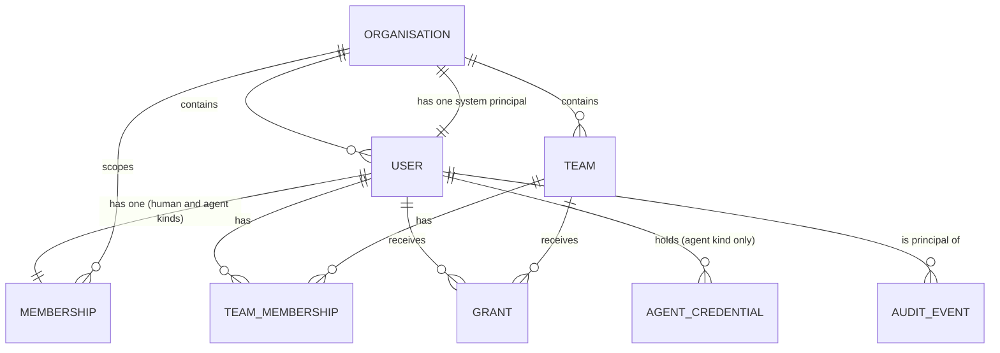
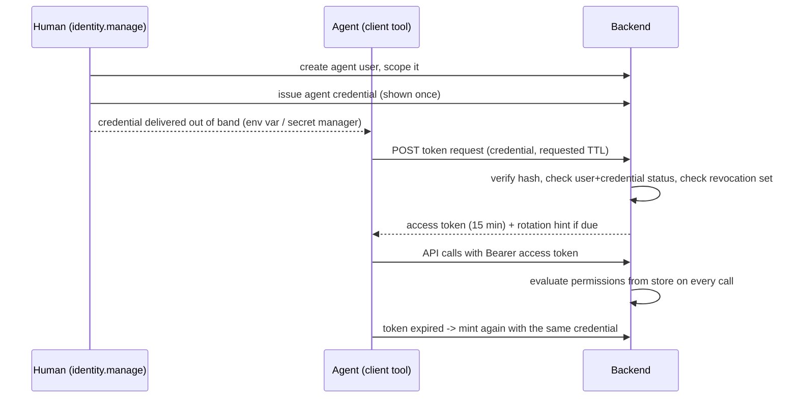

# D09: Identity, security, and audit

**Status:** Draft v2 — 2026-09-14. Owner: designer agent (T1). Reviewer: —. Approver: —.

## Purpose

This document decides who can exist in the system, how they prove who they are, what they are allowed to do, and what is recorded when they do it.

It covers:

- The identity model: Organisation, Team, User, Membership, Grant, and the three principal kinds (human, agent, system).
- Authentication for two very different clients: the non-interactive client tool used by agents, and humans in the operator UI.
- Authorisation: roles and permission verbs scoped by organisation, team, and project, including how a human decision maker is distinguished from an agent decision maker.
- The audit trail: what is recorded, how it is ordered, how long it lives, how it is redacted, and what tamper evidence v1 does and does not provide.
- Secrets handling on the server and on the client.
- A threat model with mitigations.

Objectives covered: **O8** (full auditability) and **O9** (identity: organisations, teams, users) primarily; **O3** and **O4** in the parts that touch agent operation and decisions; **O6** and **O10** only at the boundary (this document supplies hooks and constraints, not metrics or client design). Engineering objective **E6** is touched where behaviour must be tested.

Out of scope: the API surface itself (D04), the SurrealDB schema encoding (D02), the client tool's command design (D12), throughput policy (D06), and the domain state machine (D01). This document states the identity and security requirements those documents must satisfy.

**Concepts this document owns** (per the Concept ownership map in `docs/design/README.md`): Organisation, Team, TeamMembership, User, Principal, Agent user, the per-organisation system principal, Membership, Grant, roles and permission verbs, authentication, tokens, credentials, audit event, retention, redaction.

**Concepts this document only references, never redefines:** Project, Plan, Task, Dependency, User-defined edge, Metadata, Escalation, Decision, Transition, the task state machine, claim and lease semantics (owner **D01**); storage layout, indexes, transactions, live queries (owner **D02**); protocol operations, idempotency, wait and retry behaviour (owner **D03**).

## Context

### Prior decisions this rests on

- **ADR 0001** — SurrealDB is the only datastore. Identity, membership, grants, credentials, and audit records all live there.
- **ADR 0002** — The backend is Rust. Policy evaluation is Rust code, not database configuration (§2.5, confirmed by founder decision E-2026-09-14-05).
- **ADR 0003** — Design before code. Nothing here is implemented; this document is a specification.

### Founder decisions this version applies

All five escalations raised against v1 are decided or deferred in `docs/design/README.md`, together with a scope-cut decision. This version applies them:

| Decision | Applied in |
| --- | --- |
| **E-01** Cross-project dependencies allowed within an org behind a default-off org setting; opaque-blocker read rule stands | §1.1 (`settings.cross_project_dependencies`), §3.4 (`dependency.create`), §3.6 |
| **E-02** No sensitive-key feature in v1; metadata must not carry secrets; audited redaction-with-tombstone is the removal path and covers D01 Transitions as well as audit events | §4.3, §5.4, Alternatives |
| **E-03** No `Account` entity in v1; one User per organisation, one login per User | §1.4, §1.8 (I5 withdrawn), Alternatives |
| **E-04** Deferred: the erasure posture is "redaction only, pending a legal position" | §4.3 |
| **E-05** Rust is the sole enforcement point; mandatory cross-tenant isolation suite in D10; pin SurrealDB **3.2.3**; record the no-custom-API-routes constraint on D02 and D08 | §2.5, OQ-1, OQ-1b |
| **Scope cut** Delegation removed entirely; per-organisation audit hash chain and its `seq` removed | §1, §2.1, §3.4, §4, T6 withdrawn |

### Research this relies on

Every external claim below cites one of these dated notes. Nothing external is asserted without one.

| Note | Date checked | What this document takes from it |
| --- | --- | --- |
| `docs/research/2026-09-14-auth-identity-verification.md` | 2026-09-14 | SurrealDB 3.x authentication levels, `DEFINE ACCESS` types, table `PERMISSIONS` semantics, session/token durations; CVE-2026-63735; RFC 8628, 7636, 9449, 9700, 8693 status; OS-keychain conventions and the headless-Linux caveat; SPIFFE/SPIRE. All **read in docs**, none verified by running. |
| `docs/research/2026-09-14-transactions-and-claiming.md` | 2026-09-14 | **Verified by running** against SurrealDB `3.2.3+20260721.40522d1`: a guarded single-statement `UPDATE ... WHERE` under 8-way concurrency produces exactly one winner; a multi-statement `BEGIN`/`COMMIT` block detects write-write conflict at commit and returns a retryable error rather than losing an update; snapshot isolation is the only isolation level. This is the basis of §4.1's ordering rule. |
| `docs/research/2026-09-14-edges-vs-record-links.md` | 2026-09-14 | Recommends pinning the 3.2.x line, currently 3.2.3; flags 3.3 as beta with a reworked graph engine. Basis for the version pin in §2.5. |
| `docs/research/2026-09-10-surrealdb-status.md` | 2026-09-10 | SurrealDB 3.x is the target line. |

Two verification gaps are carried forward from the auth note and are not papered over: RFC 9700's exact refresh-token-rotation wording was read via a search summary rather than the full text, and no OWASP source for credential-storage guidance was directly verified (OQ-11).

### Assumptions stated explicitly

1. **A1. Single deployment, multiple organisations.** One backend instance serves many organisations. The tenant boundary is the Organisation and it is enforced in application code on every request.
2. **A2. TLS is mandatory**, terminated in front of or by the backend, including on loopback deployments.
3. **A3. Agent runtimes are untrusted and short-lived.** An agent process may live ninety seconds, with no terminal, no browser, and possibly no writable filesystem.
4. **A4. The system does not run agents** (`docs/objectives.md` non-goals). We cannot attest an agent's runtime in v1; we can only authenticate a credential handed to it.
5. **A5. Server clocks are synchronised** within a few seconds (NTP). Token expiry and audit timestamps depend on it; §2.6 allows five seconds of skew, not sixty.
6. **A6. No billing, no public self-service signup, no cross-instance federation in v1.** The first Organisation and its first human user are created by an operator at install time (§2.7).

### Vocabulary added by this document

`Agent user`, `Agent credential`, `Access token`, `Grant`, `Membership`, `Audit event`, `Correlation id`, `Revocation set`, and the **system principal**. All carry rows in `docs/glossary.md`. `Account` and `Delegation` are **not** vocabulary of this design: the first was rejected by E-03, the second was cut from scope; their glossary rows are removed in the same change.

## Design

### 1. Identity model (O9)

This section is written as a stable interface. Each entity has its own numbered subsection with a field table (field, type, required, invariant) so that D01, D02, D03, D04, and D12 can cite "D09 §1.n" for a definition instead of restating one. §1.10 states exactly what D01 may assume.



#### 1.1 Organisation

The top-level tenant boundary. Owns every other record. D01 §2.4 owns Project and its containment in an Organisation; this section owns the Organisation record itself.

| Field | Type | Required | Invariant |
| --- | --- | --- | --- |
| `id` | record id | yes | — |
| `slug` | string, lowercase | yes | unique across the deployment; immutable after creation (O-1 in D01 states the same fact for the domain side) |
| `name` | string | yes | display only |
| `status` | enum `active` \| `suspended` | yes | a suspended organisation authenticates nobody and accepts no writes |
| `settings` | object | yes | see below; every key has a default, so the object is never partially undefined |
| `created_at` | timestamp | yes | — |
| `created_by` | ref User | yes | the organisation's own system principal for the install-time first organisation (§2.7); never null |
| `archived_at` | timestamp | no | D01 O-3 governs what an archived organisation permits |

`settings` keys owned by this document:

| Key | Type | Default | Meaning |
| --- | --- | --- | --- |
| `token_ttl_minutes` | int 5–60 | 15 | access-token lifetime (§2.1) |
| `agent_decisions` | enum `allowed` \| `forbidden` | `allowed` | whether a principal with `kind = agent` may record a Decision (§3.5) |
| `agent_reversals` | bool | `false` | whether an agent may exercise `task.reverse` (§3.4) |
| `cross_project_dependencies` | bool | `false` | whether a Dependency may cross a project boundary inside the organisation (§3.6, E-01) |
| `audit_retention_days` | int ≥ 90 | 400 | audit-event retention (§4.4) |

**Organisation deletion is not an operation in v1.** An organisation may be suspended or archived; nothing hard-deletes it, its users, its history, or its audit events. Deletion would have to answer what happens to Transitions that O8 promises are permanent, and v1 has no answer worth writing down. Recorded as a designed-but-unbuilt extension in *Alternatives considered*.

#### 1.2 Team

A named group of users inside one organisation, used for assignment (D01 §2.2, T-3) and as a grant subject.

| Field | Type | Required | Invariant |
| --- | --- | --- | --- |
| `id` | record id | yes | — |
| `org` | ref Organisation | yes | immutable |
| `slug` | string | yes | unique within `org` |
| `name` | string | yes | — |
| `archived_at` | timestamp | no | an archived team keeps its grants for audit but grants nothing |
| `created_at`, `created_by` | timestamp, ref User | yes | — |

**Teams do not nest in v1** (D01 T-2 and D01 open question Q7: this is D09's answer, and it is "no"). Nesting complicates every permission evaluation and no objective asks for it. Reopening it needs an ADR (OQ-7).

#### 1.3 TeamMembership

Membership of a Team is a record, not an embedded list, so that adding and removing a member is a timestamped, attributable act.

| Field | Type | Required | Invariant |
| --- | --- | --- | --- |
| `id` | record id | yes | — |
| `org` | ref Organisation | yes | equals `user.org` and `team.org` |
| `user` | ref User | yes | `kind` is `human` or `agent`; never the system principal |
| `team` | ref Team | yes | — |
| `team_role` | enum `team_lead` \| `team_member` | yes | §3.3 |
| `status` | enum `active` \| `revoked` | yes | revoked rows are kept, never deleted |
| `granted_by`, `granted_at`, `revoked_by`, `revoked_at` | ref User, timestamps | granted_* yes | — |

At most one `active` TeamMembership per (user, team) pair.

#### 1.4 User

An identified principal within exactly one organisation. Humans, agents, and the system principal are all Users; `kind` discriminates. There is **no separate global account entity**: a human's login identity lives on the User record (founder decision E-03). A human who belongs to two organisations has two Users and two logins in v1.

| Field | Type | Required | Invariant |
| --- | --- | --- | --- |
| `id` | record id | yes | — |
| `org` | ref Organisation | yes | immutable (I2) |
| `kind` | enum `human` \| `agent` \| `system` | yes | immutable (I2); `system` is reserved for the per-organisation principal in §1.5 |
| `handle` | string | yes | unique within `org`; machine-friendly, e.g. `deploy-bot`, `pidster`. This is the name the client tool and UI show |
| `display_name` | string | yes | — |
| `status` | enum `active` \| `suspended` \| `disabled` | yes | `disabled` is terminal (I7); the system principal is always `active` (I10) |
| `email` | string, case-folded | for `kind = human` | unique within `org`; the login identifier when the local credential path is used; null for agent and system kinds |
| `external_subject` | string | no | the IdP `iss`+`sub` pair when OIDC is configured; unique within `org`; human kind only |
| `credential` | object | no | local password hash (Argon2id, §5.1) and second-factor enrolment when no IdP is configured; human kind only; never returned by any API |
| `owner` | ref User | for `kind = agent` | the human accountable for this agent (I3) |
| `owning_team` | ref Team | no | agent kind only; used for default scoping and for `team_lead` rights (§3.4) |
| `scope` | object | for `kind = agent` | project scope mask, §1.9 |
| `labels` | metadata map | yes | arbitrary K/V, may be empty (O2). Subject to §5.4 |
| `created_at`, `created_by` | timestamp, ref User | yes | `created_by` is the organisation's system principal for the system principal itself and for the install-time first human |
| `disabled_at` | timestamp | no | set when `status` becomes `disabled` |

D01 §2.3 additionally carries `agent_tier` and `agent_runtime` as descriptive fields. Those are domain description, not identity; D09 neither requires nor forbids them and states only that nothing in §3 may grant a permission on the basis of either (D01 U-4 says the same).

#### 1.5 The system principal

**Exactly one User per Organisation has `kind = system`.** It exists so that D01 U-2 holds and `Transition.actor` is never null: every system-initiated transition (D01 §7.3 — lease expiry, decision cascade, escalation withdrawal cascade) names it, and every audit event has a non-null principal (§4.1).

Rules, all of them invariants (I10–I13 in §1.8):

- It is created atomically with the Organisation, by the backend, and its `created_by` is itself. This is what makes the bootstrap act attributable rather than anonymous (§2.7).
- **It cannot authenticate.** No credential, no session, no token is ever issued for it. It holds no `email`, no `external_subject`, no `credential` object, and the token-minting endpoints reject it by `kind` before any other check. There is therefore no key to steal and no path by which a caller becomes the system.
- **It holds no Membership and no Grant**, and is exempt from I1 and I9. It is not a member of anything; it is the backend's own name.
- **It has no `owner`** and is exempt from I3.
- Its permissions are not evaluated through §3 at all. The backend performs system-initiated transitions directly, as part of the operation that triggered them; the system principal is the *name recorded on the result*, not an authority consulted beforehand. This is what resolves the case where a `decision_maker` with no `task.transition` right answers a blocking escalation: the decider is authorised for `decision.make` only, and the cascade that returns the task to `open` is a system-initiated transition recorded against the system principal (D01 §6.4 row 13 already marks it **S**).
- It cannot be suspended, disabled, renamed, or deleted. `handle` is `system` and is reserved: no other User in the organisation may take it.

#### 1.6 Membership

That a User belongs to an Organisation with a set of organisation-level roles. A separate record rather than a field on `User`, so granting and revoking a role is itself timestamped and attributable.

| Field | Type | Required | Invariant |
| --- | --- | --- | --- |
| `id` | record id | yes | — |
| `org` | ref Organisation | yes | equals `user.org` (I1) |
| `user` | ref User | yes | `kind` is `human` or `agent` |
| `roles` | set of org role | yes | from §3.2; may not be empty — `member` is the floor |
| `status` | enum `active` \| `suspended` \| `revoked` | yes | `revoked` is terminal; the row is kept forever because audit events reference the roles that were in force |
| `granted_by`, `granted_at` | ref User, timestamp | yes | — |
| `revoked_by`, `revoked_at` | ref User, timestamp | no | required when `status = revoked` |

#### 1.7 Grant

An explicit permission on a Project, or on a Task subtree within one, to a subject that is either a User or a Team.

| Field | Type | Required | Invariant |
| --- | --- | --- | --- |
| `id` | record id | yes | — |
| `org` | ref Organisation | yes | equals the org of subject and resource (I4) |
| `subject` | ref User \| ref Team | yes | never the system principal |
| `resource` | ref Project \| ref Task | yes | a Task resource means "this task and its subtree" |
| `role` | enum project role | yes | §3.3 |
| `expires_at` | timestamp | no | time-boxed access is first class |
| `status` | enum `active` \| `revoked` | yes | revoked rows are kept |
| `granted_by`, `granted_at`, `revoked_by`, `revoked_at` | | granted_* yes | every grant and revocation requires a `reason`, recorded on the audit event (§4.1) |

A Grant is never silently wider than the granter: a principal may grant only a role whose verb set is a subset of their own on that resource (§3.4, T8).

#### 1.8 Invariants

Stated here, enforced by D02's schema and D08's storage boundary, tested by D10.

- **I1.** Every User with `kind` in {`human`, `agent`} has exactly one Membership per organisation, in any status, and `Membership.org == User.org`. Revocation sets `status = revoked`; it never deletes the row and never leaves a User membership-less. The system principal has none (§1.5).
- **I2.** `User.org`, `User.kind`, and `Team.org` are immutable. Moving a user between organisations is not an operation; create a new user and disable the old one.
- **I3.** Every User with `kind = agent` has a non-null `owner` whose `kind = human` and whose `org` equals the agent's. An agent may not own an agent, so agent self-replication always terminates at a human. The system principal is exempt.
- **I4.** Every reference between records resolves to a record in the same Organisation. There is no legal cross-organisation reference anywhere in the model, including Grants, TeamMemberships, Dependencies (D01 D-2), and user-defined edges (D01 UE-2).
- **I5.** *(Withdrawn in v2.)* v1 had "an Account has at most one User per Organisation". E-03 removed the Account entity; the number is retained so that references to I6–I9 in earlier reviews still line up.
- **I6.** A User with `kind = agent` holds **at most two active Agent credentials** (which is what makes overlap rotation possible) and may hold none — it can exist created-but-not-enrolled, and cannot authenticate until one is issued. Human and system kinds hold none, ever.
- **I7.** Disabling a User is irreversible (`disabled` is terminal); suspension is reversible. Neither deletes the User, because audit events reference it forever.
- **I8.** A Grant whose subject is a Team applies to that Team's members **at evaluation time**, not at grant time.
- **I9.** Every Organisation has at least one `active` User with `kind = human` holding `org_owner`. The last such role cannot be revoked, and that human cannot be disabled while it is the last.
- **I10.** Exactly one User per Organisation has `kind = system`; it is created with the Organisation and is always `active`.
- **I11.** The system principal holds no credential, no session, and no token. Every authentication endpoint rejects `kind = system` before evaluating anything else.
- **I12.** The system principal holds no Membership, no TeamMembership, and no Grant, and is never the `subject` of one.
- **I13.** The system principal appears as `principal` on audit events and as `actor` on Transitions, and in no other role: never as `owner`, `assignee`, `claimed_by`, `raised_by`, `decided_by`, `granted_by`, or `subject`.

#### 1.9 Agent users: creation, ownership, and scope

Creation is deliberately a human act, or an act by a principal a human authorised, and is always attributable.

1. A principal holding `identity.manage` (roles `org_owner`, `org_admin`, or a `team_lead` creating an agent inside their own team) creates a User with `kind = agent`, a handle, an `owner` defaulting to the creating human, an optional `owning_team`, and a scope.
2. Creation emits an audit event and returns the agent user with **no credential**. Credential issuance is a second, separately audited step (§2.2), so "this agent exists" and "this agent can act" are distinct, revocable facts.
3. An agent user may hold `identity.manage` only through an explicit `org_admin` role, which the design discourages and the UI must warn about.

**Can an agent belong to teams?** Yes, through the same TeamMembership record as a human, and team-subject Grants apply identically. Uniformity is deliberate: assignment, routing, and authorisation all key off team membership, and special-casing agents would double every code path. Where behaviour must differ it differs on `User.kind` (§3.5, §3.4's `task.reverse` gate), not on a separate mechanism.

**Scope.** An agent's `scope` narrows what its roles and grants can ever reach:

```
scope = {
  projects: "all" | [project ids],
  include_subtrees: bool
}
```

Effective permission for an agent = (permissions from roles and grants) ∩ scope. Scope can only remove capability, never add it. The default for a newly created agent is `projects: []`: it can authenticate and read its own identity and nothing else until it is scoped. Least privilege is the default, and over-scoping is a visible, audited act. (v1's `max_task_depth` key is removed: no rule ever evaluated it, and tree depth is D01 TK-4's concern, not identity's.)

#### 1.10 Interface for D01

This subsection is the contract. **D01 may assume exactly the following and nothing more**, and should cite the section numbers rather than restate any field.

| What D01 needs | Where it is defined | What D01 may assume |
| --- | --- | --- |
| Organisation | **D09 §1.1** | It exists, has `id`, `slug`, `status`, `settings`, `archived_at`. D01 keeps only `ref<Organisation>` and the containment fact, plus its own `metadata` if the domain needs one. |
| Team | **D09 §1.2** | It exists, is org-scoped, has `slug`, `name`, `archived_at`, does not nest (answers D01 Q7). Team membership is the TeamMembership record in **§1.3**, not a `members` list on Team. |
| User | **D09 §1.4** | Org-scoped, `handle` (not `slug`), `display_name`, `kind ∈ {human, agent, system}`, `status ∈ {active, suspended, disabled}` (not a boolean `active`). "May not claim work" means `status != active`. |
| The system principal | **D09 §1.5** | Exactly one per organisation, always exists, always active, never authenticates, never holds a role. D01 U-2 stands unchanged, and D01 §7.3's system-initiated transitions name it. |
| Permission verbs | **D09 §3.4** | The verb list, including `task.reverse` for D01 §6.4's human-only rows, `task.cancel`, `dependency.create`/`dependency.remove`, and `plan.*`. D01 does not restate which role holds which verb. |
| Audit event | **D09 §4.1** | It exists, references the Transition, and carries the security fields. D01's Transition remains **authoritative for domain state** (§4.2). |
| Redaction | **D09 §4.3** | `Transition.reason` and `Transition.changed_fields` are subject to the same audited redaction-with-tombstone operation as audit events. This is the one exception to D01 TR-1's immutability and D01 should state it as such. |

Three things D09 v2 asks of D01, each an open question owned jointly (OQ-2):

1. **Add `Escalation.requires_human: bool`** (default `false`). It is the only new field D09 requires. §3.5 keys the human-only decision rule off it. D09 no longer asks for `Decision.decided_by_kind` (D01 already denormalises `Transition.actor_kind`, and `Decision.decided_by` resolves to a User whose `kind` is authoritative).
2. **Remove `Transition.on_behalf_of`.** Delegation does not exist in v1 (scope cut). The field's own note said "D09 decides whether delegation exists at all"; D09 v2 decides it does not.
3. **Delete D01 §2.1–§2.3's identity field tables** and replace them with references to §1.1, §1.2, and §1.4. This is the reviewer's recommended reconciliation and settles D09 v1's OQ-3.

D09 asks D01 for nothing else. In particular, D09 does not require a review gate (cut from v1 per `docs/design/README.md` Scope decisions, so no `task.approve` verb exists and D01 Q11 is moot), does not constrain whether a non-assignee may claim an assigned task (the domain permits it; `task.claim` is the only gate and assignment stays advisory), and does not require any field on Decision.

### 2. Authentication (O3, O9, O10 boundary)

Two clients with incompatible constraints. They share one token format and one validation path; only the way the first credential is obtained differs.

#### 2.1 Token model (shared)

- **Access token.** Short-lived, signed by the backend with Ed25519 (EdDSA), carrying `iss`, `sub` (user id), `org`, `aud` (this deployment's API identifier), `kind` (`human` \| `agent`), `cred` (the credential or session id it was minted from), `jti`, `iat`, `exp`. Default TTL **15 minutes**, configurable per organisation between 5 and 60 (`settings.token_ttl_minutes`). A token is never minted for `kind = system` (I11).
- **Signing keys.** A key pair with a `kid`. Two keys are active at any time so rotation never causes an outage: the newest signs, both verify. Rotation every 90 days and immediately on suspected compromise. Public keys are exposed on an unauthenticated JWKS-style endpoint.
- **Claims are not the authority.** The token asserts identity; it carries no permission list. Permissions are evaluated server-side from Membership, TeamMembership, Grant, and scope on every request (§2.6). This costs a cached lookup and buys correctness: a permission revoked at 10:00 does not survive in a token until 10:15.
- **Revocation.** A revocation set of credential ids, session ids, user ids, **grant ids**, membership ids, and individual `jti` values is held in memory by every backend process, refreshed from the store on a short interval (target ≤ 5 seconds) plus a push on write. A token whose `sub`, `cred`, or `jti` appears is rejected even if unexpired; a cached identity state referencing a revoked grant or membership is discarded. Grants are in the set because a project grant is the most commonly revoked permission in the product, and v1 left it as the one thing revocation could not reach.
- **Bearer, for now.** Tokens are bearer tokens over TLS. Sender-constraining them (DPoP, RFC 9449, confirmed a Proposed Standard in the auth note dated 2026-09-14) is designed for and deferred (OQ-5).

#### 2.2 The client tool: non-interactive agent authentication

**Decision: a long-lived Agent credential that mints short-lived access tokens, with a workload-identity federation path as the preferred successor wherever the agent's runtime can provide one.**

An **Agent credential** is a high-entropy secret (256 bits, base32-encoded, prefixed `ttsa_` so leak scanners can grep for it) bound to exactly one agent User.

| Field | Type | Required | Invariant |
| --- | --- | --- | --- |
| `id` | record id | yes | the `cred` claim; safe to log |
| `user` | ref User | yes | `kind = agent` |
| `org` | ref Organisation | yes | equals `user.org` |
| `secret_hash` | bytes | yes | HMAC-SHA-256 of the secret under a server-side pepper (§5.1) |
| `pepper_version` | int | yes | so a pepper can actually be retired (v1 had no way to know which pepper hashed a credential) |
| `label` | string | yes | human-readable, e.g. "ci-runner, release automation" |
| `expires_at` | timestamp | yes | default 90 days, maximum 365; expiry is mandatory, there is no non-expiring credential |
| `last_used_at`, `last_used_from` | timestamp, string | no | populated on each mint; drives stale-credential and anomaly reports |
| `status` | enum `active` \| `revoked` \| `expired` | yes | at most two `active` per agent user (I6) |
| `created_by`, `created_at`, `revoked_by`, `revoked_at`, `revocation_reason` | | created_* yes | — |



- **Issuance.** The secret is displayed exactly once and never retrievable. Only the hash is stored.
- **Rotation.** Two paths. (a) *Overlapping manual rotation*: issue a second credential, deploy it, revoke the first; both work in the window (I6 permits exactly this). (b) *Self-rotation*: within 20% of its lifetime of expiring, the token response carries a `rotation_due` hint and the client may call the rotate endpoint, which returns a replacement secret and marks the old credential to expire in 24 hours. Self-rotation is authorised by **`credential.rotate`**, a credential-scoped self-service right: it is held by the presenting credential over *itself only*, requires no role, and cannot rotate another principal's credential, extend a credential past its original maximum, or resurrect a revoked one. v1 described this path and then made it unauthorised; the verb closes that gap (§3.4).
- **Expiry.** A credential past `expires_at` mints nothing. Tokens already minted remain valid until their own short expiry.
- **Revocation.** Revoking a credential adds its id to the revocation set and fails all future mints. Suspending or disabling the agent User revokes every credential it holds in one act: this is the kill switch T3 depends on.
- **Client-side storage.** In priority order: (1) the `TTS_AGENT_CREDENTIAL` environment variable, the recommended path for containers and CI, which never touches disk; (2) the OS keychain where one is available and unlocked; (3) a file mode `0600` in a directory mode `0700` under `$XDG_CONFIG_HOME/task-tree-stream/` or the platform equivalent. The client **refuses** to read a credential file with broader permissions and says why. The auth note dated 2026-09-14 records that headless Linux commonly has no Secret Service session, which is why the keychain is second and not required. Access tokens are cached separately, `0600`, keyed by credential id; `--no-token-cache` and a read-only filesystem fall back to memory. Exact layout is D12's; these are the constraints it must meet.
- **Never persisted or printed:** the secret after first display, the access token (the client prints `jti` and expiry, never the token), and none of it via a command-line flag whose value lands in `ps` output and shell history. The client tool must reject a `--credential` value outright (D12).

**The federation path (preferred where available, not v1).** Where the runtime issues a verifiable workload identity token — a CI or cloud OIDC token, or a SPIFFE JWT-SVID — the client exchanges it for an access token using OAuth 2.0 Token Exchange (RFC 8693, a Proposed Standard per the auth note dated 2026-09-14) against a per-organisation trust relationship: issuer, audience, and a subject-matching rule pinned to one agent user. This removes the long-lived secret entirely, which is the single biggest improvement available to this design, and is why T1's residual risk is accepted only for v1. It is not v1 because it needs per-environment trust configuration and a real conformance matrix (OQ-4). The design *imitates* the SPIFFE pattern (short-lived, rotated credentials, federation instead of shared secrets) without taking SPIRE as a dependency; whether any specific issuer type, SVIDs included, is accepted is part of OQ-4 and is not committed here.

#### 2.3 Humans

**Decision: OIDC Authorization Code with PKCE against the deployment's identity provider where one is configured; a built-in local credential (password plus a mandatory second factor) where one is not.**

- Self-hosted installs frequently have no IdP, so a built-in path is required for the product to be installable at all. It is deliberately the fallback and the UI says so.
- The authorization code flow uses PKCE with `S256` (RFC 7636, Proposed Standard; `S256` mandatory-to-implement). The auth note dated 2026-09-14 records that OAuth 2.1, which would make PKCE mandatory for the code grant, is still `draft-ietf-oauth-v2-1-16` and **not an RFC**; this document therefore requires PKCE on its own merits and does not cite OAuth 2.1 as an authority.
- Browser session: the access token lives in memory in the UI; a refresh token lives in an `HttpOnly`, `Secure`, `SameSite=Lax` cookie scoped to the API origin. Refresh tokens are rotated on every use with reuse detection: presenting an already-exchanged refresh token invalidates the whole session family and raises a security audit event. Rotation-with-reuse-detection is widespread practice and is the guidance the OAuth 2.0 Security BCP (RFC 9700 / BCP 240, published January 2025) is understood to give; the auth note flags that RFC 9700's exact wording was read via a search summary, so this document does not quote it normatively (OQ-11 closes that gap by a direct read).
- Absolute session lifetime 12 hours by default; idle lifetime 1 hour.
- If the UI is served from a different origin than the API, the refresh cookie must still be first-party to the API origin and the UI must never hold a refresh token in JavaScript-reachable storage. Which origin model is used is D07/D08's decision.
- **Humans using the client tool** authenticate with the OAuth 2.0 Device Authorization Grant (RFC 8628, Proposed Standard, August 2019 — the profile it was written for is exactly a CLI with no local browser). The CLI prints a short code and a URL, the human approves in a browser, the CLI polls. A human's CLI refresh token is stored in the **OS keychain first and a `0600` file second** — never in an environment variable, because it rotates on every use and an environment variable cannot be written back. Default life 7 days, mandatory re-authentication after 30.

#### 2.4 Why this and not the alternatives

| Option | Why it lost |
| --- | --- |
| Static API key on every request | A leaked string is permanent, unbounded authority, present in every intermediary's logs. Our design keeps one long-lived secret but presents it to one endpoint a handful of times a day. |
| mTLS | Sender-constrained by construction, but demands a private CA and certificate provisioning into ephemeral runtimes that may have no writable filesystem. Revisit with DPoP (OQ-5). |
| Device flow for agents | Needs a human at a browser; A3 says there is neither. Correct for humans, adopted there. |
| Long-lived JWT, no mint step | Unrevocable short of rotating the signing key, which logs out every principal in every organisation. |
| Short-lived tokens minted from a long-lived credential | **Chosen.** Bounded blast radius, revocation in seconds, works headless, one secret to protect. |

#### 2.5 SurrealDB's own authentication and permissions

SurrealDB provides authentication at root, namespace, and database level, record users through `DEFINE ACCESS TYPE RECORD`, `TYPE JWT` and `TYPE BEARER` access, and table `PERMISSIONS` clauses evaluated against `$auth` that default to deny (auth note, 2026-09-14, read in docs, not verified by running).

**Decision (founder, E-2026-09-14-05): the Rust backend is the sole policy enforcement point for v1.** It connects to SurrealDB as a single privileged database user. We neither rely on nor expose SurrealDB's record-level permissions for tenant isolation.

Reasons: our authorisation depends on graph traversal (team membership, project grants, subtree scopes), which as permission clauses would push the most security-critical logic into a language we cannot unit-test as thoroughly as Rust; D08 may choose embedded mode, where database-level auth is close to meaningless as a boundary; and two enforcement points that disagree is a vulnerability generator.

The cost is stated plainly: **a bug in the Rust authorisation layer has nothing behind it.** Three controls are therefore mandatory, not optional:

1. The storage boundary exposes no query API callable without an organisation id. Repository functions take the org as a required parameter, and the only cross-org query capability lives in a small, separately reviewed administrative module (D08).
2. **D10 must include a cross-tenant isolation test suite** that, for every read and write operation in the API surface, asserts that a principal in org A cannot reach a record in org B — by record id, by search, by subtree traversal, or by user-defined edge. This is a requirement on D10, not a suggestion (E-05).
3. **The deployment pins SurrealDB 3.2.3 or later in the 3.2.x line, and does not use SurrealDB custom API routes.** The reason for the floor is CVE-2026-63735, a cross-tenant authorization bypass through custom API routes fixed in 3.2.0 (auth note, 2026-09-14). The reason the floor is **3.2.3 rather than 3.2.0** is that 3.2.3 (`3.2.3+20260721.40522d1`) is the only version this project's own research has exercised: the transactions note verified concurrency behaviour against it by running, and the edges note recommends pinning 3.2.x while flagging 3.3 as beta with a reworked graph engine. A floor of 3.2.0 would permit a build nobody here has tested. **This constraint is a requirement on D02 (pin the version, define no custom API routes) and on D08 (connection model, plus a dependency-advisory check for the database and the SDK)** — see OQ-1b.

Whether to add SurrealDB `PERMISSIONS` clauses as defence in depth remains **OQ-1**: it may be revisited by a later ADR once the auth experiment gives a cost figure.

#### 2.6 Validating a request

Every authenticated request, in order:

1. Parse and verify the token signature against the active `kid`s; reject on unknown `kid`, bad signature, wrong `aud`, wrong `iss`, or `exp` in the past. Clock-skew tolerance is **5 seconds**, consistent with A5; v1's 60 seconds silently extended a 15-minute token by 7%.
2. Check `sub`, `cred`, and `jti` against the revocation set. Reject on a hit.
3. Load the principal's identity state — User, Membership, TeamMemberships, **Grants**, scope — from a cache with a 10-second TTL, invalidated on a write to **any** of those records and on any revocation-set entry naming them. Reject if the User is not `active`, the Membership is not `active`, or `kind = system`.
4. Evaluate the required verb for the requested action against the resource (§3), including scope intersection and the kind gates in §3.4 and §3.5.
5. Record the outcome — allowed or denied — as an audit event, subject to §4.4's volume rules.

Steps 1 and 2 are cheap and local; step 3 is a cached lookup. This is the hot path for every agent call and D08 must treat its latency as a design constraint.

#### 2.7 Bootstrap

The install-time act that creates the first Organisation and its first `org_owner` has no authenticated caller, and vision principle 3 forbids anonymous records. The resolution is §1.5's system principal:

- The Organisation and its system principal are created atomically. The Organisation's `created_by`, the system principal's own `created_by`, and the `principal` on the bootstrap audit event are all that system principal.
- The audit event records `action = org.bootstrap`, `auth.method = bootstrap`, and the operator-supplied first human user.
- The bootstrap path is single-use per deployment, disabled once any Organisation exists, and requires a deployment-supplied secret (injected, §5.1) rather than being an open endpoint.
- The exact mechanism (configuration file, one-shot CLI subcommand, or first-run flow) is D08's; the requirements above are D09's.

### 3. Authorisation (O3, O4, O8, O9)

#### 3.1 Shape of the model

Role-based, with roles bundled at three scopes, plus agent scope as a mask:

```
effective(principal, verb, resource) =
      permitted_by_org_roles(principal, resource.org)
    ∪ permitted_by_team_roles(principal, resource)
    ∪ permitted_by_grants(principal or principal's teams, resource)
  then ∩ agent_scope(principal)            (agents only)
  then subject to the kind gates (§3.4, §3.5)
```

Roles are fixed bundles in v1; custom roles are excluded (OQ-6). Denial is the default, and there is no deny rule that can override an allow, because deny rules make a policy unexplainable. Delegation no longer appears in this expression: it is cut from v1.

#### 3.2 Organisation roles

| Role | Intent |
| --- | --- |
| `org_owner` | Everything `org_admin` has, plus organisation settings, archiving the organisation, and removing another `org_owner`. **Not** organisation deletion — no such operation exists (§1.1). Not `decision.make`, which is granted, never implied (see §3.4). At least one human must hold it (I9). |
| `org_admin` | Identity management, team management, credential issuance, all projects in the organisation. Cannot change org settings, archive the organisation, or remove an `org_owner`. |
| `member` | Default floor. Sees the organisation and its teams; project access comes only from team membership or grants. |
| `auditor` | Read-only across every project in the organisation, plus `audit.read`. No writes of any kind. It exists so that oversight does not require write access, which is the one property no combination of the other roles provides. |

#### 3.3 Team and project roles

| Scope | Role | Intent |
| --- | --- | --- |
| Team | `team_lead` | Manage team membership; create agent users whose `owning_team` is this team and issue their credentials; create projects owned by the team; grant project access up to their own level. |
| Team | `team_member` | Inherits the team's project grants. |
| Project | `project_admin` | Everything on the project including granting access, archiving it, and reading its audit events. |
| Project | `contributor` | The working role: create and update tasks and plans, claim, transition, escalate, write metadata and edges, create dependencies. |
| Project | `observer` | Read everything in the project and raise escalations. No state changes. |
| Project | `decision_maker` | Additive, not standalone: may resolve escalations and record decisions on this project. Held alongside another role. |

`decision_maker` is separate from `project_admin` on purpose. The authority to decide is the authority this product exists to route (vision: *"Escalation is cheap and explicit"*); it must be grantable to someone who is not an administrator and withholdable from someone who is.

#### 3.4 Permission verbs

Verbs are the unit of authorisation. ● = permitted, ○ = permitted only on records the principal created, blank = denied. `team_lead` is not a column because its rights are scoped exceptions, listed under the table.

| Verb | Applies to | `org_owner` | `org_admin` | `auditor` | `project_admin` | `contributor` | `observer` | `decision_maker` |
| --- | --- | --- | --- | --- | --- | --- | --- | --- |
| `org.read` | Organisation | ● | ● | ● | | | | |
| `org.update` | Organisation settings | ● | | | | | | |
| `org.archive` | Organisation | ● | | | | | | |
| `identity.manage` | User, Team, Membership, TeamMembership | ● | ● | | | | | |
| `credential.issue` / `credential.revoke` | Agent credential | ● | ● | | | | | |
| `credential.rotate` | the presenting credential, itself only — held by the credential, never by a role (§2.2) | n/a | n/a | n/a | n/a | n/a | n/a | n/a |
| `project.read` | Project | ● | ● | ● | ● | ● | ● | |
| `project.create` | Project | ● | ● | | | | | |
| `project.update` | Project | ● | ● | | ● | | | |
| `project.archive` | Project | ● | ● | | ● | | | |
| `project.grant` | Grant | ● | ● | | ● | | | |
| `plan.read` | Plan (D01 §2.5) | ● | ● | ● | ● | ● | ● | |
| `plan.create` | Plan | ● | ● | | ● | ● | | |
| `plan.update` | Plan (name, filter, policy fields) | ● | ● | | ● | ● | | |
| `plan.pause` / `plan.resume` | Plan status | ● | ● | | ● | ● | | |
| `plan.close` | Plan → `completed` \| `abandoned` | ● | ● | | ● | ○ | | |
| `task.read` | Task | ● | ● | ● | ● | ● | ● | |
| `task.create` | Task | ● | ● | | ● | ● | | |
| `task.update` | Task fields, including `reparent` | ● | ● | | ● | ● | | |
| `task.claim` | claim, heartbeat, release | ● | ● | | ● | ● | | |
| `task.transition` | D01 §6.4 rows not covered by `task.cancel` or `task.reverse` | ● | ● | | ● | ● | | |
| `task.cancel` | D01 §6.4 row 20 `cancel` (cascades) | ● | ● | | ● | | | |
| `task.reverse` | D01 §6.4 human-only rows: `unpublish`, `reopen`, `reinstate` | ● | ● | | ● | | | |
| `dependency.create` | Dependency (D01 §2.7) | ● | ● | | ● | ● | | |
| `dependency.remove` | Dependency | ● | ● | | ● | ● | | |
| `edge.write` | User-defined edge (D01 §2.8) | ● | ● | | ● | ● | | |
| `metadata.write` | Metadata on any entity | ● | ● | | ● | ● | | |
| `escalation.create` | Escalation | ● | ● | | ● | ● | ● | |
| `escalation.read` | Escalation | ● | ● | ● | ● | ● | ● | |
| `escalation.assign` | Escalation owner | ● | ● | | ● | ○ | | ● |
| `escalation.withdraw` | Escalation | ● | ● | | ● | ○ | ○ | |
| `decision.read` | Decision | ● | ● | ● | ● | ● | ● | |
| `decision.make` | Decision | | | | | | | ● |
| `audit.read` | Audit event | ● | ● | ● | ● (this project's events only) | | | |

Notes on the edges of this table:

- **`task.cancel` is separate from `task.transition`, and contributors do not hold it.** `cancel` is the one domain operation that destroys work at scale: D01 §6.4 row 20 cascades to every non-terminal descendant. v1 restricted `project.archive` and a `task.archive` verb that corresponds to no D01 operation, while leaving cancellation inside the verb every working agent holds. That is now the other way round. An agent that needs a subtree cancelled escalates.
- **`task.reverse` is how D01 §6.4's human-only rows become enforceable rights.** D01 marks `unpublish`, `reopen` and `reinstate` as human-by-default and says D09 owns whether that is enforceable. It is: `task.reverse` is held by administrators and project admins only, and is additionally **gated to `kind = human`** unless `Organisation.settings.agent_reversals` is true (default false). That is the "whether an org may loosen them" knob D01 asks for. There is no `task.approve` verb because the review gate is cut from v1 (`docs/design/README.md`, Scope decisions), which also makes D01 Q11 moot.
- **`task.archive` is removed.** D01 A15 rejects deletion and archives only projects and organisations; a verb for an operation the domain does not define could only ever be dead or, worse, invented later to match it.
- **Dependency and user-defined edge are separate verbs.** D01 §2.7 and §2.8 make them different types with different powers — a Dependency gates execution, a UserEdge does not — so one `edge.write` verb could not express the difference. `dependency.create` additionally carries §3.6's cross-project rule.
- **`plan.*` verbs exist because a Plan is D01's addressable unit and O3's entire premise is "an agent given only a plan identifier".** v1 had no plan verb at all. `plan.close` is `○` for contributors (their own plans) because closing a plan someone else is executing is a supervisory act (D01 PL-4 makes closure explicit, never derived).
- **`decision.make` is held only through `decision_maker`.** `org_owner` does not get it implicitly: an administrator who wants to decide grants themselves the capability, and that grant is audited. This is the difference between having power and using it, and the audit trail should show which. §3.2's role description is worded to match; v1's "full control" wording contradicted this table.
- **`audit.read` is project-scoped for `project_admin`** — their own project's events, and nothing else. v1 withheld it entirely without saying so.
- **`team_lead` exceptions:** `identity.manage` restricted to agent users whose `owning_team` is their team; `credential.issue`/`credential.revoke` for those agents only; `project.create` for projects owned by their team; `project.grant` up to their own level on those projects.
- **No grant may exceed the granter.** A principal may grant only a role whose verb set on that resource is a subset of their own (T8).
- **No `delegation.mint` verb exists.** Delegation is cut from v1.

#### 3.5 Human decision makers versus agent decision makers

Both humans and agents may hold `decision_maker` and record a Decision (O4 and the vision explicitly contemplate agent decision makers). They are distinguished three ways:

1. **On the record.** D01's `Decision.decided_by` resolves to a User whose `kind` is authoritative, and D01 already denormalises `actor_kind` on the Transition. Every UI and API surface that shows a Decision **must** show the kind. There is no rendering of a decision that leaves the reader unable to tell whether a person made it. D09 requires no new field on Decision to achieve this.
2. **On the escalation.** An Escalation carries `requires_human: bool` (the one field D09 asks D01 to add, §1.10). When true, only a principal with `kind = human` holding `decision_maker` may resolve it. An agent attempting it receives a distinct, machine-readable refusal, `requires_human_decision`, which D03 must define as a normal, expected outcome: the agent's correct response is to wait, not to retry or work around it.
3. **On the policy.** `Organisation.settings.agent_decisions` is `allowed` (default) or `forbidden`. **The third v1 mode, `allowed_with_human_review`, is removed.** It described an agent decision that is recorded while the escalation stays open until a human confirms, which D01's model cannot represent: ES-2 makes `decision` non-null if and only if `status = answered`, DE-3 permits exactly one Decision per Escalation, and DE-4 makes creating a Decision atomically answer the escalation and release the task. Expressing the mode would require an open escalation holding a Decision and then a second Decision on it. A deployment that wants a human in the loop sets `requires_human` on the escalations that need one, or sets `agent_decisions = forbidden`; no objective asks for anything between.

**Who moves the task.** Recording a Decision releases the subject task from `awaiting_decision` (D01 DE-4, §6.4 row 13). The decider needs `decision.make` and nothing else: the cascade is a system-initiated transition recorded against the organisation's system principal (§1.5), not an act by the decider. A `decision_maker` who also holds only `observer` is therefore legal and complete.

#### 3.6 Two authorisation rules D01 asked this document to supply

**Cross-project dependencies (E-2026-09-14-01, decided by the founder on 2026-09-14: option 2, with the opaque-blocker read rule).**

- A Dependency may cross project boundaries **within one organisation**, only when `Organisation.settings.cross_project_dependencies` is true. The setting **defaults to false**, so the out-of-the-box behaviour is same-project-only. Cross-organisation dependencies remain illegal, full stop (I4, D01 D-2).
- Creating one requires `dependency.create` **and** `task.update` on the depending task **and** `task.read` on the depended-on task, all evaluated at creation time.
- **Reading is where the subtlety lies.** A principal who can see the depending task but not the depended-on task sees the dependency as an **opaque blocker**: its existence, its direction, and whether it is satisfied — not the far task's title, body, metadata, or project. This keeps the stream honest (an agent is never told a task is ready when it is not) without leaking work across a grant boundary.
- Losing access to the far project does not delete existing dependencies; they degrade to opaque blockers. Removing one requires `dependency.remove` and `task.update` on the depending task only, since removing a constraint on work you control leaks nothing.
- **D01 models the blocker**: the degraded view, and what the stream's topological layer does with a prerequisite outside the plan, are D01's to define (founder decision, E-01). D09 supplies only the authorisation rule above.

**Metadata that should never have been written (E-2026-09-14-02, decided by the founder on 2026-09-14: option 1 plus redaction-with-tombstone).**

- **There is no sensitive-key feature in v1.** Metadata keys cannot be marked sensitive; nothing is excluded from audit on the basis of its key.
- The rule instead is a stated constraint: **metadata, task text, escalation questions, decision rationales and transition reasons must not carry secrets or personal data beyond what the product needs** (§5.4).
- The removal path for an accident is **audited redaction with a tombstone** (§4.3), and it covers **both** the audit event and D01's `Transition.reason` and `Transition.changed_fields`. v1 protected only the audit event, which left the secret sitting in the immutable Transition; that half-measure is what made option 1 workable in the first place.
- Option 3 (per-organisation sensitive key or prefix declarations, values stored but never copied into audit) is a **designed-but-unbuilt extension**, recorded in *Alternatives considered*. Option 4 (crypto-shredding, or deleting audit records) is rejected here as it is in D01.

### 4. Audit (O8)

O8 says *"Every state change carries who, when, why, and prior state."* This section makes that concrete and adds what a security audit needs beyond a state change: denials, grants, credential lifecycle, and reads of sensitive data.

#### 4.1 What an audit event records

Every audited event is one append-only record.

| Field | Type | Required | Invariant |
| --- | --- | --- | --- |
| `id` | record id | yes | — |
| `org` | ref Organisation | yes | every event belongs to exactly one |
| `occurred_at` | timestamp | yes | server UTC at the time of the action |
| `recorded_at` | timestamp | yes | when the event was written; equal or later |
| `principal` | ref User | yes | **never null**; system-initiated actions name the organisation's system principal (§1.5) |
| `principal_kind` | enum `human` \| `agent` \| `system` | yes | denormalised at write time so audit reads never join to answer "did a person do this?" |
| `auth` | object | yes | `{ method: password \| oidc \| device \| agent_credential \| federation \| bootstrap \| system, credential_id?, session_id?, jti? }`; `system` and `bootstrap` carry no ids |
| `client` | object | no | `{ name, version }` from the client tool or UI, plus the server-observed source address |
| `action` | string | yes | a verb from §3.4, or a security verb: `auth.login`, `auth.denied`, `credential.issue`, `credential.rotate`, `grant.create`, `grant.revoke`, `identity.disable`, `audit.read`, `audit.redact`, `audit.expire`, `org.bootstrap` |
| `target` | object | yes | `{ type, id, project? }` — no tree path; see below |
| `subject_seq` | int | no | present when the event accompanies a D01 Transition: the Transition's per-subject `seq`. Absent for events with no domain subject (logins, denials, credential lifecycle) |
| `transition` | ref Transition | no | set when this event accompanies one |
| `prior_state` | map | no | the changed fields' values before; null for creates |
| `new_state` | map | no | the changed fields' values after; null for deletes |
| `reason` | text | conditional | required for every D01 transition marked reason-required, every decision, and every grant, revocation, credential issuance and identity change |
| `outcome` | enum `allowed` \| `denied` | yes | — |
| `denied_because` | string code | conditional | required when `outcome = denied` |
| `policy` | string | yes | which role or grant permitted the action — the explanation, not just the result |
| `correlation_id` | id | yes | groups every event from one logical agent operation across many requests |
| `request_id` | id | yes | one request; also the idempotency key when the caller supplied one (§4.5) |

`prior_state`/`new_state` record the **changed fields**, not whole documents: whole-document snapshots on a task with large free text would multiply storage by the number of edits for little gain.

**`target` carries no tree path.** v1 denormalised the task's path so subtree audit queries needed no traversal; D01 row 24 permits re-parenting within a project, which would leave every earlier event carrying a path the task no longer has, and repairing that would mean rewriting immutable records. Subtree audit queries resolve the current subtree from the tree and then query by task id. That is a query-planning problem for D02, not a correctness problem.

**Ordering — what v1 got wrong and what replaces it.** v1 gave every event a gapless per-organisation `seq` and chained each to the previous one's hash. The transactions note (verified by running against 3.2.3 on 2026-09-14) shows why that cannot work: SurrealDB offers snapshot isolation with write conflicts detected at commit **on the same record**, so two concurrent actions in one organisation can both read the chain head, both write distinct events carrying the same predecessor, and both commit without conflict. The chain forks, `seq` duplicates, and the verification job reports a break indistinguishable from tampering. v2 removes the org-wide sequence and the chain, and orders events as follows:

- **Per subject, ordering is exact.** An audit event that accompanies a domain change carries `subject_seq`, the same value as its Transition. That value is allocated by the single guarded `UPDATE` statement on the subject record that performs the state change itself. The transactions note verified by running that under 8-way concurrency exactly one such statement wins and the rest match no rows; a blind read-modify-write, by contrast, returns a retryable `Transaction conflict` at commit rather than losing an update. Either way no two writers can be handed the same `subject_seq` for the same subject, and no extra serialisation point is required.
- **Across subjects, there is no total order, and none is claimed.** Events are ordered by `occurred_at`, to within the clock synchronisation A5 assumes. Two events in one organisation on two different tasks have no defined relative order beyond their timestamps. This is a deliberate trade: an organisation-wide order would need an organisation-wide counter, which is exactly the single-writer bottleneck that would cap the machine-speed multi-agent throughput O6 exists to measure.
- **The Transition and its audit event are two records**, so they need an explicit `BEGIN`/`COMMIT` on one connection, and the caller must treat a `Transaction conflict` at commit as retryable and retry the whole block (transactions note, findings 2 and 3). D02 owns the statement shape; D08 owns where the retry lives. What D09 requires is that they are atomic together (§4.2).

#### 4.2 Relationship to `Transition`

D01 §2.12 owns **Transition**; this document owns the **audit event**. They are two records with two purposes, linked, not merged:

- **Transition is the domain record and is authoritative for domain state.** It is what the state machine produces, what the stream and timeline views read, what throughput metrics count (O6), and what an agent reads to understand history. It is queried constantly, in the hot path. D01 TR-3's replay property is the testable statement of O8, and it is a property of Transitions.
- **The audit event is the security record.** It covers what a Transition does not: denials, reads of audit data, grants, credential issuance, identity changes, failed authentications, and bootstrap. It is queried rarely, by auditors and incident responders.

Rules:

1. **Every Transition emits exactly one audit event, in the same transaction, and that event references the Transition.** Where their fields overlap (`actor`/`principal`, `occurred_at`, `reason`, prior state) the values must agree; D10 must test that they cannot diverge.
2. **Where they disagree, the Transition wins** for domain state and the audit event wins for security context (`outcome`, `policy`, `auth`, `client`). v1 called the audit event "the complete record" while giving it a 400-day retention and the Transition an indefinite one, which inverted the relationship the moment the first expiry ran. v2 states the authority directly.
3. **Not every audit event has a Transition.** Logins, denials, grants and credential lifecycle have no domain state change.

The alternative — deriving Transitions from the audit log, one source of truth, no divergence possible — is genuinely attractive and is rejected for v1 because it couples the hot domain read path to the append-only security store and makes an audit retention policy silently a *domain* retention policy. It remains the most defensible thing to reopen in v2 if divergence ever shows up in practice.

#### 4.3 Append-only storage, redaction, and what v1 does not provide

- **The audit table is append-only.** No role in §3.4 has an update or delete verb for it, no API offers one, and D02 must not define one. The two exceptions are `audit.redact` and `audit.expire` below, both of which are themselves audited actions performed by the backend, not by a caller's arbitrary write.
- **Redaction, not deletion, is the only removal path.** `audit.redact` replaces the text of `reason`, or one key's value in `prior_state`/`new_state`, with a tombstone recording who redacted it, when, and why. It applies to audit events **and, by the same rule, to D01's `Transition.reason` and `Transition.changed_fields`** — the founder's E-02 decision requires both, and a redaction that reached only the audit event would leave the secret in the immutable Transition. This is the single, named exception to D01 TR-1's immutability, and D01 should say so. Redaction requires `identity.manage` plus `audit.read` and is never available to a project role.
- Redaction is visible as a redaction and never as an absence: the tombstone is a value, not a missing field, and the redaction is itself an audit event with its own `reason`.
- **Values already written before anyone noticed are not recoverable after redaction, and that is the point.** Conversely, a value that was copied into an export, a log shipper, or a backup before redaction is beyond this system's reach; §5.4 exists to keep the volume of such accidents low.
- **Personal-data erasure posture: redaction only, pending a legal position** (founder decision E-2026-09-14-04, deferred on 2026-09-14). The deployer is the data controller. Pseudonymising the principal reference after a retention period remains possible without a schema change, and no further design work on this happens in Phase 1.

**What v1 does not provide, stated plainly.** The per-organisation hash chain, its verification job, and its daily external head-hash export are **cut**. Therefore:

- There is **no cryptographic tamper evidence**. An actor with direct write access to SurrealDB — which includes the single privileged database user the backend itself holds (§2.5) and anyone with the database credentials or the disk — can alter or delete audit events and Transitions, and the system will not detect it.
- There is **no proof of completeness**: nothing demonstrates that no event was removed, because there is no organisation-wide sequence to have a gap in.
- There is **no external, write-once copy** of the audit trail.
- What v1 *does* provide is: append-only by construction (no verb, no API, no schema path that writes twice), an `auditor` role that reads without any write capability anywhere, a non-null principal on every record, per-subject ordering that is exact, and a redaction path that is visible.
- This is a deliberate trade, not an oversight. No objective asks for cryptographic tamper evidence — O8 asks that every state change carry who, when, why, and prior state, and append-only storage delivers that. The chain, as designed in v1, cost an unserialisable counter, a throughput bottleneck on every domain write, and false alarms from its own redaction and retention paths, to defend against an attacker who already holds the database. **Recovering tamper evidence is a hardening-phase item and belongs with the external write-once sink (OQ-8), where the two together actually work.**

#### 4.4 Retention

| Class | Default retention | Rationale |
| --- | --- | --- |
| Transitions and domain history | Indefinite; removed only with the project | It is the product's value; O8 and O6 both depend on it |
| Audit events, state-changing | `settings.audit_retention_days`, default 400, minimum 90 | A full year plus reporting lag |
| Audit events, authentication and denial | Same | Needed for incident reconstruction |
| High-volume read audit (`task.read`, `project.read`, `plan.read`) | Not recorded per record; counted in aggregate per principal per hour | An agent polling a plan would otherwise bury every security-relevant event |
| Access token and session records (the records, not the tokens) | 30 days after expiry | Enough to answer "what did this session do?" |

Reads are audited selectively: `audit.read`, reads of credential metadata, and reads of identity records are **always** recorded individually; ordinary task, project and plan reads are aggregated. This trades completeness for an audit log that stays usable, and a reviewer reading O8 strictly should challenge it (OQ-9).

Expiry is a scheduled job that deletes events **older than** the retention window and writes one `audit.expire` event naming the organisation, the cut-off timestamp, and the number of events removed. That summary event is itself exempt from expiry, so the earliest thing any audit query can find is an explanation of what is no longer there. With the chain gone, expiry no longer orphans anything: deleting the oldest events leaves the survivors independently valid, which was not true in v1.

#### 4.5 Correlation and idempotency

- `correlation_id` is supplied by the client tool for a whole logical operation ("work this plan") and propagated across every request. An operator can therefore read one agent's entire run as a unit, which is what makes "what did this runaway agent do?" answerable in one query.
- **Idempotency is D03's, with one mechanism and one name.** D01 §6.10 requires a caller-supplied `request_id` and replay matching on the same `request_id` *and the same parameters*; D03 owns the retention window and the exact matching rule. v1 of this document specified a competing `Idempotency-Key` keyed on `(principal, key)` for 24 hours with no parameter comparison, which would have silently returned the first result where D01 requires an error. **That variant is deleted.** D09's only requirement is that the `request_id` is recorded on the audit event (§4.1) so that a replay is visible in audit rather than invisible.

### 5. Secrets and sensitive content

#### 5.1 Server side

| Secret | Storage | Rotation |
| --- | --- | --- |
| Token signing private keys (Ed25519) | Injected via environment or a mounted file from the deployment's secret manager; held in memory; never written by the process | 90 days, two active keys, overlap |
| Credential pepper (for `secret_hash`) | Same injection path, separate from the signing key | Peppers are **versioned**, each credential records its `pepper_version` (§2.2), both are accepted during a migration, and an old pepper is retired once no active credential references it |
| SurrealDB connection credentials | Injected; never in a repository or a committed config file | Per deployment policy |
| OIDC client secret | Injected | Per IdP policy |
| Cookie signing/encryption key | Injected | 90 days |
| Bootstrap secret (§2.7) | Injected; single-use | Discarded once an organisation exists |

- Agent credential secrets are stored **only** as `HMAC-SHA-256(pepper, secret)`. A memory-hard hash is unnecessary for a 256-bit random secret — there is nothing to brute force — and would add latency to every mint. Human passwords, on the local credential path, **are** hashed with Argon2id, because humans choose guessable passwords. The two cases are different and are treated differently on purpose.
- No secret is stored in SurrealDB in plaintext, including during a migration, and no secret round-trips through an API response, a health endpoint, or an error message.

#### 5.2 Client side

Environment variable first for agent credentials, OS keychain second, `0600` file third, refusal on loose permissions, no credential-bearing command-line flags, access tokens cached separately from the long-lived credential so that clearing the token cache is a safe, routine act. Human CLI refresh tokens invert the first two (§2.3): keychain first, file second, never an environment variable, because they rotate on use.

#### 5.3 What must never be logged

Not by the backend, not by the client tool, not at any log level, not in a panic, not in a debug build:

- Agent credential secrets, human passwords, one-time codes, TOTP seeds, recovery codes, the bootstrap secret.
- Access tokens, refresh tokens, device codes, OIDC tokens, cookie values, `Authorization` headers. Log the `jti`, the `cred` id and the `sub` instead — they identify the credential without being it.
- Signing keys, peppers, the cookie key, database credentials, IdP client secrets.
- Full request bodies for the token, credential-issuance, and credential-rotation endpoints.

Positively required: a redaction **allowlist** rather than a denylist for those endpoints; structured logging carrying `correlation_id`, `request_id`, `org`, `sub` and `jti` on every line; and a D10 test asserting that a token string cannot appear in output. Email addresses and task free text are personal data rather than secrets: permitted in audit records, kept out of application logs, pseudonymised where a log must identify a person.

#### 5.4 Metadata and free text must not carry secrets

This is the constraint the founder's E-02 decision rests on, so it is stated as a rule rather than left to convention:

- Task text, escalation questions, decision rationales, transition reasons, and metadata values are copied verbatim and permanently into the Transition log and the audit event. **They must not carry credentials, tokens, keys, or personal data beyond what the product needs.**
- The product must not make this worse: free text is never echoed into application logs (§5.3), and secret-shaped strings (including the `ttsa_` prefix this design chose to be greppable) should be detected and warned about on write. Detection is a best-effort UI and client-tool affordance, not a security control, and must never silently modify what a principal wrote.
- When it happens anyway, §4.3's audited redaction is the remedy, covering both records.
- Preventing it at source is out of scope for v1.

### 6. Threat model

Top risks, in the order a reviewer should attack them. Likelihood and impact are judgements, not measurements.

| # | Threat | Impact | Mitigations |
| --- | --- | --- | --- |
| T1 | **Leaked agent credential** — the long-lived secret ends up in a container image, a log, a repository, or a prompt. | Full agent authority until noticed. | Env-var-first delivery; mandatory expiry (90 days default, 365 maximum); greppable `ttsa_` prefix; `last_used_from` anomaly reporting; one-act kill switch (suspending the user revokes every credential); scope keeps blast radius to the agent's projects; the federation path (§2.2) removes the secret entirely where available. **Residual risk is real and accepted for v1** (R3), which is why OQ-4 matters. |
| T2 | **Leaked access token** — captured from a process, a cache file, or a proxy. | Agent authority for ≤ 15 minutes. | 15-minute TTL; audience and issuer binding; revocation set with ≤ 5-second lag; `0600` token cache; never logged; DPoP planned (OQ-5). |
| T3 | **Runaway agent** — an authenticated agent, buggy or prompt-injected, churns or destroys work at machine speed. | Large-scale damage inside its scope, quickly. | Default-deny scope (`projects: []` on creation); `task.cancel` and `task.reverse` withheld from `contributor`, so the cascading destructive operation is not in a working agent's verb set; `requires_human` escalations; per-principal rate limits and in-flight caps (hook here, policy in D06, OQ-10); one-act kill switch; `correlation_id` makes the blast radius one query. **Honest limits:** damage is *attributable and individually reversible*, not cheaply reversible — D01 §3.1 makes `cancel` cascade to every non-terminal descendant while row 23's `reinstate` does not un-cancel descendants, so recovering a large cancelled subtree is one audited act per task and no bulk operation exists. A bulk reinstate is a gap, recorded as OQ-12 against D01 and D03. **Prompt injection is not authentication's problem to solve**; the mitigation is that the agent's authority is small, its actions attributable, and the destructive verb withheld. |
| T4 | **Cross-organisation privilege escalation** — a principal in org A reaches data in org B by record id, search, subtree traversal, or a user-defined edge. | Total tenant-isolation failure. | Single-valued `org` claim in every token; invariant I4; repository functions that cannot be called without an org; no query API taking a bare record id without an org check; **mandatory cross-tenant test suite in D10** covering every operation; SurrealDB pinned to 3.2.3+ with no custom API routes (CVE-2026-63735, auth note 2026-09-14). §2.5's admission that there is no second enforcement layer is precisely why this is tested exhaustively. |
| T5 | **Replay** — a captured request is re-sent. | Duplicated actions. | TLS (A2); 15-minute token expiry; D01/D03's `request_id` replay matching; `request_id` and `jti` recorded on every audit event, so a replay is visible; DPoP would close it fully (OQ-5). |
| T6 | *(Withdrawn in v2.)* Confused deputy via delegation. | — | Delegation is cut from v1, so the threat does not exist. If delegation is ever reintroduced it needs an ADR, and this row comes back with it. |
| T7 | **Audit tampering or repudiation** — someone with database access edits or deletes history. | Loss of the property O8 exists to provide. | Append-only by design and by the absence of any write verb, API, or schema path; redaction as the only removal path, itself audited; expiry bounded and summarised by a non-expiring event; `auditor` role gives oversight without write access anywhere. **Not mitigated:** an actor holding the database credentials or the disk can alter history undetected (§4.3). This is the largest accepted gap in v2 and the reason OQ-8 exists. |
| T8 | **Privilege escalation inside an org** — a contributor grants themselves more, or an agent creates a more privileged agent. | Internal authority inflation. | No grant may exceed the granter's own verb set on the resource; `identity.manage` restricted to org admins and, narrowly, team leads; an agent may not own an agent (I3); every grant and revocation requires a reason and is audited; the last `org_owner` cannot be removed (I9); the system principal cannot be authenticated as (I11) or granted anything (I12). |
| T9 | **Client-tool supply chain** — a tampered binary exfiltrates credentials. | Credential theft at scale. | Out of scope for this document; recorded as a requirement on D12: signed releases, published checksums, reproducible builds where practical. |

## Alternatives considered

**Identity**

- **A global `Account` entity so a human in two organisations logs in once.** This was v1's design and escalation E-2026-09-14-03. **Rejected by the founder on 2026-09-14** (option 2): no Account in v1, one User per organisation, one login per User. A6 rules out self-service signup, the deployment is self-hosted, and a human in two organisations is rare enough in v1 that two logins is an acceptable cost. **Extension path:** adding Account later means introducing a global record holding `email`, `external_subject` and `credential`, moving those three fields off `User`, and linking at most one User per organisation to it. That is a credential migration for a small number of humans, not a change to any other entity, which is why deferring it is cheap. It would need an ADR and a change to §1.4 and §1.8 only.
- **Agents as a separate entity type rather than a kind of User.** Rejected. Every downstream mechanism — membership, grants, assignment, audit principal, decision authorship — would need two code paths and two test suites, and the vision says agents and humans alike "act as users".
- **Users global, with organisation membership as the only scoping.** Rejected: a user id alone would no longer identify a tenant, weakening I4.
- **Nested teams.** Rejected for v1 (OQ-7); no objective asks for them and they complicate every permission evaluation.
- **A system principal per deployment rather than per organisation.** Rejected: a cross-organisation User violates I4, and the bootstrap problem it would solve is solved instead by the first organisation's own system principal (§2.7).

**Authentication**

- **Static API keys on every request**, **mTLS**, **device flow for agents**, and **long-lived JWTs**: all covered in §2.4.
- **Opaque tokens validated by a database lookup on every request.** Attractive for instant revocation. Rejected in favour of signed tokens plus a revocation set: ≤ 5-second revocation lag at in-memory cost, with cheap validation on the agent hot path. The trade is stated plainly — bounded lag instead of zero lag.
- **Adopting SPIFFE/SPIRE wholesale.** The most principled answer to "how does a workload prove who it is", and CNCF-graduated (auth note, 2026-09-14). Rejected as a dependency: requiring every self-hosted deployment to stand up SPIRE before one agent can authenticate is disproportionate. v2 also drops v1's standing commitment to accept SVIDs as a federated issuer type — which issuers are accepted is part of OQ-4, not something to promise before the work is scoped.
- **Relying on SurrealDB's record-level permissions as the primary authorisation layer.** Rejected for v1 (§2.5, founder decision E-05), with the cost stated rather than hidden, and OQ-1 left genuinely open for defence in depth.

**Authorisation**

- **Delegation (`on_behalf_of`): an agent acting with a human's borrowed authority.** v1 designed this in full: a dual-intersection rule, a token claim, an org disable switch, a depth limit, a permission verb, an audit field, a threat row, and a field on D01's Transition. **Cut from v1** by founder scope decision on 2026-09-14. No objective requires it: O9 asks for organisations, teams, users and scoped authorisation; O4 asks that decisions have an owner and a resolution; neither needs an agent to borrow human authority — and v1 itself called that borrowing "the single most dangerous failure mode in a system where agents make decisions". Reintroducing it requires an ADR, not a design section.
- **A per-organisation audit hash chain with a verification job and a daily external head-hash export.** **Cut from v1** by the same decision, for the reasons in §4.3: it had no serialisation point under SurrealDB's snapshot isolation (transactions note, 2026-09-14), it made the organisation's chain head a single-writer bottleneck on every domain write, and it broke under its own redaction and retention paths. Recovering tamper evidence belongs to the hardening phase, together with an external write-once sink (OQ-8), where the two work together instead of against each other.
- **`settings.agent_decisions = allowed_with_human_review`.** Removed; unrepresentable in D01's Escalation/Decision model (§3.5), and no objective needs the middle mode.
- **Sensitive metadata keys (E-02 option 3): per-organisation key or prefix declarations, values stored but never copied into audit.** Not built in v1 (founder decision). Kept here as the **designed-but-unbuilt extension**: sensitivity would be declared per organisation for a key or key prefix, never per record, because per-record marking makes the audit log's coverage unpredictable — an auditor could not tell whether a missing value means "not sensitive and unchanged" or "sensitive here but not there". The declaration would live in `Organisation.settings`, and values written before a key was declared sensitive would remain in the log and be reachable only by redaction. Adding it later changes §4.1 and D02's audited-field rules and nothing else.
- **Organisation deletion.** Not an operation in v1 (§1.1). It would need answers for Transitions O8 promises are permanent, audit events under retention, and users other records still reference (I7). Archiving covers the real need (offboarding) without any of that. If it is ever built it needs its own design section and an ADR.
- **Fully attribute-based policy**, **custom roles**, **deny rules overriding allows**, and **folding `decision_maker` into `project_admin`**: all rejected for v1, unchanged from v1's reasoning — a fixed role set is renderable in a UI and enumerable in tests; deny rules make "why can this agent do that?" unanswerable; decision authority is the product's central scarce resource and must be independently grantable.

**Audit**

- **One log: derive Transitions from audit events.** Genuinely attractive; rejected for v1 (§4.2).
- **Whole-document snapshots in every audit event.** Rejected on storage grounds; changed-field diffs reconstruct state exactly.
- **Auditing every read individually.** Rejected; aggregate counting for ordinary reads, individual records for sensitive ones (§4.4, OQ-9).
- **External write-once audit sink in v1.** Rejected as a build item; documented as a deployment option (OQ-8).

## Risks and open questions

| # | Question | Owner | Plan to close |
| --- | --- | --- | --- |
| OQ-1 | Do we add SurrealDB record-level `PERMISSIONS` as defence in depth behind the Rust policy layer, and can per-request identity be propagated in embedded mode at acceptable cost? | D02 author, with D08 | Decided for v1 by E-2026-09-14-05 (Rust only). Reopening requires the SurrealDB auth/permissions experiment in `docs/research/README.md` and a superseding ADR. |
| OQ-1b | **Requirement on D02 and D08** (E-05): D02 must pin SurrealDB 3.2.3 or later in the 3.2.x line and must define no custom API routes; D08 must record the same constraint in its connection model and add a dependency-advisory check for the database and the SDK. | D02 author and D08 author | Confirm on those documents' first drafts; D09 cannot be the only place a deployment-wide constraint is written. Recorded against their rows in `docs/design/README.md`. |
| OQ-2 | D01 alignment: does D01 add `Escalation.requires_human`, remove `Transition.on_behalf_of`, and replace its §2.1–§2.3 identity tables with references to D09 §1.1/§1.2/§1.4? | D01 author | §1.10 states the whole ask. Settle in D01's next revision; both documents move to Approved together. This replaces v1's OQ-2 and OQ-3, which are now answered by the Concept ownership map. |
| OQ-4 | Is workload-identity federation (RFC 8693 token exchange against a runtime-issued OIDC token or SVID) v1.1 or later, and which issuer types are accepted? | Founder, with D12 author | Scope against the release plan in D11. It materially reduces T1 and should not drift silently (R3). |
| OQ-5 | Do we sender-constrain tokens (DPoP, RFC 9449) or adopt mTLS for agents, and when? | D04 author | Assess client-side key handling in ephemeral runtimes during D04/D12; decide by the Phase 2 gate. |
| OQ-6 | Custom roles and fine-grained per-task grants: deferred, or needed for a workflow we have not yet articulated? | Founder | Revisit after D07 shows real access patterns; defer with an ADR if still out. |
| OQ-7 | Nested teams and team-of-teams scoping. | D09 reviewer | D09 §1.2 answers "no nesting in v1", which also answers D01 Q7. Record the deferral in an ADR if it is still out at the Phase 2 gate. |
| OQ-8 | Tamper evidence: a write-once external audit sink plus a hash chain, in the hardening phase. §4.3 states exactly what v1 does not provide. | Founder | Decide alongside the Phase 5 hardening criteria. The two must be designed together; a chain without an external sink was v1's mistake. |
| OQ-9 | Is aggregate-only auditing of ordinary reads compatible with a strict reading of O8? | D09 reviewer, with the founder | Confirm the intended reading of O8 and either accept aggregates or define a sampling policy. |
| OQ-10 | Per-principal rate limits and in-flight caps: D09 requires the hook, D06 sets the numbers. Same enforcement point? | D06 author, with D08 | Settle when D06 is drafted; the enforcement point should be the same middleware as §2.6. |
| OQ-11 | Two external claims still need a direct read: RFC 9700's exact refresh-token-rotation wording, and an OWASP source for CLI credential storage. §2.3 and §2.2 are written so that neither is cited normatively today. | D09 author | A short research pass appending to `docs/research/2026-09-14-auth-identity-verification.md` before D09 is Approved. |
| OQ-12 | Bulk recovery after a cascading `cancel`: T3's honest limit. Is a bulk `reinstate` (a subtree operation, individually audited) needed in v1? | D01 author, with D03 | D01 owns the operation and its audit shape; D03 owns whether an agent may invoke it. D09 only records that the gap weakens T3. |
| OQ-13 | Cross-project dependencies: D09 §3.6 supplies the authorisation rule and the default-off setting; **D01 must model the opaque blocker** and say what the stream's topological layer does with a prerequisite outside the plan. | D01 author | Founder decided the policy on 2026-09-14 (E-01). D01 carries the model in its next revision. |

**Risks not phrased as questions**

- **R1.** §2.5 leaves the Rust authorisation layer as the only thing between organisations. The founder accepted this (E-05); the risk is structural and the D10 suite is the whole of the mitigation.
- **R2.** Every SurrealDB-dependent statement about *authentication features* rests on documentation read on 2026-09-14 and nothing verified by running. The *concurrency* statements in §4.1 are the exception: those were verified by running against 3.2.3.
- **R3.** T1's residual risk — a leaked long-lived agent credential — is accepted for v1, dated 2026-09-14. If OQ-4 resolves later than v1.1, the acceptance should be re-dated, not assumed.
- **R4.** §4.3's accepted gap: an actor with database access can alter history undetected. Accepted for v1; OQ-8 is the path out.

## Objective trace

| Objective | Section |
| --- | --- |
| O3 — Agent-operable plans | §2.2 (non-interactive authentication for the client tool), §2.6 (request validation on the agent hot path), §3.4 (`plan.*` verbs, without which "an agent given only a plan identifier" is unauthorised), §3.5 (the `requires_human_decision` refusal D03 must handle) |
| O4 — Decisions as first-class objects | §3.3 (`decision_maker` as an independent capability), §3.4 (`decision.make` held only through it), §3.5 (human versus agent decision makers, and who performs the cascade), §4.1 (a reason is required on every decision) |
| O6 — Measurable, controllable throughput **(boundary)** | §4.1 (`correlation_id` and per-principal attribution, the attribution D06 measures on), §4.1's ordering rule (no org-wide counter, so throughput is not capped by the audit design), T3 and OQ-10 (the rate-limit hook; D06 sets every number). **This document measures and throttles nothing.** |
| O8 — Full auditability | §4.1 (who, when, why, prior state, and the policy that permitted it), §4.2 (authority relative to `Transition`), §4.3 (append-only, redaction, and the stated limits of v1's tamper evidence), §4.4 (retention), §4.5 (correlation), §1.5 (a non-null principal on every record) |
| O9 — Identity: organisations, teams, users | §1 in full (entities §1.1–§1.7, invariants §1.8, agent users §1.9, the D01 interface §1.10), §2 (authentication for both authenticating kinds), §3 (authorisation scoped by org, team and project, including §3.6's cross-project rule) |
| O10 — Self-contained agent client and skill **(boundary)** | §2.2 (credential storage, rotation and the constraints D12 must meet), §2.3 (device grant for humans on the CLI), §5.2, §5.3, T9. **The client's commands, output format and Skill are D12's.** |
| E6 — Test coverage where it matters | §1.8 (invariants D10 must test), §2.5 (the mandatory cross-tenant isolation suite), §4.2 (Transition/audit-event agreement), §5.3 (no-token-in-logs test) |

## Review log

### v2 changes

1. Founder decisions E-01 to E-05 and the 2026-09-14 scope cuts are applied throughout; the Context section maps each decision to the sections that carry it.
2. **Delegation is cut entirely**: §1.4's second mode, the `on_behalf_of` claim and audit field, the dual-intersection rule, the per-org switch, `delegation.mint`, and threat T6.
3. **The per-organisation audit hash chain and its `seq` are cut**, with §4.3 now stating plainly what tamper evidence v1 does not provide.
4. **Audit ordering is rebuilt on the verified transactions note**: exact per-subject ordering allocated by the single guarded write that performs the change; no organisation-wide order, and none claimed.
5. **The `Account` entity is removed** (E-03); human login identity moves onto `User`, I5 is withdrawn, and the extension path is recorded in Alternatives.
6. **A per-organisation system principal is added (§1.5)**: `kind = system`, exactly one, cannot authenticate, holds no credential, role or grant, exempt from I1/I3, so D01 U-2 and the never-null actor hold.
7. **The permission model is rebuilt (§3.4)**: `plan.*` verbs added, `dependency.create`/`dependency.remove` split from `edge.write`, `task.cancel` and `task.reverse` separated from `task.transition`, `credential.rotate` added, `task.archive` and `delegation.mint` removed.
8. **`allowed_with_human_review` is removed** as unrepresentable in D01's Escalation/Decision model; `agent_decisions` is now `allowed` or `forbidden`.
9. **§1 is rewritten as a stable interface**: one numbered subsection and field table per entity, plus §1.10 "Interface for D01" stating exactly what D01 may assume and the three things D09 asks of it.
10. **Redaction now covers D01's `Transition.reason` and `changed_fields`** as well as audit events (E-02), and is the named exception to D01 TR-1.
11. Revocation reaches **grants and memberships**, closing the gap where the most commonly revoked permission survived in cache.
12. Retention, bootstrap, organisation deletion, `target.path`, idempotency, clock skew, pepper versioning, and the dead `scope_digest`/`max_task_depth` fields are each fixed or removed per the findings below.
13. **SurrealDB is pinned to 3.2.3** (not a 3.2.0 floor) with the reason recorded, and the no-custom-API-routes constraint is placed on D02 and D08 as OQ-1b.
14. Every external claim now cites a dated research note; the two unverified claims (RFC 9700 wording, OWASP) are stated non-normatively and tracked as OQ-11.
15. Objective trace marks O6 and O10 as boundary coverage; status is Draft v2 and the document returns to review.

### Findings

| Date | Reviewer | Severity | Finding | Resolution |
| --- | --- | --- | --- | --- |
| 2026-09-14 | reviewer agent (T1) | blocker | **The per-organisation audit hash chain has no serialisation point and will fork silently.** §4.1 gives every audit event a monotonic per-organisation `seq` and §4.3 chains each event to the previous one's hash. `docs/research/2026-09-14-transactions-and-claiming.md` (verified by running against 3.2.3) establishes that SurrealDB offers snapshot isolation with write conflicts detected at commit *on the same record*. Two concurrent actions in one organisation both read the current chain head, both write new and distinct audit records carrying the same `prev_hash`, and both commit without conflict. Failure: the chain forks, `seq` is duplicated, and the §4.3 verification job reports a break that is indistinguishable from tampering — so the one control T7 rests on produces false positives under ordinary concurrent load. D09 cites no transaction research at all; the note that exists contradicts the design. | **Fixed.** The chain, the verification job and the org-wide `seq` are cut (founder scope decision). §4.1 replaces them with exact per-subject ordering allocated by the single guarded `UPDATE` that performs the state change, citing the transactions note by finding; §4.3 states what tamper evidence v1 therefore does not provide, and T7 is rewritten to claim only what it delivers. |
| 2026-09-14 | reviewer agent (T1) | blocker | **§4.2 makes the audit chain head a write bottleneck on every domain write in an organisation.** "Every Transition emits exactly one audit event, and that event references the Transition... written in one transaction." Combined with §4.1's org-scoped `seq` and §4.3's `prev_hash`, every task claim, start, heartbeat-derived edit and completion anywhere in the organisation must serialise on one counter. Failure: the "machine speed" multi-agent operation T3 is written to defend against, and the throughput O6 exists to measure, are capped by a single-writer structure the document never acknowledges. Either the chain is per-project, or it is asynchronous and batched, or §4.2's one-transaction rule goes — but the design must pick one. | **Fixed.** There is no organisation-wide counter or chain head to contend on (§4.1). The one-transaction rule survives, but it now spans only the subject's own records, whose contention is already the contention the domain write has; §4.1 records that the two-record write needs `BEGIN`/`COMMIT` on one session with a caller retry on `Transaction conflict`, per the transactions note. §4.1 also states that no cross-subject total order is claimed, and why. |
| 2026-09-14 | reviewer agent (T1) | blocker | **`settings.agent_decisions = allowed_with_human_review` is not expressible in D01's Decision model.** §3.5 defines it as "an agent decision is recorded but the escalation stays open until a human confirms". D01 ES-1 allows only `open → answered`; ES-2 makes `decision` non-null if and only if `status = answered`; DE-3 allows exactly one Decision per Escalation; DE-4 makes creating a Decision atomically answer the escalation and release the task. Failure: an org sets this mode, an agent decides, and the system must produce an open escalation that holds a Decision (violating ES-2), then a second Decision on the same escalation (violating DE-3), while the subject task either does or does not leave `awaiting_decision` — the two documents give opposite answers. | **Fixed by removal.** §3.5 now offers `allowed` and `forbidden` only, and states the D01 invariants that made the third mode unrepresentable. A deployment wanting a human in the loop sets `Escalation.requires_human` per escalation or `agent_decisions = forbidden` org-wide. |
| 2026-09-14 | reviewer agent (T1) | blocker | **The permission model cannot express the domain it is supposed to govern.** (a) There is no `plan.*` verb of any kind in §3.4, yet a Plan is D01's addressable unit and O3's entire premise is "an agent given only a plan identifier" — nothing authorises reading a plan, pausing it, or closing it. (b) D01 §6.4 marks `unpublish`, `reopen`, `reinstate` and `approve` as human-only defaults and explicitly says "D09 owns whether they are enforceable rights"; D09 supplies a single `task.transition` verb held outright by `contributor`, a role agents hold, so under D09 an agent may reopen completed work and approve its own review. (c) `task.archive` names an operation D01 does not define — D01 A15 rejects deletion and archives only projects and organisations. (d) No verb gates creating or removing a `Dependency`; §3.6 refers to `task.update` and `task.read`, while the matrix bundles `metadata.write / edge.write` into one row, and D01 §2.7/§2.8 make Dependency and UserEdge different types with different powers. | **Fixed, all four.** (a) §3.4 adds `plan.read`, `plan.create`, `plan.update`, `plan.pause`/`plan.resume`, `plan.close`. (b) `task.reverse` is a distinct verb withheld from `contributor` and gated to `kind = human` unless `settings.agent_reversals` is set — the enforceable right and the loosening knob D01 asked for; `approve` needs no verb because the review gate is cut from v1, which also answers D01 Q11. (c) `task.archive` removed. (d) `dependency.create` and `dependency.remove` are separate verbs, `edge.write` is its own row, and §3.6's cross-project rule now attaches to `dependency.create`. |
| 2026-09-14 | reviewer agent (T1) | blocker | **Identity ownership is undecided while the glossary has already committed.** OQ-3 asks whether D01 or D09 owns Organisation, Team, User, Membership and Grant, and both documents define overlapping, conflicting versions (see the matching D01 finding). Meanwhile `docs/glossary.md` already states `Account`, `Membership`, `Grant`, `Agent user`, `Agent credential`, `Access token`, `Delegation`, `Revocation set`, `Audit event` and `Correlation id` as settled terms "Defined in D09", while escalation E-2026-09-14-03 — does `Account` exist at all — is Open and D09 §1.1 says it "is raised as an escalation rather than assumed". Failure: the project's controlled vocabulary asserts an entity the project has not decided to build, so any later "no Account in v1" decision silently invalidates glossary rows and D09 §2.3's whole human-authentication path. | **Fixed.** Ownership is settled by the Concept ownership map (D09 owns the identity entities), so v1's OQ-3 is closed and folded into OQ-2. E-03 was decided against `Account`: the entity is removed from §1, I5 is withdrawn, §2.3's human path now authenticates against `User`, and the glossary rows for `Account` and `Delegation` are removed while `Membership` and `Grant` lose their `proposed` markers in the same change. §1.10 gives D01 a citable interface so the overlap cannot recur. |
| 2026-09-14 | reviewer agent (T1) | major | **Redaction breaks the very chain it claims to preserve.** §4.3 says the audit table is append-only with no update path, then defines `audit.redact` as replacing free text in an existing event with a tombstone, "recomputes nothing", and asserts "a redaction is visible as a redaction and never as an absence". If the event's content changes and its `hash` is not recomputed, the stored hash no longer matches the content and the periodic verification job reports a break at that event and at every event after it. If the hash *is* recomputed, the chain is rewritten and tamper evidence is lost. Failure: the first legitimate redaction turns the nightly chain alert permanently red and operators learn to ignore it. | **Fixed.** With the chain cut there is nothing to break. §4.3 now names redaction and expiry as the only two exceptions to append-only, both performed by the backend and both themselves audited, and the tombstone is a value rather than an absence. |
| 2026-09-14 | reviewer agent (T1) | major | **Retention expiry orphans the chain.** §4.4 expires audit events "by a scheduled job that deletes whole `seq` ranges from the tail". Expiry by age removes the *oldest* events, whose hashes are the `prev_hash` of the first surviving event. Failure: after the first expiry run, the chain cannot be verified from its start, and a genuine deletion of the oldest surviving events is indistinguishable from scheduled expiry. "Tail" is also ambiguous between oldest and newest, and the "boundary is itself an audit event" only helps if that event is itself never expired, which §4.4 does not say. | **Fixed.** §4.4 says "older than the retention window" rather than "tail", records that the surviving events remain independently valid now that no chain links them, and states explicitly that the `audit.expire` summary event is itself exempt from expiry, so the earliest thing any query finds is an explanation of what is gone. |
| 2026-09-14 | reviewer agent (T1) | major | **Revoking a Grant has no fast path and may never take effect.** §2.1's revocation set holds credential ids, session ids, user ids and `jti` values — not grants. §2.6 step 3 caches "User, Membership, TeamMemberships, scope" for 10 seconds, "invalidated on write to any of those records"; `Grant` is not in that list. Failure: an operator revokes a contributor grant on a project from a compromised agent, the agent's User, Membership and scope are untouched so no invalidation fires, and the cached permission set continues to authorise writes until the entry happens to be evicted. The document's headline property — "a permission revoked at 10:00 does not survive in a token" — is untrue for the most commonly revoked permission. | **Fixed.** §2.1's revocation set now holds grant ids and membership ids as well, and §2.6 step 3 includes Grants in the cached identity state with invalidation on write and on any revocation-set entry naming them. |
| 2026-09-14 | reviewer agent (T1) | major | **Credential self-rotation is unauthorised by this document's own matrix.** §2.2 rotation path (b) has the client tool call "a rotate endpoint that returns a replacement secret", and says "self-rotation requires the credential itself, not a human". §3.4 grants `credential.issue` and `credential.revoke` only to `org_owner`/`org_admin` and narrowly to `team_lead`; there is no `credential.rotate` verb and no rule letting a principal act on its own credential. Failure: the one rotation path designed for agents whose runtime persists is refused by the authorisation layer, leaving only human-driven overlap rotation and making the mandatory 90-day expiry (T1's main mitigation) a recurring manual task. | **Fixed.** `credential.rotate` exists in §3.4 as a credential-scoped self-service right held by the presenting credential over itself only, with §2.2 stating its four limits: not another principal's credential, no extension past the original maximum, no resurrection of a revoked credential, and no role required. |
| 2026-09-14 | reviewer agent (T1) | major | **Delegation can be minted by agents, defeating its own threat model.** §1.4 describes delegation as "a *human* principal mints a delegated access token for a named agent user", and T6's entire defence rests on that framing plus double intersection. §3.4 grants `delegation.mint` to `contributor`, a project role agents hold. Failure: agent A, holding contributor, mints a delegated token naming agent B with itself as `on_behalf_of`; the audit record shows an `on_behalf_of` that is not a human, UI surfaces that render "acting on behalf of" imply human sanction, and delegation becomes exactly the laundering path §1.4 says it must never be. | **Fixed by removal.** Delegation is cut from v1 by founder scope decision: §1.4's second mode, the `on_behalf_of` token claim and audit field, the dual intersection, the org switch, `delegation.mint`, and T6 are all gone. Alternatives records why and what reintroducing it would require. |
| 2026-09-14 | reviewer agent (T1) | major | **I1 makes membership revocation illegal.** I1 requires every User to have exactly one Membership with `status = active` or `suspended`. The Membership record carries `revoked_by` and `revoked_at`. I7 forbids deleting users because audit events reference them forever. Failure: revoke Alice's membership and she is a User with no active or suspended Membership, violating I1, and she cannot be deleted to fix it. Either revocation is a third status I1 must admit, or Membership is not one-per-user and the ER diagram's `has exactly one` is wrong. | **Fixed.** §1.6 gives Membership `status ∈ {active, suspended, revoked}` and I1 now requires exactly one Membership per (user, org) **in any status**, with revocation setting the status and never deleting the row. The system principal is excluded from I1 by §1.5. |
| 2026-09-14 | reviewer agent (T1) | major | **T3's "soft deletes only, so damage is reversible" is false against D01.** D01 §3.1 makes `cancel` cascade to every non-terminal descendant, and D01 row 23 states that `reinstate` "does **not** un-cancel descendants automatically". Failure: a prompt-injected agent cancels a high task in the tree; ten thousand descendants are cancelled with `resolution = obsolete`; recovery is one manual, individually audited `reinstate` per task, with no bulk operation defined anywhere. The mitigation as written overstates the protection T3 actually provides. | **Fixed.** T3 now says damage is *attributable and individually reversible, not cheaply reversible*, names the D01 cascade and the row-23 asymmetry, and records the missing bulk reinstate as OQ-12 against D01 and D03 rather than claiming a protection that does not exist. |
| 2026-09-14 | reviewer agent (T1) | major | **T3 restricts the wrong verbs.** It names `project.archive` and `task.archive` as "not contributor verbs for arbitrary records". The destructive operation in D01 is `cancel` (row 20, "any non-terminal → cancelled", cascading), which falls under `task.transition` — granted ● to `contributor`, the role every working agent holds. `task.archive` meanwhile corresponds to no D01 operation. Failure: the runaway-agent control is applied to an operation that does not exist and withheld from the one that destroys work. | **Fixed.** `task.cancel` is now its own verb, withheld from `contributor` and held by project admins and above; `task.archive` is deleted. T3's mitigation column names the cancel verb, not the archive one. |
| 2026-09-14 | reviewer agent (T1) | major | **`target.path` is a stale denormalisation.** §4.1 stores the task's tree path on every audit event "so subtree audit queries do not need traversal". D01 row 24 permits re-parenting within a project, which changes the path of a task and of its whole subtree. Failure: a task is moved; a later subtree audit query over the new parent misses every event recorded before the move and a query over the old parent returns events for work that no longer lives there. Either the path is explicitly point-in-time (and unusable for subtree queries), or it must be maintained across re-parents, which is a rewrite of immutable records. | **Fixed by removal.** §4.1's `target` is `{ type, id, project? }`; the path is gone, with a note that subtree audit queries resolve the current subtree from the tree and query by task id, making it a D02 query-planning concern rather than a correctness one. |
| 2026-09-14 | reviewer agent (T1) | major | **This document requires fields of D01 entities that D01 does not have.** §3.5 requires `Escalation.requires_human`, `Decision.decided_by_kind` and `Decision.on_behalf_of`; §4.1 requires a reason on every decision. D01 §2.10 and §2.11 contain none of these — D01's Decision carries `decided_by` only, and D09's `decided_by_kind` duplicates information D01 already denormalises as `Transition.actor_kind`. Failure: the `requires_human_decision` refusal §3.5 tells D03 to treat as a normal outcome has no field to key off. OQ-2 records the overlap but neither document is drafted to the other's shape. | **Fixed.** The ask is cut to one field, `Escalation.requires_human`, stated in §1.10 and tracked as OQ-2. `decided_by_kind` is dropped (the User's `kind` is authoritative and D01 already denormalises `actor_kind`), `on_behalf_of` is dropped with delegation, and the required decision reason maps to D01's existing mandatory `Decision.rationale`. |
| 2026-09-14 | reviewer agent (T1) | major | **A Decision changes task state that the decider may not be authorised to change.** D01 DE-4 makes creating a Decision atomically set the escalation to `answered` and release the subject task from `awaiting_decision` to `open`. §3.4 grants `decision.make` only through `decision_maker`, an additive capability explicitly designed to be holdable by someone who is not an administrator and who may hold no `task.transition`. Failure: a `decision_maker` with `observer` answers a blocking escalation; the resulting task transition is performed by a principal with no transition right. D09 has no concept of a system-actor side effect, and D01 §7.3 lists only lease expiry and decision cascades as system-initiated — so §3.4 must either name a system actor or the two models disagree on who moved the task. | **Fixed.** §1.5 introduces the system principal and states that its permissions are never evaluated through §3 — it names the result of a system-initiated transition rather than being an authority consulted first. §3.5 applies this: the decider needs `decision.make` and nothing else, and the cascade is recorded against the system principal, matching D01 §6.4 row 13's **S**. A `decision_maker` who is otherwise only an `observer` is legal and complete. |
| 2026-09-14 | reviewer agent (T1) | major | **Bootstrap requires an anonymous audit record that three documents forbid.** OQ-12 asks how the install-time organisation and first `org_owner` are created "and how that act is audited with a null principal". §4.1 makes `principal` a required field, D01 U-2 exists specifically so that `Transition.actor` is never null, and vision principle 3 states "nothing happens anonymously". Failure: the very first audited act in every deployment breaks the invariant the audit design is built on. The fix (a per-instance or per-org bootstrap principal) is small but must be decided, not left as an open question, because it also determines what U-2's system user is and who owns it. | **Fixed and decided, not deferred.** §2.7 specifies the bootstrap: the Organisation and its system principal are created atomically, that principal is the `created_by` of both and the `principal` of the `org.bootstrap` audit event, `auth.method = bootstrap`, the path is single-use per deployment and requires an injected secret. Only the mechanism (config file, one-shot CLI, first-run flow) remains D08's. |
| 2026-09-14 | reviewer agent (T1) | major | **Organisation deletion is granted but undefined.** §3.2 gives `org_owner` "full control including... deleting the organisation". I7 keeps users forever because audit events reference them. §4.4 keeps domain history indefinitely and audit events for 400 days. §4.3's hash chain is per-organisation. D01 A15 rejects hard deletes and defers real deletion to D09. Failure: an org owner deletes the organisation and nothing says what happens to its audit chain, to Transitions O8 promises are permanent, to `Account` records linked to users in other organisations (I5), or to cross-project dependencies whose far end has vanished. This is the single largest destructive operation in the product and it is one line in a role description. | **Fixed by removal.** §1.1 states that organisation deletion is not an operation in v1; §3.2 gives `org_owner` `org.archive` and no deletion verb, and §3.4 has no such verb. Alternatives records what a future deletion design would have to answer and that it needs its own section and an ADR. |
| 2026-09-14 | reviewer agent (T1) | major | **Sensitive metadata is protected in the wrong record, and only prospectively.** §3.6 adopts option 3 and applies it to audit `prior_state`/`new_state`. D01 TR-5 copies before/after values into `Transition.changed_fields`, which §4.2 says is written in the same transaction and must agree — so either the values diverge, or the secret survives in the Transition. The design also never says where a per-organisation sensitive key or prefix declaration is stored (neither `Organisation.settings` in §1.1 nor D01's key catalogue names it), nor what happens to values already written to an immutable log before the key was declared sensitive. §4.3's redaction path covers `reason` free text only. | **Fixed per the founder's E-02 decision (option 1 plus redaction).** There is no sensitive-key feature in v1, so there is nothing to store a declaration for. §5.4 states the must-not-carry-secrets rule; §4.3's redaction now covers audit `reason`, `prior_state`/`new_state`, **and** D01's `Transition.reason` and `changed_fields`, and says explicitly that redacted values are unrecoverable and that copies already exported are beyond reach. Option 3 is preserved as a designed-but-unbuilt extension in Alternatives, including where the declaration would live. |
| 2026-09-14 | reviewer agent (T1) | major | **The objective trace overstates coverage of O6 and O10.** O6 requires that operators "can see work in flight, blocked, and completed per unit time, per project and per agent, and can throttle intake". D09 offers a `correlation_id`, a per-principal attribution field, a threat-model sentence and OQ-10, which defers both the numbers and the enforcement point. Nothing here measures or throttles anything. O10 requires a single-binary client with machine-readable output plus an Agent Skill sufficient to operate a plan; D09 covers credential storage and logging constraints and nothing else. Both are cited without the "(boundary)" qualifier the design index applies to O3 and O9. | **Fixed.** Both rows in the objective trace are marked **(boundary)** and each says in plain words what this document does not do — "measures and throttles nothing" for O6, "the client's commands, output format and Skill are D12's" for O10. The Purpose section is worded to match, and the index's D09 row is updated in the same change. |
| 2026-09-14 | reviewer agent (T1) | major | **Over-design: delegation is a subsystem no objective requires.** §1.4, the `on_behalf_of` claim, the dual-intersection rule, the per-org disable switch, the depth-one rule, `delegation.mint` in the matrix, threat T6, and a field on D01's Transition all exist for a capability that appears in no objective. O9 asks for organisations, teams, users, and authorisation scoped by org and team. O4 asks that decisions have an owner and a resolution. Neither needs an agent to borrow a human's authority — and §1.4 itself identifies that borrowing as "the single most dangerous failure mode in a system where agents make decisions". Cutting it from v1 removes a threat, a token variant, a permission verb, an audit field and a D01 field. If it is kept, it needs an ADR, not a design section. | **Fixed — finding accepted in full and cut by founder scope decision.** Every listed element is removed, and §1.10 asks D01 to drop `Transition.on_behalf_of` for the same reason. Alternatives records that reintroduction requires an ADR. |
| 2026-09-14 | reviewer agent (T1) | major | **Over-design: the tamper-evidence chain costs more than it buys.** §4.3's per-org hash chain, periodic verification job and daily external head-hash export defend against an attacker who already holds the single privileged database user §2.5 hands the backend — and §4.3 concedes it "detects tampering; it does not prevent it". In exchange it introduces the fork problem and the serialisation bottleneck above, and it breaks under its own redaction and retention paths. No objective asks for cryptographic tamper evidence; O8 asks that every state change carry who, when, why and prior state. Append-only storage plus the `auditor` read-only role delivers O8. Recommend deferring the chain to the hardening phase alongside OQ-8's external sink, where it belongs. | **Fixed — finding accepted in full and cut by founder scope decision.** §4.3 now lists what v1 provides (append-only by construction, an `auditor` role with no write capability, non-null principals, exact per-subject ordering, visible redaction) and, separately and explicitly, the three things it does not: no cryptographic tamper evidence, no proof of completeness, no external write-once copy. T7 and R4 are rewritten to match, and OQ-8 carries the chain and the sink together into the hardening phase. |
| 2026-09-14 | reviewer agent (T1) | minor | **Two external-standard claims are firmer than the cited research allows.** §2.3 states PKCE with `S256` is what "OAuth 2.1 makes mandatory"; `docs/research/2026-09-14-auth-identity-verification.md` §4 records that OAuth 2.1 is still `draft-ietf-oauth-v2-1-16` and not an RFC as of 2026-09-14. The same section cites RFC 9700 normatively for refresh-token rotation with reuse detection while the note explicitly says to "treat the specific refresh-token-rotation wording as needing a direct read of RFC 9700 before quoting it". The parenthetical acknowledgement in §2.3 does not undo the normative sentence that precedes it. | **Fixed.** §2.3 now requires PKCE `S256` on the authority of RFC 7636 alone and states that OAuth 2.1 is a draft, not an authority this design cites. Rotation with reuse detection is described as widespread practice and as the guidance RFC 9700 is *understood* to give, explicitly not quoted normatively, with OQ-11 closing the gap by a direct read before approval. |
| 2026-09-14 | reviewer agent (T1) | minor | **The SurrealDB version floor is weaker than the project's own verified pin.** §2.5 requires "3.2.0 or later" on CVE grounds. Every other 2026-09-14 note verified behaviour against `3.2.3+20260721.40522d1`, and `2026-09-14-edges-vs-record-links.md` recommends pinning `3.2.x`, currently 3.2.3, and flags 3.3 as beta with a reworked graph engine. A floor of 3.2.0 permits a version none of the project's research has exercised. | **Fixed (also founder decision E-05).** §2.5 pins **3.2.3 or later in the 3.2.x line** and gives both reasons in order: the CVE fix landed in 3.2.0, but 3.2.3 is the only build this project's research has exercised by running, and 3.3 is beta. The pin and the no-custom-API-routes constraint are placed on D02 and D08 as OQ-1b. |
| 2026-09-14 | reviewer agent (T1) | minor | **Dead fields and a vacuous invariant.** §2.1's `scope_digest` token claim is never read, checked or explained anywhere in the document. §1.3's `scope.max_task_depth` is never used in any evaluation rule and duplicates D01 TK-4's `MAX_TREE_DEPTH` with different ownership. I6's "at least zero Agent credentials" constrains nothing; the real constraint (at most two active) appears only in §2.2 prose. | **Fixed, all three.** `scope_digest` is removed from the token (§2.1); `max_task_depth` is removed from the scope object (§1.9) with a note that tree depth is D01 TK-4's; I6 now states the real constraint — at most two active credentials, possibly none, and never any for human or system kinds — and §2.2's credential `status` field carries it. |
| 2026-09-14 | reviewer agent (T1) | minor | **Inconsistent clock and storage rules.** §2.6 step 1 allows 60 seconds of clock skew while A5 assumes synchronisation "within a few seconds"; a 60-second tolerance extends a 15-minute token by 7% and interacts with D01's lease expiry, which is also evaluated against a server clock across what §2.1 implies are multiple backend processes. §2.3 says a human's CLI refresh token "is stored with the same rules as an agent credential (§2.2)", whose first-priority location is the `TTS_AGENT_CREDENTIAL` environment variable — unworkable for a token that §2.3 rotates on every use. §5.1's pepper rotation ("re-hash on next use") can never retire an old pepper, because a credential that is never presented again is never re-hashed, and the §2.2 credential record carries no pepper version. | **Fixed, all three.** §2.6 step 1 allows 5 seconds, consistent with A5, and says why. §2.3 gives the human CLI refresh token its own storage order — keychain first, `0600` file second, never an environment variable, because it rotates on use — and §5.2 states the inversion. §2.2 adds `pepper_version` to the credential record and §5.1 defines retirement as "once no active credential references it". |
| 2026-09-14 | reviewer agent (T1) | minor | **Role-model inconsistencies and smaller over-design.** §3.2 describes `org_owner` as "full control" while §3.4 deliberately withholds `decision.make` from it; `project_admin` cannot read the audit of their own project, which the document never states as intentional. Separately, three items carry cost no objective requires: the `Account` entity (escalated as E-2026-09-14-03, and A6 already rules out self-service signup, so the multi-org human is rare in v1), the `auditor` role, and the commitment to accept SPIFFE JWT-SVIDs as a federated issuer type. | **Mostly fixed; one declined.** §3.2's `org_owner` description now enumerates what the role adds over `org_admin` and states that `decision.make` is granted and never implied. §3.4 gives `project_admin` project-scoped `audit.read`. `Account` is removed (E-03). The standing commitment to accept SVIDs is withdrawn — issuer types are part of OQ-4. **Declined:** the `auditor` role stays. Read-everything-write-nothing is a property no combination of the remaining roles provides, and oversight that requires write access is exactly what O8 exists to avoid. |
| 2026-09-14 | reviewer agent (T1), pass 2 | blocker | **§1.10 — the interface D01 is required to consume — asserts facts about D01 that D01 v2 deleted at this document's own instruction, and every D01 citation in D09 points at v1 numbering.** §1.10 states "D01 U-2 stands unchanged"; D01 v2's Review log records U-2 as **withdrawn** (it was a restatement of a D09 fact), and §1.5 repeats the claim. §1.1 says "D01 O-3 governs what an archived organisation permits" and "O-1 in D01 states the same fact" — both invariants are withdrawn; D01 §2.1 now governs it. §1.2 cites "D01 §2.2, T-3" and "D01 T-2" for team assignment and non-nesting — D01 §2.2 is now **Project**, and T-2/T-3 no longer exist because §1.10 itself told D01 to delete its identity tables. §1.4 states "D01 §2.3 additionally carries `agent_tier` and `agent_runtime`... (D01 U-4 says the same)" — D01 §2.3 is now **Plan**, U-4 is gone, and those two fields exist in no document, so a descriptive attribute of an agent user is now owned by nobody while D09 legislates about it. The numeric drift is systematic: §3.4 cites Plan as "D01 §2.5" (now Dependency), Dependency as "§2.7" (now Metadata), UserEdge as "§2.8" (now Escalation); §4.2 cites "D01 §2.12" for Transition (now §2.10); §3.4 and T3 cite `cancel` as "row 20" (now 17) and `reinstate` as "row 23" (now 20); §4.1 cites `reparent` as "row 24" (now 21). D01 v2's change log item 15 records the renumbering and says the index and glossary were updated in the same change; D09 was not. Failure: the single-owner rule in `.claude/rules/21-design-docs.md` requires other documents to reference a concept "by owning doc and section"; a D02 or D03 author resolving D09 §3.4's "Dependency (D01 §2.7)" lands on Metadata, and §1.10 — the contract D01 says it "assumes exactly and nothing more" — contains statements that are false about the current D01. | open |
| 2026-09-14 | reviewer agent (T1), pass 2 | blocker | **No verb permits reading a Dependency, a user-defined edge, or metadata, so D01's stream cannot be computed by any principal.** §3.1 makes denial the default and §3.4 makes verbs "the unit of authorisation". The matrix defines `dependency.create`, `dependency.remove`, `edge.write` and `metadata.write` — every one of them a write — and read verbs for Organisation, Project, Plan, Task, Escalation, Decision and Audit. There is no `dependency.read`, no edge read and no metadata read. D01 §3.2 step 2 builds the stream from "every non-removed Dependency, hard or soft, with both ends in scope"; §3.3's rejection message lists unsatisfied prerequisites; §3.6's opaque blocker is a rendering of a Dependency. Failure: an agent holding `contributor` asks for its plan's stream, the operation must read Dependency records, and under default-deny nothing authorises it — so either the implementation invents an undocumented verb, or `task.read` is silently stretched to cover the edge tables, which is exactly the conflation §3.4's own note rejects when it says "one `edge.write` verb could not express the difference" between a Dependency and a UserEdge. This is the same class as the first pass's blocker on absent `plan.*` verbs: the model cannot express the domain it governs. | open |
| 2026-09-14 | reviewer agent (T1), pass 2 | major | **Archiving is a one-way door: no verb un-archives an organisation or a project, and none pauses or resumes a project.** §3.4 defines `org.archive` and `project.archive` and no inverse. D01 P-4 states that an archived project is read-only "**except for un-archiving**", D01 §2.1 extends the same rule to a suspended or archived organisation, and D01 §7.1 closes the project event vocabulary as `create`, `pause`, `resume`, `archive`, `unarchive`, `edit` and the plan vocabulary as including `activate`. §3.4 has no `project.unarchive`, no `org.unarchive`, no project pause/resume verb and no `plan.activate`. §1.1's `status` enum for Organisation is `active | suspended` with no verb that sets `suspended` either. Failure: an operator archives an organisation to offboard it, later needs to reopen it for an audit, and the one operation D01 says is permitted has no authorising verb — with §1.1 also stating that organisation deletion does not exist, the record is permanently frozen. | open |
| 2026-09-14 | reviewer agent (T1), pass 2 | major | **Bootstrap is still not complete: the first human's Membership has no legal `granted_by`.** §2.7 resolves the anonymous-principal problem for the Organisation, the system principal and the `org.bootstrap` audit event. It does not resolve Membership. I9 requires every Organisation to have at least one `active` human holding `org_owner`; §1.6 makes `roles` non-empty and `granted_by` a **required** ref User; §2.7 says the bootstrap "records... the operator-supplied first human user" but names no granter. The only principal in existence at that moment is the system principal, and **I13 forbids it from appearing as `granted_by`**. Failure: the first Membership in every deployment either violates I13 or leaves a required field null — the same failure mode as the first-pass bootstrap finding, moved one record along. Relatedly, I13 says the system principal appears as audit `principal` and Transition `actor` "and in no other role", while §1.1 and §1.4 place it in `created_by` on the Organisation, on itself and on the first human; the enumeration and the design disagree. | open |
| 2026-09-14 | reviewer agent (T1), pass 2 | major | **§5.4 promises a remedy §4.3 does not provide for two of the five text kinds it names.** §5.4 lists "Task text, escalation questions, decision rationales, transition reasons, and metadata values" as content that must not carry secrets, and says "when it happens anyway, §4.3's audited redaction is the remedy, covering both records". §4.3's redaction covers audit `reason` and one key of `prior_state`/`new_state`, plus D01's `Transition.reason` and `changed_fields`. It does not cover the live domain records. D01 DE-1 makes a Decision **immutable after creation** and D01 §2.9 makes `rationale` required free text, so a secret in a rationale can be neither edited nor redacted and persists indefinitely in a record D09 §4.4 keeps forever, long after the 400-day audit copy has expired. `Escalation.question` survives only because D01 §7.1 happens to define an escalation `edit` event. Since the founder's E-02 decision rests entirely on redaction being the removal path, this is the gap that decision assumes is closed. | open |
| 2026-09-14 | reviewer agent (T1), pass 2 | minor | **Paired redaction is not stated to be atomic, and after retention there is nothing to pair with.** §4.2 rule 1 requires the Transition and its audit event to agree where their fields overlap (`reason`, prior state) and says "D10 must test that they cannot diverge". §4.3 makes redaction apply to both "by the same rule" but never says the two writes are one transaction, so a redaction that succeeds on the audit event and fails on the Transition leaves precisely the divergence D10 is told to prove impossible — with the secret surviving in the half that is kept indefinitely. Independently, once `settings.audit_retention_days` has expired an event, its Transition has no counterpart, so the D10 agreement test needs a stated scope. | open |
| 2026-09-14 | reviewer agent (T1), pass 2 | minor | **`agent_decisions = forbidden` has no refusal code while its sibling rule does.** §3.5 gives the `requires_human` path a named, machine-readable refusal, `requires_human_decision`, and tells D03 to treat it as a normal outcome; D01 DE-5 carries the same name. The org-wide `settings.agent_decisions = forbidden` switch, which produces the same outcome for the same caller, names no code in either document. Failure: an agent hitting the org-wide switch receives an undifferentiated authorisation denial and cannot tell "wait for a human" from "you are not a decision maker", so the agent-side behaviour §3.5 is careful to specify for one path is undefined for the other. | open |
| 2026-09-14 | reviewer agent (T1), pass 2 | minor | **An escalation owner who holds no project role cannot withdraw the escalation they own.** D01 ES-3 permits withdrawal by "`raised_by`, the `owner`, or a principal holding `escalation.withdraw`". §3.4 grants `escalation.withdraw` as ● to admins and `project_admin` and as ○ (own records only) to `contributor` and `observer`, with `decision_maker` blank. D01 ES-6 makes `owner` required and defaults it to the subject's Project `owner`, who need not hold any of those roles. Failure: the accountable owner of a blocking escalation cannot withdraw it, which is one of the two paths §6.9 gives for releasing a task from `awaiting_decision`. Either §3.4 gains an owner exception or ES-3's "the owner" clause is unenforceable. | open |
| 2026-09-14 | reviewer agent (T1), pass 2 | minor | **§4.4 conditions Transition retention on an operation that does not exist.** The retention table says Transitions and domain history are kept "Indefinite; removed only with the project". No document defines project deletion: D01 A15 rejects hard deletes throughout and archives projects instead, and §1.1 rejects organisation deletion for exactly the reason that would apply here — Transitions O8 promises are permanent. The clause reads as a retention escape hatch for an operation the design has ruled out; say "not removed" or define the operation. | open |
